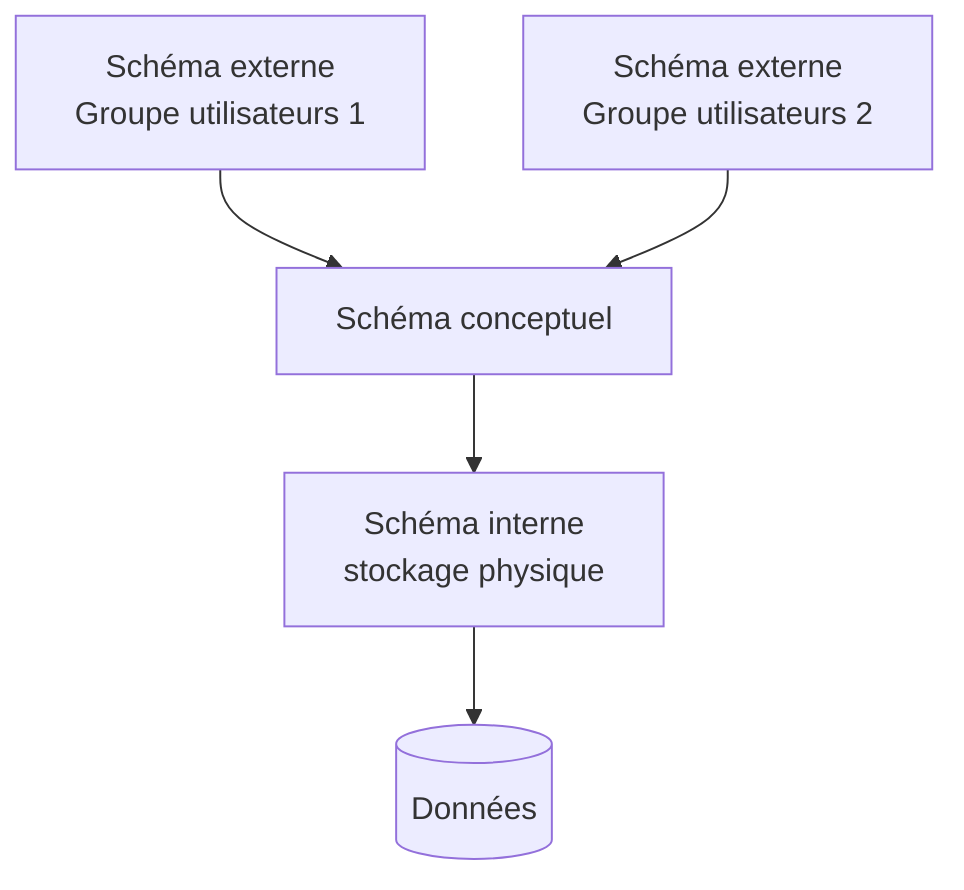
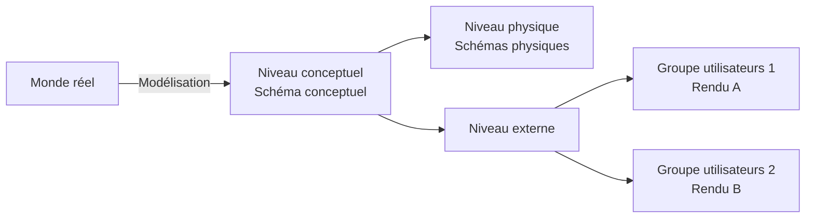
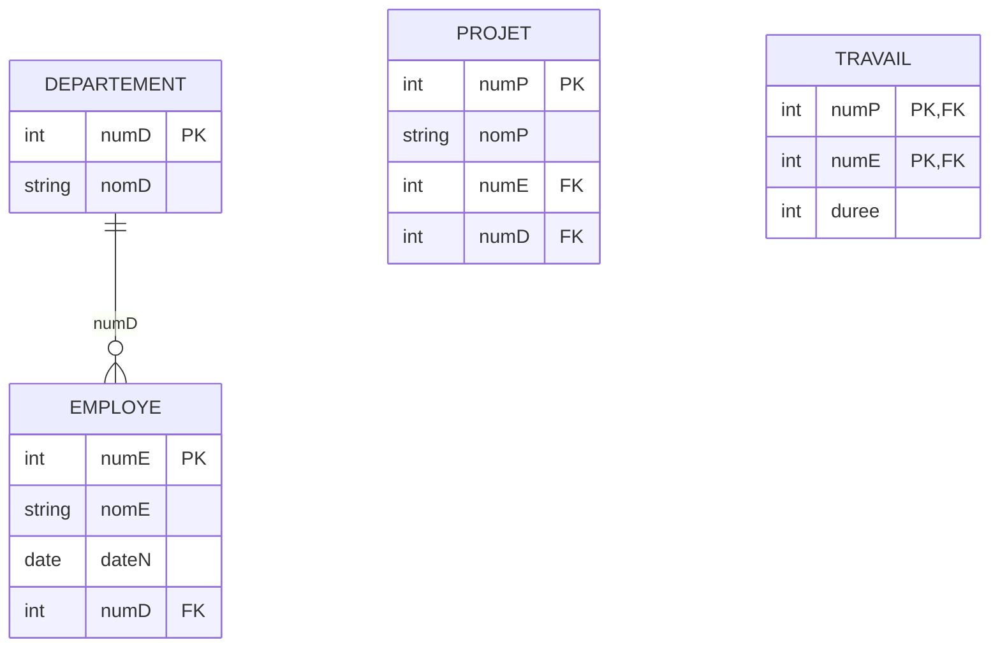
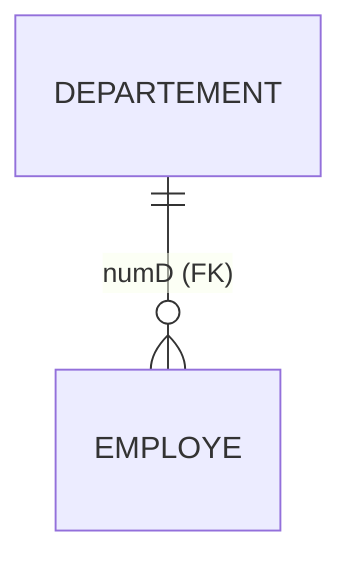
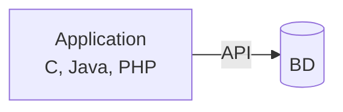
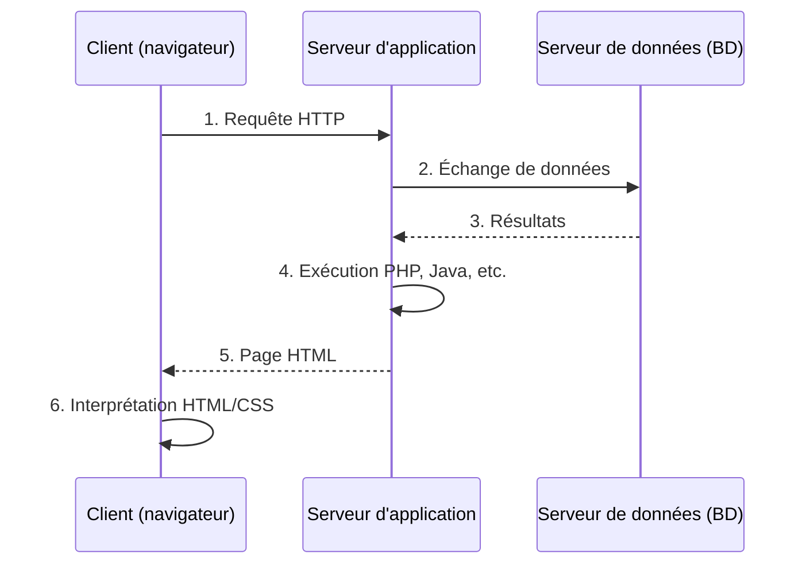
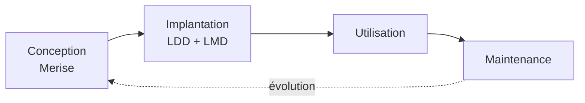
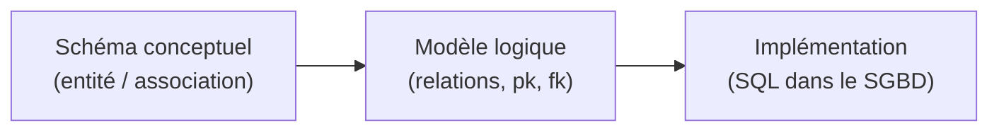

# CM1 — Bases de données et SGBD

[[R1-05 - Index|← Index R1-05]] · Suite : [[CM2 - Algèbre relationnelle]]

> [!abstract] En bref
> Une **base de données** = des données + la structure qui les organise. Le **SGBD** est le logiciel qui stocke, protège et interroge ces données. Depuis les années 1980, c'est le **modèle relationnel** (tables, clés, contraintes) qui domine, et il se manipule avec **SQL**.

---

## 1. Vocabulaire de base

| Terme | Définition |
|-------|------------|
| **Base de données (BD)** | Ensemble de données modélisant un univers (un **domaine**) + l'outil de stockage structuré et de consultation correspondant |
| **SGBD** | Logiciel de manipulation et de stockage de la BD |
| **Administrateur de BD (ABD / DBA)** | Responsable, en permanence, du bon fonctionnement des serveurs de bases de données |
| **Banque de données** | Collection de bases de données |

> [!note] Abréviations
> BdD / BDD = base de données · DB = *database* · ABD = administrateur de base de données · DBA = *database administrator* · SGBD = système de gestion de base de données · DBMS = *database-management system*.

---

## 2. Avant les bases de données

On utilisait :

- des fichiers **non informatisés** (papier, classeurs) ;
- un **tableur** (Microsoft Excel) ;
- d'autres **simples fichiers informatisés**.

### Limites des approches traditionnelles

- **Complexité** (exponentielle)
- **Redondance** (duplication des données)
- **Coûts importants** de développement et de maintenance
- **Manque de flexibilité**
- **Manque de sécurité**

> [!info] Deux concepts déjà présents (et partagés avec une BD)
> - l'organisation des données sur disque (ou autre stockage) ;
> - le procédé de récupération des données.

---

## 3. Intérêts d'une BD

- Stocker de **(très) gros volumes** de données durablement
- **Protéger** les données (avaries, piratage)
- **Simplifier** l'accès aux données
- **Diminuer drastiquement** les temps de recherche
- Prendre en compte les **liens (dépendances)** entre les données
- Permettre **plusieurs utilisateurs simultanés**

---

## 4. Historique

### Modèles de données

| Décennie | Modèle |
|----------|--------|
| 1960 | Modèle **hiérarchique** |
| 1970 | Modèle **en réseau** |
| 1980 | Modèle **relationnel** |
| 1990 | Modèle **objet** |

### SQL (norme)

| Année | Version |
|-------|---------|
| 1986 | SQL-86 |
| 1989 | SQL-1 |
| 1992 | SQL2 |
| 1999 | SQL3 |

Depuis : révisions mineures — SQL:2003, SQL:2008, SQL:2011.

> [!important] Deux noms à retenir
> - **E. F. Codd** : inventeur du modèle relationnel.
> - **CODASYL** : organisme à l'origine des BD.
> - **SQL** (*structured query language*, « langage de requête structurée ») : inventé en **1974**.

---

## 5. Architecture ANSI-SPARC : les 3 schémas

| Schéma | Rôle |
|--------|------|
| **Externe (SE)** | Comment **l'utilisateur** voit les données (une vue par groupe d'utilisateurs) |
| **Conceptuel (SC)** | **Structure logique** des données (le modèle de la BD) |
| **Interne (SI)** | **Structure physique** de stockage des données |

> [!tip] Pourquoi 3 niveaux ?
> Cela garantit l'**indépendance** :
> - **logique** : changer le schéma conceptuel sans casser les vues utilisateurs ;
> - **physique** : changer le stockage sans changer le schéma conceptuel.

### Architecture d'un SGBD

Acteurs : **ingénieur logiciel SGBD**, **administrateur de la BD**, **ingénieur système**.

---

## 6. Fonctionnalités d'un SGBD

| Fonctionnalité | Ce que ça couvre |
|----------------|------------------|
| **Description des données** | Redondance minimale |
| **Intégrité de la base** | Cohérence avec la réalité transcrite |
| **Indépendance des données** | Indépendance applicative |
| **Sécurité de fonctionnement** | Journalisation |
| **Administration et contrôle** | Privilèges, optimisation |
| **Partage des données** | Transactions (sérialisées) |
| **Souplesse d'accès aux données** | Langages déclaratifs |

> [!note] Langage déclaratif
> Un langage **déclaratif** suit un paradigme produisant des résultats **contextuellement indépendants** : on décrit *quoi* obtenir, pas *comment* l'obtenir (SQL en est un).

---

## 7. Schéma conceptuel et modèles de données

Un **schéma conceptuel** est une **représentation graphique** décrivant une base de données : il exprime un besoin et traduit le monde réel (modélisation).

> [!quote] Définition d'un modèle
> Représentation abstraite d'un système qui facilite l'étude et la compréhension du système et permet de le simuler. Vue **subjective, décomposée mais pertinente** de la réalité : représentation d'un système dans un autre monde que celui du système.

| Modèle | Défauts |
|--------|---------|
| **Hiérarchique** | Redondance, dissymétrie, parcours long |
| **Réseau** (ou réseaux sémantiques) | Trop faible indépendance des données |
| **Objet** | Importante quantité de ressources nécessaire |
| **Entité / association** (relationnel) | *(le modèle retenu dans ce cours)* |

---

## 8. Le modèle relationnel

> [!important] Fondation
> Le modèle relationnel repose sur une **théorie mathématique** : l'**algèbre relationnelle** (ensembliste) → voir [[CM2 - Algèbre relationnelle]].

### Vocabulaire

| Concept | Nom formel | Équivalent « tableur » |
|---------|------------|------------------------|
| Table | **Relation** | feuille |
| Colonne | **Attribut** | champ, rubrique |
| Ligne | **Tuple** (n-uplet) | enregistrement, fiche |
| Valeurs possibles d'un attribut | **Domaine** $D_i$ | liste de valeurs autorisées |

- **Intension** : la **structure** de la base (le schéma).
- **Extension** : les **données** de la base (le contenu).
- Une relation se note $R = (a_1, a_2, \dots, a_n)$.
- $iR$ = **instance** de $R$ (l'ensemble des tuples à un instant donné).

> [!note] Domaine
> Ensemble **nommé non vide** de valeurs que peut prendre un attribut.

### Caractéristiques

- **Degré** : nombre d'**attributs** d'une relation (nombre de colonnes).
- **Cardinalité** : nombre de **tuples** d'une relation (nombre de lignes).
- **Clé candidate (potentielle)** : ensemble des données permettant d'**indexer chaque ligne de manière différenciée**.

### Exemple de schéma

| Departement | | |
|---|---|---|
| **numD** | **nomD** | |
| 1 | ISMIN | |
| 2 | ICM | |

| Employe | | | |
|---|---|---|---|
| **numE** | **nomE** | **dateN** | **numD** |
| 1 | Dupond | 1/12/80 | 1 |
| 2 | Jacques | 21/04/68 | 1 |
| 3 | Martin | 03/25/52 | 2 |

### Navigation et normalisation

- Navigation grâce à **SQL**
- Associé à la théorie de la **normalisation** (partie IV du cours)
- **SGBDR** = SGBD **relationnel**

> [!tip] Pour aller plus loin
> Les **12 règles de Codd** définissent ce qu'est un vrai SGBDR (disponibles sur le site de l'enseignant).

---

## 9. Les clés

### Clé primaire

- **Une seule** par relation (c'est la clé candidate **retenue**)
- **Simple** (un seul attribut) ou **composée** (plusieurs attributs)
- **Unique** et **non nulle**

### Clé étrangère

- C'est la **clé primaire d'une autre relation** de la BD (référence)
- Elle crée le **lien** entre deux relations
- Sa valeur doit exister dans la relation référencée (voir intégrité référentielle)

> [!example] Lecture
> `Employe.numD` est une clé étrangère qui référence `Departement.numD`. Un employé appartient donc à **un** département existant.

---

## 10. Les contraintes

### Types de contraintes

| Famille | Contraintes |
|---------|-------------|
| **Contraintes d'intégrité** | Clé primaire, clé étrangère |
| **Contraintes de valeurs** | Non-nullité, unicité (une valeur donnée n'apparaît qu'une fois) |

### Niveau de définition

- **Contraintes d'attributs** : spécifiques à un attribut donné
- **Contraintes de tables** : portent sur **plusieurs** attributs

> [!note] Bon à savoir
> Il est possible de **nommer** une contrainte. Les contraintes apportent de la **cohérence** à la base.

### Les 4 intégrités

| Intégrité | Principe |
|-----------|----------|
| **D'entité** (ou de relation) | Garantit un attribut (donc l'extension) **sans doublon** |
| **Référentielle** | Impose que toute valeur de clé étrangère soit une valeur de **clé primaire** de la relation associée |
| **Sémantique** | Pas toujours modélisable au niveau du schéma relationnel → **triggers** |
| **Applicative** | **Extérieure** à la BD : liée à l'application |

> [!warning] À retenir
> Des **restrictions existent sur les mises à jour** (on ne peut pas supprimer un département encore référencé par un employé, par exemple).

---

## 11. Les principaux SGBDR

Le marché est dominé par quelques produits : **Oracle**, **Microsoft SQL Server**, **Microsoft SQL Azure**, **PostgreSQL**, **MySQL**, **SQLite** (embarqué), **DB2**, etc.

> [!tip] Quel SGBD choisir ?
> - **Oracle** → très grosses architectures
> - **MySQL** → architectures moyennes
> - **SQLite** → l'**embarqué** (toute petite BD)

### Pourquoi Oracle ?

| Avantages | Inconvénients |
|-----------|---------------|
| SGBDR très (le plus) utilisé | Payant — **17 500 $ / 47 500 $ par cœur** |
| Solution la plus performante sur d'immenses volumes de données ? | Ne respecte pas complètement la norme SQL (loin s'en faut) |
| Version *express* gratuite | Difficulté de déploiement et de prise en main |
| Sauvegardes / réplications | |

---

## 12. Utilisation d'un SGBDR

### Deux façons d'écrire une application

| Approche | Principe | Avantages |
|----------|----------|-----------|
| **L3G** (langage de 3ᵉ génération) | Procédural, séquentiel (C, Java, PHP) + **API** pour dialoguer avec la BD | Préserve l'**indépendance physique/logique** |
| **L4G** (langage de 4ᵉ génération) | SGBDR **intégré** (Microsoft Access) + générateur d'application | Rapide et simple pour de **petites** applications |

### Architecture client-serveur 3-tier

Les **3 tiers** :

1. **Client**
2. **Serveur d'application**
3. **Serveur de données** (la BD)

---

## 13. Cycle de vie d'une BD

| Étape | Contenu |
|-------|---------|
| **Conception** | Modélisation avec **Merise** (partie V) |
| **Implantation** | **LDD** (langage de définition de données) + **LMD** (langage de manipulation de données) |
| **Utilisation** | Requêtes, applications |
| **Maintenance** | **Corrective** (corriger), **adaptative** (adapter à l'environnement), **perfective** (améliorer) |

---

## 14. Conception d'une BD

Le passage du monde réel au SGBD se fait en 3 temps :

| Niveau | Représentation |
|--------|----------------|
| **Schéma conceptuel** | Domaine → représentation (entités, associations, cardinalités) |
| **Modèle logique** | Relations : `pk_foo`, `fk_foo`, `pk_bar`… |
| **Implémentation** | Création physique dans le SGBD (LDD) |

---

## ✅ À retenir

- **BD** = données + structure ; **SGBD** = logiciel qui gère ; **SGBDR** = SGBD relationnel.
- Une BD apporte : volume, sécurité, accès simple, rapidité, liens entre données, **concurrence**.
- **ANSI-SPARC** : 3 schémas (externe / conceptuel / interne) → indépendance logique et physique.
- Modèle relationnel : **relation** (table), **attribut** (colonne), **tuple** (ligne), **domaine**.
- **Degré** = nb de colonnes ; **cardinalité** = nb de lignes.
- **Clé primaire** : unique + non nulle, une seule par relation. **Clé étrangère** : référence une clé primaire.
- Intégrités : **entité**, **référentielle**, **sémantique** (triggers), **applicative**.
- Cycle de vie : **conception → implantation → utilisation → maintenance**.

### Questions d'auto-évaluation

- [ ] Quelle est la différence entre intension et extension ?
- [ ] Pourquoi une clé primaire ne peut-elle pas être nulle ?
- [ ] Quelles sont les 3 couches de l'architecture ANSI-SPARC ?
- [ ] Différence entre contrainte d'attribut et contrainte de table ?
- [ ] Que se passe-t-il si on supprime un tuple référencé par une clé étrangère ?
