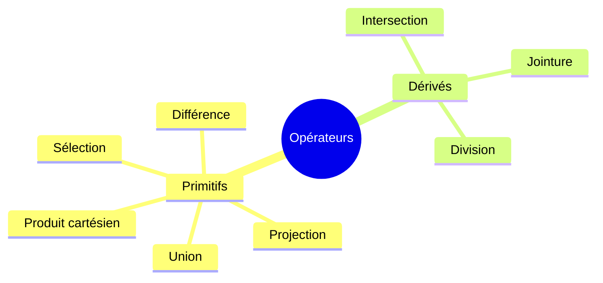

# CM2 — Algèbre relationnelle

[[CM1 - Bases de données et SGBD|← CM1]] · [[R1-05 - Index|Index R1-05]]

> [!abstract] En bref
> L'algèbre relationnelle est un **langage procédural** de manipulation des relations : des **opérateurs** combinent des relations entre elles, et le résultat est **toujours une relation** (algèbre **fermée**). C'est la théorie qui fonde SQL.

---

## 1. Théorie du modèle relationnel

Il existe **deux catégories** de langages de manipulation des relations :

| Catégorie | Principe |
|-----------|----------|
| **Langage algébrique** | Propose des **opérateurs** combinant les relations entre elles |
| **Langage logique** | Permet de **spécifier** des relations à partir de **formules logiques** |

> [!important] Algèbre fermée
> Le résultat de **tout opérateur** est du **même type** que les opérandes : une **relation**. On peut donc **enchaîner** les opérateurs.

---

## 2. Base de données exemple

On travaille sur cette BD dans tout le chapitre.

### Etudiant

| idE | nom | prenom | sexe | dateN | adresse | annee |
|----:|-----|--------|:----:|-------|---------|------:|
| 8 | Dupond | Lulu | M | 1981-03-16 | Aix_en_Pce | 3 |
| 12 | Duvent | Yves | M | 1981-04-20 | Marseille | 2 |
| 14 | Dupond | Maurice | M | 1982-04-17 | Marseille | 3 |
| 15 | Durand | Helene | F | 1982-04-18 | Gardanne | 1 |
| 17 | Tapioca | Lulu | M | 1980-05-11 | NULL | 3 |
| 45 | Deschamps | Jean | M | 1982-04-20 | Aix_en_Pce | 2 |

### Societe

| idS | nom | raisonS | activite | adresse |
|----:|-----|---------|---------:|---------|
| 8 | Microware | SARL | 8 | Aix_en_Pce |
| 13 | EdF | SEM | 15 | Marseille |
| 21 | TOTAL | SA | 9 | Fos_sur_Mer |
| 34 | Almacom | SARL | 7 | Aubagne |

### Personnel

| idP | nom | prenom | idS | salaire |
|----:|-----|--------|----:|--------:|
| 2 | Durand | Jules | 8 | 3100 |
| 4 | Dupond | Emile | 8 | 2420 |
| 7 | Toulemonde | Rene | 8 | 1960 |
| 12 | Mirabeau | Regine | 13 | 1810.5 |
| 19 | Petitjean | Helene | 21 | 1750 |
| 53 | Duvent | Yves | 34 | 3200 |
| 61 | Martin | Louis | 21 | 2670 |

### Convention

| idE | idS | idP | dateC | duree | intitule | note |
|----:|----:|----:|-------|------:|----------|-----:|
| 8 | 8 | 2 | 2003-06-10 | 3 | conception d'un logiciel… | 16 |
| 17 | 8 | 7 | 2003-05-08 | 4 | réalisation d'un serveur WEB | 14 |
| 15 | 13 | 12 | 2003-04-12 | 5 | logiciel de contrôle / commande | 11 |
| 8 | 34 | 53 | 2004-03-02 | 6 | logiciel de transfert de fichiers | 14 |
| 17 | 34 | 53 | 2004-03-02 | 6 | prototype de modem externe | 18 |
| 12 | 13 | 12 | 2003-06-02 | 6 | carte d'acquisition | 13 |
| 14 | 21 | 19 | 2003-05-21 | 5 | logiciel de traitement d'images | 17 |
| 15 | 8 | 4 | 2004-06-06 | 6 | driver de carte vidéo | 10 |

### Stagiaire

| idSt | nom | prenom | sexe | dateN | adresse | annee |
|-----:|-----|--------|:----:|-------|---------|------:|
| 8 | Dupond | Lulu | M | 1981-03-16 | Aix_en_Pce | 3 |
| 14 | Dupond | Maurice | M | 1982-04-17 | Marseille | 3 |
| 17 | Tapioca | Lulu | M | 1980-05-11 | NULL | 3 |
| 62 | Balmon | Nadia | F | 1983-11-21 | Gardanne | 4 |

---

## 3. Les opérateurs



> [!info] Opérateurs ensemblistes
> **Union**, **différence** et **intersection** sont des opérateurs **ensemblistes** : ils **dédupliquent** les résultats.
> Ils exigent que les deux relations soient **unicompatibles** (les domaines des attributs correspondants doivent être les mêmes).

> [!warning] Nuance importante du cours
> Dans ce cours, la **projection ne déduplique pas** (le résultat de $\pi_{nom}(Etudiant)$ contient « Dupond » **deux fois**).
> Seuls les **opérateurs ensemblistes** dédupliquent. En algèbre relationnelle « pure », la projection déduplique aussi.

---

## 4. Projection $\pi$

**Préserve (projette) certains attributs** d'une relation.

| | |
|---|---|
| **Version mathématique** | $R_1 = \pi_{nom}(Etudiant)$ |
| **Version littérale** | `R1 = PROJECTION (Etudiant / nom)` |

**Résultat** — `ResProj`

| nom |
|-----|
| Dupond |
| Duvent |
| Dupond |
| Durand |
| Tapioca |
| Deschamps |

> [!tip] En SQL
> `SELECT nom FROM Etudiant;` (et `SELECT DISTINCT` pour dédupliquer).

---

## 5. Sélection $\sigma$

**Filtre certains tuples** d'une relation selon une **condition** (un ou plusieurs prédicats).

| | |
|---|---|
| **Version mathématique** | $R_1 = \sigma_{annee < 3}(Etudiant)$ |
| **Version littérale** | `R1 = SÉLECTION (Etudiant / annee < 3)` |

### Anatomie d'une condition

- **Attribut(s)**
- **Constantes** : `2`, `'F'`, etc.
- **Opérateurs** :
  - de comparaison : `=`, `<>`, `>`, `>=`, `<`, `<=`, etc.
  - et autres

**Résultat** — `ResSel`

| idE | nom | prenom | sexe | dateN | adresse | annee |
|----:|-----|--------|:----:|-------|---------|------:|
| 12 | Duvent | Yves | M | 20.04.1981 | Marseille | 2 |
| 15 | Durand | Helene | F | 18.04.1982 | Gardanne | 1 |
| 45 | Deschamps | Jean | M | 20.04.1982 | Aix_en_Pce | 2 |

> [!warning] Pièges
> - Une condition est un **prédicat** : une **expression logique vraie ou fausse**.
> - Il n'y a **pas d'opération d'attributs entre eux** (ex. `salaire * 2` n'est pas une sélection).
> - Les comparaisons sont possibles sur des attributs **textuels** aussi.

> [!tip] En SQL
> `SELECT * FROM Etudiant WHERE annee < 3;`

---

## 6. Renommage $\rho$

**Renomme un attribut** d'une relation.

| | |
|---|---|
| **Version mathématique** | $R_1 = \rho_{nom \to patronyme}(Etudiant)$ |
| **Version littérale** | `R1 = RENOMMAGE (Etudiant / nom → patronyme)` |

**Résultat** — `ResProj`

| patronyme |
|-----------|
| Dupond |
| Duvent |
| Dupond |
| Durand |
| Tapioca |
| Deschamps |

> [!tip] En SQL
> `SELECT nom AS patronyme FROM Etudiant;`

---

## 7. Union $\cup$

**Fusionne les tuples** de deux relations.

| | |
|---|---|
| **Version mathématique** | $R_1 = Etudiant \cup Stagiaire$ |
| **Version littérale** | `R1 = UNION (Etudiant, Stagiaire)` |

**Condition** : relations **unicompatibles** (mêmes domaines pour les attributs correspondants).

**Résultat** — `ResUni` (7 tuples : les doublons sont supprimés)

| idE | nom | prenom | sexe | dateN | adresse | annee |
|----:|-----|--------|:----:|-------|---------|------:|
| 8 | Dupond | Lulu | M | 16.03.1981 | Aix_en_Pce | 3 |
| 12 | Duvent | Yves | M | 20.04.1981 | Marseille | 2 |
| 14 | Dupond | Maurice | M | 17.04.1982 | Marseille | 3 |
| 15 | Durand | Helene | F | 18.04.1982 | Gardanne | 1 |
| 17 | Tapioca | Lulu | M | 11.05.1980 | – | 3 |
| 45 | Deschamps | Jean | M | 20.04.1982 | Aix_en_Pce | 2 |
| 62 | Balmon | Nadia | F | 21.11.1983 | Gardanne | 4 |

> [!tip] En SQL
> `SELECT * FROM Etudiant UNION SELECT * FROM Stagiaire;`

---

## 8. Différence $-$ (ou $\setminus$)

**Retourne les tuples de la première relation ne figurant pas dans la seconde.**

| | |
|---|---|
| **Version mathématique** | $R_1 = Etudiant - Stagiaire$ |
| **Version littérale** | `R1 = DIFFÉRENCE (Etudiant, Stagiaire)` |

**Condition** : relations **unicompatibles**.

**Résultat** — `ResDif`

| idE | nom | prenom | sexe | dateN | adresse | annee |
|----:|-----|--------|:----:|-------|---------|------:|
| 12 | Duvent | Yves | M | 20.04.1981 | Marseille | 2 |
| 15 | Durand | Helene | F | 18.04.1982 | Gardanne | 1 |
| 45 | Deschamps | Jean | M | 20.04.1982 | Aix_en_Pce | 2 |

> [!tip] En SQL
> `SELECT * FROM Etudiant EXCEPT SELECT * FROM Stagiaire;`

---

## 9. Intersection $\cap$

**Retourne les tuples communs** aux deux relations.

| | |
|---|---|
| **Version mathématique** | $R_1 = Etudiant \cap Stagiaire$ |
| **Version littérale** | `R1 = INTERSECTION (Etudiant, Stagiaire)` |

**Condition** : relations **unicompatibles**.

**Résultat** — `ResInt`

| idE | nom | prenom | sexe | dateN | adresse | annee |
|----:|-----|--------|:----:|-------|---------|------:|
| 8 | Dupond | Lulu | M | 16.03.1981 | Aix_en_Pce | 3 |
| 14 | Dupond | Maurice | M | 17.04.1982 | Marseille | 3 |
| 17 | Tapioca | Lulu | M | 11.05.1980 | – | 3 |

> [!tip] En SQL
> `SELECT * FROM Etudiant INTERSECT SELECT * FROM Stagiaire;`

---

## 10. Produit cartésien $\times$

**Associe chaque tuple d'une relation avec chaque tuple d'une autre.**

| | |
|---|---|
| **Version mathématique** | $R_1 = Stagiaire \times Societe$ |
| **Version littérale** | `R1 = PRODUIT (Stagiaire, Societe)` |

- **Degré** du résultat = somme des degrés (7 + 5 = 12 attributs)
- **Cardinalité** du résultat = **produit** des cardinalités (4 × 4 = 16 tuples)

**Résultat** — `ResPrC` (extrait)

| idSt | nom | … | annee | idS | nom | … | adresse |
|-----:|-----|---|------:|----:|-----|---|---------|
| 8 | Dupond | … | 3 | 8 | Microware | … | Aix_en_Pce |
| 14 | Dupond | … | 3 | 8 | Microware | … | Aix_en_Pce |
| 17 | Tapioca | … | 3 | 8 | Microware | … | Aix_en_Pce |
| 62 | Balmon | … | 4 | 8 | Microware | … | Aix_en_Pce |
| 8 | Dupond | … | 3 | 13 | EdF | … | Marseille |
| … | … | … | … | … | … | … | … |
| 62 | Balmon | … | 4 | 34 | Almacom | … | Aubagne |

> [!warning] Très peu utile (seul)
> On l'utilise presque toujours **suivi d'une sélection** : c'est exactement ainsi que se définit la **jointure**.

---

## 11. Jointure $\bowtie$ (θ-jointure)

**Union des attributs de deux relations avec les tuples coïncidant** selon un **comparateur**.

| | |
|---|---|
| **Version mathématique** | $R_1 = Societe \bowtie_{Societe.idS = Personnel.idS} Personnel$ |
| **Version littérale** | `R1 = JOINTURE (Societe, Personnel / idS = idS)` |

**Résultat** — `ResJoi`

| idS | nom | … | adresse | idP | nom | … | salaire |
|----:|-----|---|---------|----:|-----|---|--------:|
| 8 | Microware | … | Aix_en_Pce | 2 | Durand | … | 3100 |
| 8 | Microware | … | Aix_en_Pce | 4 | Dupond | … | 2420 |
| 8 | Microware | … | Aix_en_Pce | 7 | Toulemonde | … | 1960 |
| 13 | EdF | … | Marseille | 12 | Mirabeau | … | 1810.5 |
| 21 | Total | … | Fos_sur_Mer | 19 | Petitjean | … | 1750 |
| 34 | Almacom | … | Aubagne | 53 | Duvent | … | 3200 |
| 21 | Total | … | Fos_sur_Mer | 61 | Martin | … | 2670 |

> [!important] Définition formelle
> $R \bowtie_\theta S = \sigma_\theta(R \times S)$
> Une jointure = **produit cartésien + sélection** sur le comparateur.

> [!tip] En SQL
> `SELECT * FROM Societe JOIN Personnel ON Societe.idS = Personnel.idS;`

---

## 12. Division $\div$

**Retourne les tuples d'une relation qui correspondent à la combinaison de *tous* les tuples d'une autre relation**, projetés sans les attributs de la seconde.

| | |
|---|---|
| **Version mathématique** | $R_3 = R_2 \div R_1$ (attribut commun : `idE`) |
| **Version littérale** | `R3 = DIVISION (R2, R1 / idE, idE)` |

**R1** — les étudiants recherchés

| idE |
|----:|
| 8 |
| 17 |

**R2** — les couples (société, étudiant)

| idS | idE |
|----:|----:|
| 8 | 8 |
| 8 | 17 |
| 13 | 15 |
| 34 | 8 |
| 34 | 17 |
| 13 | 12 |
| 21 | 14 |
| 8 | 15 |
| 34 | 15 |
| 2 | 17 |

**Résultat** — `ResDiv` : les sociétés ayant une convention avec **tous** les étudiants de R1 (8 **et** 17)

| idS |
|----:|
| 8 |
| 34 |

> [!tip] Quand utiliser la division ?
> À chaque fois que l'énoncé contient « **tous** », « **tous ceux qui** », « **au moins tous les** »…
> En SQL, cela se traduit par une **double négation** (`NOT EXISTS ... NOT EXISTS`) ou un `GROUP BY ... HAVING COUNT`.

---

## 13. Combiner les opérateurs

L'extraction des données peut se faire en **plusieurs étapes**.

### Sélection puis projection

```
-- Une sélection suivie d'une projection.
R1 = SÉLECTION (Etudiant / prenom = 'Lulu')
R2 = PROJECTION (R1 / nom)
```

En version mathématique :

$$R_1 = \sigma_{prenom = 'Lulu'}(Etudiant)$$
$$R_2 = \pi_{nom}(R_1)$$

> [!warning] Syntaxe
> - Chaînes de caractères entre **guillemets simples** `'…'` (pas de guillemets doubles).
> - Commentaire en langage algébrique : `--`.

### Opérateurs logiques

| Opérateur | Mathématique | Littéral |
|-----------|--------------|----------|
| **Et** | $R_1 = \sigma_{annee<3 \wedge prenom='Lulu'}(Etudiant)$ | `SÉLECTION (Etudiant / annee < 3 ET prenom = 'Lulu')` |
| **Ou** | $R_1 = \sigma_{annee<3 \vee prenom='Lulu'}(Etudiant)$ | `SÉLECTION (Etudiant / annee < 3 OU prenom = 'Lulu')` |
| **Non** | $R_1 = \sigma_{\neg sexe='M'}(Etudiant)$ | `SÉLECTION (Etudiant / NON sexe = 'M')` |

Symboles : $\wedge$ = ET · $\vee$ = OU · $\neg$ = NON.

---

## 14. Aller plus loin

- **Calcul relationnel** (à variables de domaines) : langage **déclaratif**.
- **Correspondance calcul / algèbre** : les deux ont la même puissance d'expression.

> [!quote] Pourquoi le calcul relationnel ?
> L'algèbre relationnelle **présuppose la connaissance du schéma** pour naviguer entre les relations : c'est un langage **procédural**, l'**ordre d'application des opérateurs doit être fourni**.
> Pour écrire des requêtes de manière **déclarative**, le calcul relationnel a été introduit *(hors cours)* — c'est l'idée reprise par SQL.

---

## 📋 Mémo des opérateurs

| Opérateur | Notation | Catégorie | Idée | SQL |
|-----------|----------|-----------|------|-----|
| **Projection** | $\pi_{a}(R)$ | primitif | garder certaines **colonnes** | `SELECT a` |
| **Sélection** | $\sigma_{cond}(R)$ | primitif | garder certaines **lignes** | `WHERE cond` |
| **Renommage** | $\rho_{a \to b}(R)$ | primitif | renommer une colonne | `AS b` |
| **Union** | $R \cup S$ | ensembliste | tout, sans doublon | `UNION` |
| **Différence** | $R - S$ | ensembliste | dans R mais pas dans S | `EXCEPT` |
| **Intersection** | $R \cap S$ | ensembliste | commun aux deux | `INTERSECT` |
| **Produit cartésien** | $R \times S$ | primitif | toutes les combinaisons | `CROSS JOIN` |
| **Jointure** | $R \bowtie_\theta S$ | dérivé | produit + sélection | `JOIN ... ON` |
| **Division** | $R_2 \div R_1$ | dérivé | « **tous** » | double `NOT EXISTS` |

> [!warning] Les 3 pièges classiques
> 1. **Unicompatibilité** obligatoire pour $\cup$, $-$ et $\cap$ (mêmes domaines, dans le même ordre).
> 2. Les **ensemblistes dédupliquent** ; la projection du cours, non.
> 3. **Jointure = produit + sélection** : si on oublie la condition, on obtient un produit cartésien.

---

## ✅ À retenir

- L'algèbre relationnelle est **fermée** : tout résultat est une relation → on peut composer.
- **5 primitifs** : $\pi$, $\sigma$, $\cup$, $-$, $\times$. **3 dérivés** : $\cap$, $\bowtie$, $\div$.
- Une **jointure** = un **produit cartésien** + une **sélection**.
- La **division** répond aux questions contenant « **tous** ».
- C'est un langage **procédural** : SQL (déclaratif) en est l'héritier direct.

### Questions d'auto-évaluation

- [ ] Quels sont les 5 opérateurs primitifs ? Les 3 dérivés ?
- [ ] Pourquoi l'algèbre relationnelle est-elle dite « fermée » ?
- [ ] Que signifie « unicompatible » ? Quels opérateurs l'exigent ?
- [ ] Comment exprimer une jointure avec seulement $\times$ et $\sigma$ ?
- [ ] Écrire la requête « les sociétés qui ont une convention avec **tous** les étudiants de R1 ».
- [ ] Différence entre $\pi_{nom}(Etudiant)$ et `SELECT DISTINCT nom FROM Etudiant` ?
