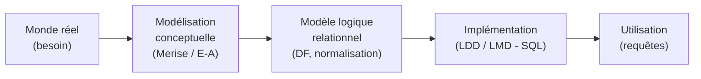

# R1-05 — Introduction aux bases de données et SQL

> 🗺️ **Carte des cours :** [[Hub - Carte des cours.canvas|vue d'ensemble du semestre]]

> [!abstract] Le cours en une phrase
> Savoir **concevoir** une base de données, savoir l'**utiliser**, et connaître le **langage SQL**.

## Objectifs pédagogiques

- Savoir concevoir une base de données
- Savoir utiliser une base de données
- Connaître le langage SQL

**Prérequis :** être méthodique et rigoureux.

## Modalités d'évaluation

- Questionnaires d'évaluation
- Examen × 2

## Plan du cours

| # | Partie | Notes |
|---|--------|-------|
| I | Présentation | cette note |
| II | BD et SGBD | [[CM1 - Bases de données et SGBD]] |
| III | Algèbre relationnelle | [[CM2 - Algèbre relationnelle]] |
| IV | DF et normalisation | *(à venir)* |
| V | Merise | *(à venir)* |
| VI | LMD | *(à venir)* |

## Progression logique du cours

> [!tip] Fil conducteur
> 1. On **modélise** le réel (Merise, entité/association).
> 2. On **traduit** en relations (normalisation, dépendances fonctionnelles).
> 3. On **implémente** en SQL (LDD = structure, LMD = données).
> 4. On **interroge** avec l'algèbre relationnelle puis SQL.

## Sources

- CM0 : Présentation du cours (V1.0.1)
- CM1 : Base de données et SGBDR (V1.0.3)
- CM2 : Algèbre relationnelle (V1.7.0)
- Auteur : Mickaël Martin Nevot — cours en ligne : [mickael-martin-nevot.com](http://www.mickael-martin-nevot.com)
- Licence : CC BY-NC-SA

## Voir aussi
