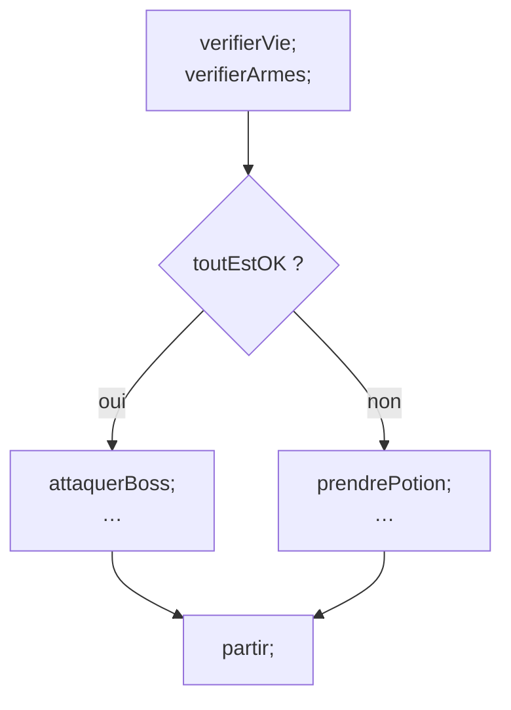

# CM1 — Introduction à l'algorithmique

[[R1.01 - Index|← Index R1.01]] · Suite : [[CM2 - Expressions logiques et types primitifs]]

> [!abstract] En bref
> Un **algorithme** est une séquence d'opérations qui résout un problème **en un temps fini**, avec une condition d'arrêt explicite. Avant d'écrire du C++, on apprend à décrire ces opérations en **pseudo-code** : actions simples, conditions (`si` / `sinon`), choix multiples et expressions logiques.

---

## 1. Informations pratiques

### 1.1 Contacts et ressources

| Sujet | Information |
|-------|-------------|
| Enseignant en amphi | A. Casali — <alain.casali@univ-amu.fr> — <https://casali.site/> |
| TD / TP | A. Casali, Khader Betari (MCF) et des professionnels |
| Planning | <https://casali.site/category/r1-01-init-dev/r1-01-planning/> |
| Discord Informaix | <https://discord.gg/chqTEBhzsC> |
| Discord du Département | <https://discord.gg/YfVCKP6yf3> — **se nommer** (mêmes règles de nommage que le Discord du prof) |
| Tuteurat | Le soir, 17 h 45 → 18 h 45, par des 2A / 3A |
| VDI | `m-vdi-etu-ha.univ-amu.fr` (travailler depuis chez soi) |

> [!note] Le personnage mystère
> La diapo « Qu'est-ce qui ne va pas si vous voyez… » montre une photo : ce n'est pas Obi Wan Kenobi, c'est **M. Betari**. Anecdote de rentrée, mais surtout un rappel : **ne pas confondre une ressemblance avec une identité**.

### 1.2 Objectifs pédagogiques

- Apprendre l'**algorithmique** ;
- Apprendre les bases d'un **langage de programmation** (le C++) ;
- **Réduire la dette cognitive vis-à-vis de l'IA**.

> [!warning] Le danger pointé par le prof
> On croit savoir résoudre un problème parce qu'on a **vu une vidéo**, **lu un tuto** ou **demandé à une IA** : dans les deux premiers cas une personne physique a résolu *votre* problème, dans le troisième un algorithme virtuel l'a résolu. Vous restez **incapable de reproduire** ce que vous avez vu ou lu.

### 1.3 Division de la ressource

| Partie | Contenu |
|--------|---------|
| **Algorithmique** | Amphis 1 à 4 |
| **Programmation** | Amphis 5 à 10 (C++) |
| **SAE** | 2 SAE |

### 1.4 Notation *(temporaire)*

- Poids : **~20 % de la note du S1**.
- Dans la ressource :
  - **Contrôle continu — coef 1** : minitests + feuille d'amphi ;
  - **Test #1 — coef 1** : partie **algo** ;
  - **Test #2 — coef 1** : partie **code** + bonus Ecosia (1 pt).
- Note finale **au choix** :
  - `CC × moyenne(test1, test2)`
  - `moyenne(CC, test1, test2)`

### 1.5 Minitests et feuille d'amphi

- Minitests : <https://casali.site/category/r1-01-init-dev/r1-01-mini-tests/> — un minitest = une **date** + un **cheat code**.
- Feuille d'amphi : chaque étudiant prépare **5 questions et 5 réponses** sur l'amphi précédent. C'est **un autre étudiant** qui répond (bonus **0,1 pt** par bonne réponse). Si un étudiant nommé est absent : **−0,1** sur la moyenne. On itère jusqu'à obtenir toutes les bonnes réponses.
- Conséquence : les amphis durent en pratique **~1 h 45** (1 h 30 programmée).

### 1.6 Divers

- Questions bienvenues pendant l'amphi.
- Ressources documentaires : ENT → BU → « Ressources électroniques de A à Z » → rechercher « **Diamond Éditions** ».
- Chaînes YouTube citées : Micode / Underscore_, Adrien Linux Tricks, Vision IA.
- Matériel : aucune idée de vos besoins personnels → viser un ordinateur **qui dure**.
- Livres : n'importe quel livre d'informatique, **n'importe quel langage** (il faut savoir passer de l'un à l'autre). Attention au niveau ; si c'est écrit par **Claude Delannoy**, c'est bon signe.

---

## 2. C'est quoi un algorithme ?

### 2.1 Origine du mot

Au **XIIIᵉ siècle**, la traduction en latin d'un mémoire du **IXᵉ siècle** de **Mohammed Ibn Musa Abu Djefar**, dit **Al-Khuwarismi**, donne le mot « algorithme ».

> [!tip] Sourcer les informations
> Le prof insiste : « **Sourcer les infos, c'est important** ». Références citées : `fr.wikipedia.org/wiki/Algorithmique` et `fr.wikipedia.org/wiki/Al-Khuwarizmi`.

### 2.2 Définition du cours

> [!important] Définition
> **Séquence d'opérations visant à la résolution d'un problème en un temps fini** — en mentionnant la **condition d'arrêt**.

Trois mots à retenir : **séquence** (un ordre), **fini** (ça s'arrête), **condition d'arrêt** (on sait *quand* ça s'arrête).

### 2.3 Le problème du prof

La diapo « Mon problème » illustre l'écart entre **capacité de réflexion** et **réflexes scolaires** : environ **50 % des étudiants n'ont pas la moyenne au test de positionnement de maths**. Ce n'est pas un cours de maths : c'est un cours de **méthode**.

---

## 3. Premier exemple : le sandwich choco-banane

### 3.1 Version humaine

> Tartiner une tranche de pain avec du Nutella **sur une face**.

### 3.2 Version « ordinateur »

```text
Ai-je du pain ?
    Si non, en acheter…
    Si oui, aller au point suivant ;
Ai-je du Nutella ?
    Si non, en acheter…
    Si oui, aller au point suivant ;
Ai-je des bananes ?
    Si non, en acheter…
    Si oui, aller au point suivant ;

Tant que (1, 2 et 3) ne sont pas satisfaits, rester ici !

Si l'opercule du Nutella est fermé
    L'ouvrir avec un couteau
Répartir uniformément le Nutella sur une face d'une tranche de pain ;
```

### 3.3 Ce que révèle l'exemple

- Un algorithme suppose des **préconditions** (avoir les ingrédients, un couteau…).
- Il contient des **actions simples** (« ouvrir »), **conditionnelles** (« si… ») et **répétitives** (« tant que… »).
- Si vous n'avez **ni pain, ni Nutella, ni banane**, l'algorithme échoue — **quel que soit votre système d'exploitation** (Windows, Linux, macOS). Le problème n'est pas la machine, c'est la **spécification**.

> [!quote] Règle d'or #1
> « **Tout algorithme est faux, mais il fait ce qu'on lui demande — enfin on l'espère !** »

Le nombre de failles **0-day** découvertes quotidiennement augmente fortement avec l'IA : même une IA peut se tromper, **surtout en informatique**.

### 3.4 Epic fails et documentation

| Exemple | Leçon |
|---------|-------|
| Rendez-vous Apollo / Soyouz | Presque manqué : les Russes parlaient en **mètres**, les États-Uniens en **pouces** → **bien lire les spécifications** |
| Premier lancement d'**Ariane 5** | Une erreur de spécification / de réutilisation de code peut détruire une fusée |
| Documentation en anglais | Lire la version **anglaise** évite les erreurs de traduction |

### 3.5 Les 10 règles de la NASA

| # | Règle |
|---|-------|
| 1 | Éviter les constructions de flux complexes, comme `goto` et la récursion. |
| 2 | Toutes les boucles doivent avoir des **bornes fixes** : cela empêche le code de s'emballer. |
| 3 | Éviter l'**allocation mémoire dynamique** (*heap*). |
| 4 | Limiter les fonctions à **une page imprimée**. |
| 5 | Utiliser au minimum **deux assertions d'exécution** par fonction. |
| 6 | Restreindre la **portée des données** au plus petit espace possible. |
| 7 | Vérifier la valeur de retour de **toutes** les fonctions non `void`, ou la caster en `void` pour indiquer qu'elle est inutile. |
| 8 | Utiliser le **préprocesseur** avec parcimonie. |
| 9 | Limiter les pointeurs à **un seul déréférencement**, et ne pas utiliser de pointeurs de fonction. |
| 10 | Compiler avec **tous les avertissements** actifs, et les traiter avant la livraison. |

> [!tip] Pourquoi ces règles ?
> Elles viennent du logiciel **embarqué critique** : quand on ne peut pas redémarrer le programme, on préfère un code **simple, borné et vérifiable** à un code astucieux. Le cours applique la même philosophie : schémas simples, une seule sortie par boucle, pas de rupture de séquence dans un `pour` (voir [[CM4 - Boucle pour, portée et sous-programmes]]).

### 3.6 IA : mode d'emploi dans le module

- Attention à ce que l'IA raconte : **géolocalisation** des informations (Trump vs Ouïghours : Gemini vs DeepSeek), séries TV terminées, spatial, OVNI, Terre plate…
- **Ne pas utiliser d'IA qui ne source pas** les informations qu'elle donne.
- Distinguer IA **locale** (sur le PC) et **globale** (sur le Web).

---

## 4. Les types d'action

| Type d'action | Définition | Exemple |
|---------------|------------|---------|
| **Simple / impérative** | Une action élémentaire, sans condition ni répétition | « répartir le Nutella » |
| **Conditionnelle** | Une action exécutée **si** une condition est vraie (éventuellement **sinon**) | « il se passe quoi si on n'a plus de Nutella ? » |
| **Répétitive** | Une action répétée tant qu'une condition le demande | « répartir le Nutella **uniformément** » |
| **Complexe** | Une **combinaison** des autres | une recette complète |

> [!note] Vocabulaire
> Les diapos correspondantes sont **essentiellement graphiques** (peu de texte) : elles illustrent les schémas, elles ne donnent pas de définition supplémentaire. Les définitions ci-dessus reprennent les légendes et l'exemple du sandwich.

---

## 5. Le schéma alternatif

### 5.1 Exemple fil rouge : coller du tube PVC

```text
// La colle sèche en quelques minutes
1. Nettoyer les surfaces à coller avec du papier de verre fin ;
2. Eventuellement les dégraisser au trichloréthylène ;
3. Etaler de la colle sur les deux surfaces ;
4. Emboîter les deux éléments bien à fond et dans la position souhaitée ;
```

- `//` marque un **commentaire** : tout ce qui suit n'est pas pris en compte. « Aide le développeur ! »
- `;` est le **marqueur de fin d'instruction**.
- L'étape 2 est **conditionnelle** : « **si** les surfaces sont grasses, **alors** les dégraisser… **sinon RIEN !** ».

### 5.2 Forme générale

```text
action1;
action2;

si (condition)
    action3;
    action4;
sinon
    action5;
    action6;
fsi

action7;
```

- `action1`, `action2`, `action7` : faites **dans tous les cas**.
- `action3`, `action4` : faites **si la condition est vraie**.
- `action5`, `action6` : faites **si la même condition est fausse**.
- La **condition** est une **expression booléenne** (vraie ou fausse), entre parenthèses.

### 5.3 Exemple « jeu vidéo »

```text
verifierVie;
verifierArmes;

si (toutEstOK)
    attaquerBoss;
    …;
sinon
    prendrePotion;
    …;
fsi

partir;
```

### 5.4 Représentation graphique (algorigramme)



### 5.5 Règles d'écriture

- Les instructions d'un même bloc sont **alignées verticalement** (même **indentation**).
- On **indente** les séquences des blocs « alors » et « sinon ».
- La condition est une **expression booléenne entre parenthèses**.
- On termine par `fsi` (*fin si*).

> [!warning] Le piège de l'indentation
> L'indentation n'est **pas décorative** : elle matérialise les blocs. Deux instructions alignées appartiennent au même bloc ; une instruction décalée appartient au bloc supérieur. Un algorithme mal indenté est un algorithme **ambigu**.

### 5.6 Cas particulier : pas de `sinon`

```text
action1;
action2;

si (toutEstOK)
    attaquerBoss;
    …;
fsi

action7;
```

Ici, si `toutEstOK` est faux, on ne fait **rien** et on passe directement à `action7`.

---

## 6. Le schéma alternatif en cascade

Quand il y a **plusieurs conditions différentes** à tester successivement :

```text
si (exprLog1)
    sequ1;
sinon
    si (exprLog2)
        sequ2;
    sinon
        si (exprLog3)
            sequ3;
        sinon
            sequ4;
        fsi
    fsi
fsi
```

> [!warning] Le problème
> **3 niveaux d'imbrication ⇒ 3 niveaux d'indentation ⇒ 3 fois plus pénible à gérer, 3 fois moins lisible** que du code « normal ».

### 6.1 Exemple

```text
si (peuDeVie)
    prendreUnePotion;
sinon
    si (jeSuisUnGuerrier)
        attaquerAvecEpee;
    sinon
        si (jeSuisUnMage)
            lancerUnSort;
        sinon
            partir;
        fsi
    fsi
fsi
```

### 6.2 La version lisible : `sinon_si`

```text
si (peuDeVie)
    prendreUnePotion;
sinon_si (jeSuisUnGuerrier)
    attaquerAvecEpee;
sinon_si (jeSuisUnMage)
    lancerUnSort;
sinon
    partir;          // tous les autres cas
fsi
```

**Même nombre de cas, un seul niveau d'indentation : 3 fois plus lisible.**

> [!important] À retenir
> `sinon_si` = « sinon, **si**… ». C'est exactement le `else if` du C++ (voir [[CM5 - Du pseudo-code au C++]]). Les expressions logiques testées sont **différentes** ; si elles étaient identiques, il faudrait utiliser `ET` / `OU`.

---

## 7. Le schéma de choix

Quand on teste **une seule variable** contre un **ensemble de valeurs** :

```text
choix_sur variableDeChoix entre

  cas ens1 :
    sequ1;
  cas ens2 :
    sequ2;
  cas ens3 :
    sequ3;
  autre :              // tous les autres cas
    sequ4;

fchoix
```

- `ens1`, `ens2`, `ens3` sont des **ensembles de valeurs de même type** que `variableDeChoix`.
- Les ensembles sont **disjoints** (une valeur ne peut pas appartenir à deux `cas`).

### Exemple

```text
choix_sur monPersonnage entre

  cas jeSuisUnGuerrier :
    attaquerAvecEpee;
  cas jeSuisUnMage :
    lancerUnSort;
  cas jeSuisUnSuperPlombier :
    lancerUneBouleDeFeu;
  autre :
    partir;

fchoix
```

> [!tip] Lien avec le C++
> Ce schéma deviendra le `switch / case` (voir [[CM6 - Caractères, chaînes, boucles et vector]]), avec `default` pour `autre` et `break` pour sortir du bloc.

---

## 8. Les expressions logiques complexes (introduction)

### 8.1 Opérateur `ET`

Deux `si` imbriqués :

```text
si (exprLog1)
    si (exprLog2)
        sequ1;
    fsi
fsi

sequn;
```

peuvent se simplifier en **un seul niveau d'imbrication** :

```text
si (exprLog1 ET exprLog2)
    sequ1;
fsi

sequn;
```

`sequ1` n'est exécutée que si **les deux** expressions sont vraies **en même temps**.

### 8.2 Opérateur `OU`

```text
si (exprLog1)
    sequ1;
sinon
    si (exprLog2)
        sequ1;
    fsi
fsi
```

se simplifie en :

```text
si (exprLog1 OU exprLog2)
    sequ1;
fsi
```

On exécute `sequ1` si `exprLog1` est vraie **ou, à défaut**, si `exprLog2` est vraie.

### 8.3 Ce qui ne se simplifie pas

```text
si (exprLog1)
    si (exprLog2)
        sequ1;
    sinon
        sequ2;
    fsi
fsi
```

est **impossible à simplifier** : il y a **deux séquences différentes** (`sequ1` et `sequ2`) et le `sinon` dépend de `exprLog2`, pas de `exprLog1`.

> [!warning] `ET` n'est pas `ET_ALORS`
> Les opérateurs `ET` et `OU` évaluent **toujours les deux** expressions. Le C++ utilise `&&` et `||`, qui **court-circuitent** l'évaluation. Cette différence (et les opérateurs `ET_ALORS` / `OU_SINON`) est traitée en détail dans [[CM2 - Expressions logiques et types primitifs]].

---

## ✅ À retenir

- Un **algorithme** = une **séquence d'opérations** qui résout un problème **en un temps fini**, avec une **condition d'arrêt**.
- Le mot vient d'**Al-Khuwarismi** (IXᵉ siècle, traduit au XIIIᵉ).
- **Règle d'or #1** : « Tout algorithme est faux, mais il fait ce qu'on lui demande. »
- **4 types d'action** : simple, conditionnelle, répétitive, complexe.
- **Schéma alternatif** : `si (condition) … sinon … fsi`, avec **indentation** obligatoire.
- **Cascade** : préférer `sinon_si` à l'imbrication de `si`.
- **Schéma de choix** : `choix_sur … entre cas … autre … fchoix`.
- `ET` / `OU` simplifient des `si` imbriqués, **sauf** quand les séquences ou les `sinon` diffèrent.
- **Les 10 règles de la NASA** : simplicité, bornes fixes, portée minimale, avertissements traités.

### Questions d'auto-évaluation

- [ ] Donner la définition exacte d'un algorithme vue en cours. Que manque-t-il si on oublie la condition d'arrêt ?
- [ ] D'où vient le mot « algorithme » ? Pourquoi le prof insiste-t-il sur le sourçage ?
- [ ] Citer les quatre types d'action et donner un exemple de chacun.
- [ ] Écrire le schéma alternatif général, avec et sans `sinon`.
- [ ] Pourquoi `sinon_si` est-il préférable à une cascade de `si` imbriqués ?
- [ ] Dans quel cas un `si` imbriqué **ne peut pas** être remplacé par un `ET` ?
- [ ] Écrire un `choix_sur` sur un personnage de jeu vidéo.
- [ ] Citer cinq règles de la NASA et expliquer leur intérêt.
- [ ] Quelle est la règle d'or #1 ? Que dit-elle sur la fiabilité d'un algorithme ?
- [ ] Pourquoi le sandwich choco-banane échoue-t-il si l'on n'a aucun ingrédient, quel que soit l'OS ?
