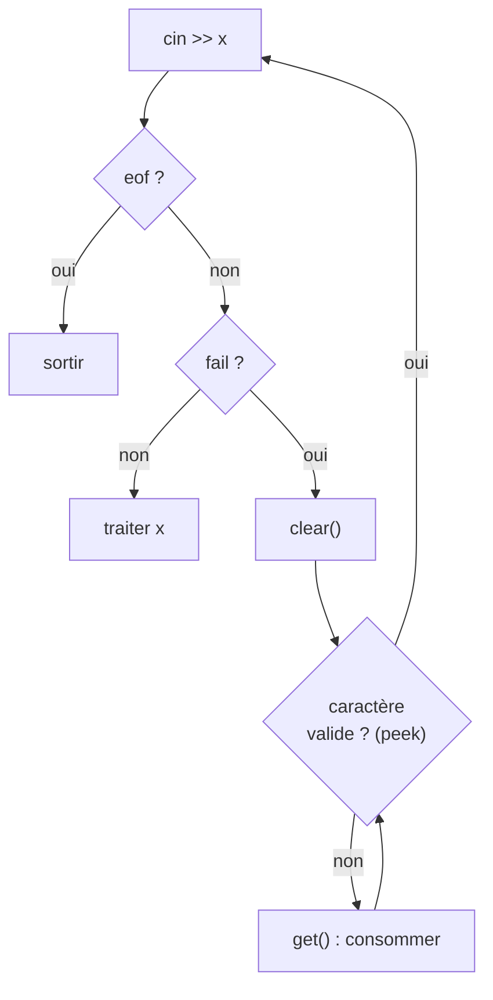

# CM10 — Flux, tri et tests

[[R1.01 - Index|← Index R1.01]] · Retour : [[CM9 - Chaînes, vecteurs et fichiers]]

> [!abstract] En bref
> Dernier CM : rendre les **lectures robustes** (échec de lecture, purge du tampon, `clear`, `peek`, `ignore`), se **positionner** dans un flux (`seekg` / `tellg`), connaître les **états** d'un flux. Puis les quatre **tris** classiques et leur complexité. Enfin, **tester** : d'abord la **justesse** (`assert`), ensuite seulement la **performance** (`time` / `difftime`, moyenne ou médiane).

---

## 1. Gestion des erreurs de lecture

### 1.1 Le problème : échec de lecture

```cpp
int i;
for ( ; ; )
{
    cout << "Taper un entier suivi de <CR> : ";
    cin >> i;
    if (cin.eof ()) break;
    cout << "i = " << i << endl;
}
```

Avec l'entrée `x10` :

```text
Taper un entier suivi de <CR> : i = 1075991360
...
Taper un entier suivi de <CR> : i = 1075991360
Taper un entier suivi de <CR> : i = 1075991360
```

> [!warning] Boucle infinie
> « Ça aurait pu être n'importe quel `ifstream`, le résultat aurait été le même. »

Explication :

1. l'utilisateur n'a **pas** entré un `int` ;
2. la chaîne `"x10"` **reste dans le tampon** ;
3. le tampon n'a pas pu se vider ;
4. à chaque tour, l'extracteur essaie de convertir ce qu'il y a dans le tampon en `int` → **retour au point 2**.

`i` garde une valeur indéterminée (ici `1075991360`).

### 1.2 Détecter l'erreur : `fail()`

> [!important] `fail()`
> Méthode de la classe **`istream`**, donc disponible pour **tous les flux d'entrée** (`cin`, `ifstream`, …). Renvoie vrai si l'**extraction n'a pas pu se faire**.

```cpp
int i;
for (;;) {
    cout << "Taper un entier suivi de <CR> : ";
    cin >> i;
    if (cin.eof ()) break;
    if (cin.fail ())
        cout << "echec de lecture" << endl;
    else
        cout << "i = " << i << endl;
}
```

Résultat :

```text
Taper un entier suivi de <CR> : x10
echec de lecture
Taper un entier suivi de <CR> : echec de lecture
Taper un entier suivi de <CR> : echec de lecture
...
```

> [!warning] Détecter ne suffit pas
> L'erreur est bien détectée, « mais le caractère invalide n'étant pas lu, il reste dans le tampon et est retrouvé à la lecture suivante → **purger le tampon** ».

### 1.3 Première tentative : `getline`

```cpp
if (cin.fail ())
{
    cout << "echec de lecture" << endl;
    string Buf;
    getline (cin, Buf);
}
```

> [!warning] Même exécution, même résultat
> Tel quel, cela ne change rien : le flux est en état d'échec, donc `getline` **ne lit pas**. Il faut d'abord **restaurer** le flux.

### 1.4 Restaurer le flux : `clear()`

> [!important] `clear()`
> Pour pouvoir restaurer un flux positionné dans un état `fail()`, il faut appeler la méthode **`clear()`** sur ce flux.

```cpp
if (cin.fail ())
{
    cout << "echec de lecture" << endl;
    cin.clear ();          // remise en état du flux
    string Buf;
    getline (cin, Buf);    // purge de la ligne
}
```

```text
Taper un entier suivi de <CR> : x10
echec de lecture
Taper un entier suivi de <CR> : 10
i = 10
Taper un entier suivi de <CR> : Ctrl+D
```

> [!warning] Les entiers de la ligne sont perdus
> Avec `getline`, **tous les entiers situés après le caractère invalide sur la même ligne sont perdus**. Exemple : `x10 20 30` → on jette toute la ligne, y compris `20` et `30`.

### 1.5 Purger caractère par caractère avec `get`

Objectif : supprimer **tous les caractères invalides** du tampon qui sont **avant** l'entier à extraire.

```cpp
if (cin.fail ())
{
    cout << "echec de lecture" << endl;
    char c;
    cin.clear ();
    for (cin.get (c); !isdigit (c); cin.get (c));
}
```

```text
Taper un entier suivi de <CR> : xyz10
echec de lecture
Taper un entier suivi de <CR> : i = 0
```

> [!warning] `get` consomme… même le caractère valide
> `get()` consomme l'information du tampon : la boucle s'arrête **après** avoir mangé le `1` de `10`. Il ne reste que `0`.

### 1.6 Lire sans consommer : `peek()`

> [!important] `peek()`
> Lit dans le tampon **sans le toucher** : on ne consomme l'information que si elle est **invalide**.

```cpp
if (cin.fail ())
{
    cout << "echec de lecture" << endl;
    cin.clear ();
    char c;
    for (c = cin.peek (); !isdigit (c); c = cin.peek ())
        cin.get ();
}
```

```text
Taper un entier suivi de <CR> : xyz10
echec de lecture
Taper un entier suivi de <CR> : i = 10
Taper un entier suivi de <CR> : Ctrl + D
```

> [!tip] Le duo gagnant
> `peek()` **regarde**, `get()` **consomme**. On regarde d'abord, on ne consomme que si le caractère est invalide.

### 1.7 Purger **après** la lecture

Problème : l'utilisateur tape deux informations sur la même ligne.

```cpp
string email;
cout << "Entrer votre email : ";
cin >> email;
cout << email << endl;

unsigned age;
cout << "Entrer votre age : ";
cin >> age;
cout << age << endl;
```

```text
Entrer votre email : alain.casali@univ-amu.fr marc.laporte@univ-amu.fr
alain.casali@univ-amu.fr
Entrer votre age : 0
```

`cin >> email` s'arrête au premier blanc ; le second email reste dans le tampon et `age` lit n'importe quoi (`0`, ou l'échec).

> [!important] Règle
> Il faut **purger le reste du tampon après avoir fait la lecture**.

### 1.8 `ignore()`

```cpp
void ignore (streamsize n, int delim);
```

| Paramètre | Rôle | Défaut |
|-----------|------|--------|
| `n` | nombre **maximum** de caractères à ignorer (supprimés du tampon) | 1 |
| `delim` | ignorer jusqu'à ce qu'on trouve ce caractère | EOF |

```cpp
string email;
cout << "Entrer votre email : ";
cin >> email;
cout << email << endl;
cin.ignore (numeric_limits<streamsize>::max(), '\n');

unsigned age;
cout << "Entrer votre age : ";
cin >> age;
cout << age << endl;
```

> [!note] `numeric_limits<streamsize>::max()`
> « On ignore tout le reste du flux » : on demande d'ignorer un nombre **maximal** de caractères, jusqu'au `'\n'`. Il faut `#include <limits>`.

> [!tip] `ignore` vs `getline` pour purger
> `getline (cin, buf)` jette la ligne entière et la garde dans une chaîne ; `ignore (…, '\n')` jette sans stocker. Les deux fonctionnent, `ignore` est plus explicite sur l'intention.

### 1.9 Récapitulatif



---

## 2. Positionnement dans un flux

### 2.1 `seekg()`

> [!important] `seekg`
> Méthode de la classe **`istream`** (flux d'entrée) pour déplacer la **tête de lecture**.

```cpp
void seekg (streamoff, ios_base::seekdir);
```

| Paramètre | Rôle |
|-----------|------|
| 1 | nombre d'**octets** du déplacement (type entier, éventuellement négatif) |
| 2 | **position de départ** du déplacement |

| Position | Signification |
|----------|---------------|
| `ios_base::beg` | déplacement à partir du **début** du flux |
| `ios_base::cur` | déplacement à partir de la position **courante** |
| `ios_base::end` | déplacement à partir de la **fin** du flux |

### 2.2 `tellg()`

`tellg()` renvoie la **position courante** de la tête de lecture. On peut l'afficher ou l'utiliser comme condition de fin.

### 2.3 Exemple : lire un flux à l'envers

```cpp
ifstream ios ("Relecture", ios_base::ate | ios_base::in);
if (0 == ios.tellg()) return 0;

ios.seekg (-1, ios_base::cur);

for (char c; ; )
{
    cout << ios.tellg();
    ios.get (c);
    cout << ' ' << c << '\n';

    if (1 == ios.tellg()) break;
    ios.seekg (-2, ios_base::cur);
}
return 0;
```

| Étape | Détail |
|-------|--------|
| ouverture `ate` | la tête est placée **à la fin** du fichier |
| `seekg (-1, cur)` | recule d'un octet : on se place sur le **dernier** caractère |
| `get (c)` | lit le caractère courant (avance d'un octet) |
| `seekg (-2, cur)` | recule de **deux** octets : on revient sur le caractère précédent |
| `if (1 == tellg())` | condition d'arrêt du support |

Le fichier `Relecture` contient les chiffres de 0 à 5 ; la sortie affichée est :

```text
5 5
4 4
3 3
2 2
1 1
0 0
```

> [!warning] Condition d'arrêt fragile
> La condition `if (1 == ios.tellg())` est **spécifique au contenu** de l'exemple : elle dépend du nombre de caractères. Un test correct de fin de fichier est `if (0 == ios.tellg())` **après** la lecture, ou plus simplement `if (!ios)` / `ios.eof()`.

---

## 3. État d'un flux

### 3.1 Les quatre états

| Méthode | Signification |
|---------|---------------|
| `eof()` | **fin de fichier** atteinte |
| `fail()` | **erreur d'E/S** (conversion impossible, etc.) |
| `bad()` | **erreur sur le flux** (propagation d'exception, …) |
| `good()` | le flux est **OK** |

> [!important] Test équivalent
> ```cpp
> if (ifs)
> if (ifs.good () == true)
> ```
> Ces deux tests sont **équivalents** : un flux se convertit implicitement en booléen qui vaut `good()`.

### 3.2 Nouveau profil de `getline`

**Ancien profil (amphi 9) :**

```cpp
void getline (ifstream &, string &);
```

**Nouveau profil :**

```cpp
ifstream getline (ifstream &, string &);
```

La fonction renvoie désormais le **flux**, ce qui permet de l'utiliser directement comme condition.

### 3.3 Deux écritures de la lecture complète

**Version de l'amphi 9 :**

```cpp
string str;
for (getline (ifs, str); !ifs.eof (); getline (ifs, str))
    Manipulate (str);
```

**Version avec le nouveau profil :**

```cpp
string str;
for ( ; getline (ifs, str); )
    Manipulate (str);
```

> [!important] Pourquoi la seconde est meilleure
> « Appel sous-jacent à `.good()` et on n'effectue l'appel à la fonction uniquement si le flux est dans un état valide. » On évite le classique « dernière ligne traitée deux fois » et le test `eof` mal placé.

---

## 4. Tri de tableau

### 4.1 Tri par sélection

> [!important] Principe
> À la **i-ème itération**, on cherche le **plus petit élément** du tableau `V` entre les positions `[i, V.size()[` et on le **permute** avec l'élément en position `i`.

Tableau de départ :

| 5 | 1 | 2 | 12 | 24 | 13 | 10 | 2 |
|---|---|---|---|---|---|---|---|

Après la 1ʳᵉ itération (le plus petit, `1`, passe en position 0) :

| 1 | 5 | 2 | 12 | 24 | 13 | 10 | 2 |
|---|---|---|---|---|---|---|---|

Après l'itération `i = 2` (le `2` situé en fin de tableau passe en position 2, le `5` part en fin) :

| 1 | 2 | 2 | 12 | 24 | 13 | 10 | 5 |
|---|---|---|---|---|---|---|---|

> [!note] États intermédiaires
> Le support ne montre que trois lignes : l'état initial, l'état après la première itération, puis un état plus avancé. L'état après `i = 1` (qui donnerait `1, 2, 5, 12, 24, 13, 10, 2`) n'est pas représenté.

**Complexité : $O(n^2)$.**

### 4.2 Tri par insertion

> [!important] Principe
> Chaque élément est placé à sa **position finale** dans le vecteur : on cherche à placer le **i-ème élément** à sa place dans le sous-vecteur `[0, i[`.

| Étape | Tableau |
|-------|---------|
| départ | 5, 1, 2, 12, 24, 13, 10, 2 |
| après insertion de `1` | 1, 5, 2, 12, 24, 13, 10, 2 |
| après insertion de `2` | 1, 2, 5, 12, 24, 13, 10, 2 |

**Complexité : $O(n^2)$.**

### 4.3 Tri à bulles

> [!important] Principe
> Si l'élément d'indice `i` est **plus grand** que celui d'indice `i + 1`, on les **permute**.

| Étape | Tableau |
|-------|---------|
| départ | 5, 1, 2, 12, 24, 13, 10, 2 |
| après une passe | 1, 2, 5, 12, 13, 10, 2, 24 |
| après une autre passe | 1, 2, 5, 12, 10, 2, 13, 24 |

> [!tip] Optimisation du support
> « Faire une passe sur indice **croissant** et une passe sur indice **décroissant** dans chaque boucle » (tri cocktail / shaker sort).

**Complexité : $O(n^2)$.**

### 4.4 Tri par comptage

> [!important] Principe
> On crée un **tableau externe** de taille `max − min` dans lequel on compte chaque **occurrence** de chaque nombre.

Tableau initial :

| 6 | 1 | 2 | 2 | 4 | 3 | 1 | 2 |
|---|---|---|---|---|---|---|---|

Tableau externe (nombre d'occurrences) :

| 2 | 3 | 1 | 1 | 0 | 1 |
|---|---|---|---|---|---|

Lecture : la case 0 compte les `1` (2 fois), la case 1 compte les `2` (3 fois), etc. Le support illustre : « L'élément `min + 1` apparaît **3 fois** » — c'est la valeur `2`.

On **reconstitue** ensuite le tableau initial :

| 1 | 1 | 2 | 2 | 2 | 3 | 4 | 6 |
|---|---|---|---|---|---|---|---|

**Complexité : $O(n)$.**

> [!warning] Le $O(n)$ a un prix
> Le tri par comptage est linéaire **en nombre d'éléments**, mais il alloue un tableau de taille **`max − min`**. Si les valeurs sont très étalées (par exemple `1` et `1 000 000 000`), le tableau externe devient énorme. Il n'est adapté qu'à des **petites plages de valeurs**.

### 4.5 Comparaison

| Tri | Idée | Complexité |
|-----|------|------------|
| Sélection | chercher le minimum et le mettre en place | $O(n^2)$ |
| Insertion | insérer chaque élément dans la partie déjà triée | $O(n^2)$ |
| Bulles | permuter les voisins mal ordonnés | $O(n^2)$ |
| Comptage | compter les occurrences | $O(n)$ (plage bornée) |

---

## 5. Tester ses programmes

### 5.1 Test interne : `assert`

> [!important] Priorité absolue
> « La première qualité d'un programme est sa **justesse** ! Il doit répondre aux spécifications demandées. »

Fonction de test du support :

```cpp
void estVecteurTrie (const vector<int> & V)
{
    for (size_t i (0); i < V.Size () - 1; ++i)
        assert (V[i] <= V[i + 1];
}
```

> [!warning] Trois erreurs dans le code du support
> 1. `V.Size()` → c'est **`V.size()`** (minuscule).
> 2. `assert (V[i] <= V[i + 1];` → il manque la **parenthèse fermante** : `assert (V[i] <= V[i + 1]);`.
> 3. `V.size () - 1` avec un `size_t` sur un vecteur **vide** provoque un **débordement** (`0 - 1` devient un très grand nombre) → la boucle lit hors du vecteur.
>
> Version corrigée :
>
> ```cpp
> void estVecteurTrie (const vector<int> & V)
> {
>     for (size_t i (0); i + 1 < V.size (); ++i)
>         assert (V[i] <= V[i + 1]);
> }
> ```

> [!note] `assert`
> `assert (condition)` **arrête** le programme si la condition est fausse (en mode debug). C'est un test **interne**, pas une gestion d'erreur destinée à l'utilisateur. Il faut `#include <cassert>`.

### 5.2 Test de performance : le principe

> [!important] Règle
> « On ne commence les tests de performance qu'à partir du moment où le programme est **juste** ! »

Idée naïve :

```text
Temps1 <- DemanderHeure ();
appeler la fonction;
Temps2 <- DemanderHeure ();
CalculerDifference (Temps2, Temps1);
```

> [!warning] Sémantiquement juste, pratiquement faux
> « Si on exécute plusieurs fois le programme de test, on n'obtiendra jamais le même résultat (l'OS n'étant pas dans le même état) → il faut faire **N** tests (suffisamment grand selon le temps disponible) et faire la **moyenne** des N tests. »

### 5.3 Mesure avec `time` et `difftime`

```cpp
#include <ctime>

void Test (const unsigned & nbTests)
{
     vector<time_t> vTime (nbTests);
     // functionToTest () params initialization
     for (unsigned i (0); i < nbTests; ++i) {
         time_t timer1, timer2;
         time (&timer1);
         functionToTest (listOfParams);
         time (&timer2);
         vTime [i] = difftime (timer2, timer1);
     }
     manipulate (makeAverage (vTime));
}
```

| Élément | Rôle |
|---------|------|
| `time_t` | type de stockage d'un **horodatage** |
| `time (&timer1)` | stocke dans `timer1` l'horodatage courant (nécessite une **adresse** → passage par référence) |
| `difftime (timer2, timer1)` | renvoie la **différence en secondes** entre `timer2` et `timer1` |

> [!note] Le support parle de moyenne **et** de médiane
> La slide écrit `makeAvergae` (faute de frappe pour `makeAverage`) puis note : « `makeMedian ()` serait plus parlant ! »

### 5.4 Moyenne ou médiane ? Supprimer les extrêmes

```cpp
void Test (const unsigned & NbTests, size_t & NbToRemove)
{
     vector<time_t> vTime (nbTests);
     for (unsigned i (0); i < NbTests; ++i) {
         time_t timer1, timer2;
         time (&timer1);
         functionToTest (listOfParams);
         time (&timer2);
         vTime [i] = difftime (timer2, timer1);
     }
     for (size_t i (0); i < NbToRemove / 2; ++i) {
         vTime.erase (max_element (vTime.begin (), vTime.end ()));
         vTime.erase (min_element (vTime.begin (), vTime.end ()));
     }
     manipulate (makeAverage (vTime));
}
```

> [!tip] Pourquoi supprimer les extrêmes ?
> Les mesures aberrantes (pic système, changement de contexte) tirent la moyenne vers le haut. En retirant les **`NbToRemove / 2` plus grandes** et les **`NbToRemove / 2` plus petites** valeurs, on se rapproche d'une **médiane**, plus robuste. « Ou mieux si `nbTest` est suffisamment grand (à votre guise). »

> [!warning] Résolution d'un chronomètre en secondes
> `difftime` renvoie des **secondes entières**. Un traitement de quelques millisecondes est donc mesuré à **0**, et l'arrondi domine. C'est ce qui explique les zéros du tableau ci-dessous.

### 5.5 Exemple : passage par référence vs par valeur

On veut étudier l'impact du **passage par référence** d'un vecteur dans une fonction d'affichage.

```cpp
void showVectV1 (const vect & V);   // par référence
void showVectV2 (const vect V);     // par valeur (copie !)
```

| NbElem | NbIter | TempsMoyenV1 | TempsMoyenV2 |
|--------|--------|--------------|--------------|
| 1 000 | 100 000 | 0 | 0 |
| 10 000 | 100 000 | 0 | 0 |
| 100 000 | 100 000 | 0 | 0 |
| 10 000 000 | 100 000 | 2 | 3 |
| 1 000 000 000 | 100 000 | 209 | 245 |

> [!important] Morale
> « Est-ce suffisant ? **NON** : on n'a pas fait varier les paramètres de la fonction à tester !! »
>
> Il faut faire varier la **taille** du vecteur (c'est ce que fait ce tableau) pour voir apparaître la différence : à petite taille, la copie est indolore ; à **1 milliard** d'éléments, elle coûte visiblement plus cher (245 s contre 209 s).
>
> Autrement dit : un test de performance sans **variation des paramètres** ne prouve rien.

---

## ✅ À retenir

- `cin >> i` qui échoue laisse le caractère invalide **dans le tampon** → boucle infinie.
- `fail()` **détecte** ; `clear()` **restaure** ; `get()` / `getline()` / `ignore()` **purgent**.
- `peek()` regarde **sans consommer** ; on ne consomme que si le caractère est invalide.
- `ignore (numeric_limits<streamsize>::max(), '\n')` purge la fin de ligne après une lecture.
- `seekg (offset, ios_base::beg | cur | end)` déplace la tête de lecture ; `tellg()` donne sa position.
- Quatre états : `eof`, `fail`, `bad`, `good` ; `if (ifs)` équivaut à `ifs.good() == true`.
- Nouveau profil `getline` → renvoie le flux : `for ( ; getline (ifs, str); )` est plus sûr que le test `eof`.
- Sélection, insertion, bulles : $O(n^2)$ ; comptage : $O(n)$ mais tableau externe de taille `max − min`.
- Justesse **d'abord** (`assert`), performance **ensuite**.
- `time (&t)` + `difftime (t2, t1)` mesure en **secondes** ; répéter **N** fois et moyenner (ou prendre la médiane).
- Un test de performance doit faire **varier les paramètres** (taille du vecteur, mode de passage…).

### Questions d'auto-évaluation

- [ ] Pourquoi la boucle `cin >> i` entre-t-elle en boucle infinie sur l'entrée `x10` ?
- [ ] Que fait exactement `fail()` ? Sur quels flux est-il disponible ?
- [ ] Pourquoi `getline` seul ne suffit-il pas à purger après un `fail()` ?
- [ ] À quoi sert `clear()` ? Que se passe-t-il si on l'oublie ?
- [ ] Différence entre `get()`, `peek()` et `ignore()` ?
- [ ] Pourquoi la boucle `for (cin.get (c); !isdigit (c); cin.get (c));` perd-elle le premier chiffre ?
- [ ] Quels sont les trois paramètres de `seekg` ? Que signifient `beg`, `cur`, `end` ?
- [ ] Pourquoi le `seekg (-2, ios_base::cur)` de l'exemple est-il nécessaire après un `get` ?
- [ ] Citer les quatre états d'un flux et leur signification.
- [ ] Pourquoi `for ( ; getline (ifs, str); )` est-il préférable au test `!ifs.eof()` ?
- [ ] Décrire le tri par sélection, le tri par insertion et le tri à bulles en une phrase chacun.
- [ ] Pourquoi le tri par comptage est-il $O(n)$ ? Quel est son inconvénient ?
- [ ] Pourquoi `assert` ne remplace-t-il pas une gestion d'erreur utilisateur ?
- [ ] Pourquoi `difftime` peut-il renvoyer 0 pour une fonction rapide ?
- [ ] Pourquoi un test de performance sans variation des paramètres est-il insuffisant ?
