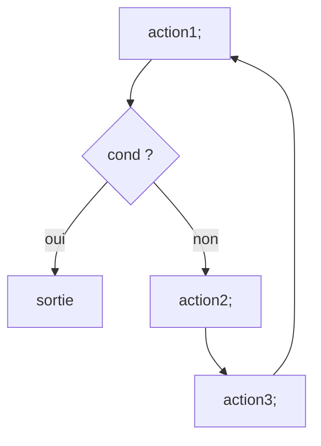
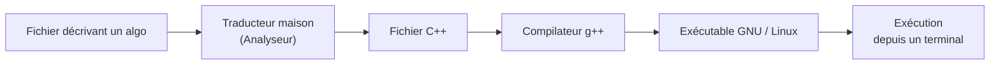

# CM3 — Chaînes, algorithmes et boucles

[[R1.01 - Index|← Index R1.01]] · Suite : [[CM4 - Boucle pour, portée et sous-programmes]]

> [!abstract] En bref
> On ajoute le type **`string`**, on écrit ses **premiers algorithmes complets** (`algorithme … debut … fin`), puis on découvre les **boucles non comptées** : `boucle` (avec `sortie`), `tant_que`, `jusqua` et `repeter`. Le fil rouge : **parcourir** un tableau ou une chaîne **sans déborder**.

---

## 1. Le type complexe `string`

### 1.1 Identificateur et valeurs

| Élément | Contenu |
|---------|---------|
| **Identificateur** | `string` |
| **Littéral** | Une **suite de caractères entre guillemets** (doubles quotes) |
| **Comparaisons** | `<`, `<=`, `>`, `>=` → `booleen` (ordre **lexicographique**) |
| **Identité** | `vaut`, `ne_vaut_pas` → `booleen` |
| **Concaténation** | `+` |
| **Taille** | `taille (Chaine)` |

```text
declarer Chaine : string;
Chaine <- "AEIOUY\"";
```

La chaîne `AEIOUY"` contient **7 caractères** : le `\"` est un **guillemet échappé**, pas un caractère de fin de chaîne.

### 1.2 Concaténation

```text
Chaine <- Chaine + "0123456789";
```

`AEIOUY"` (7 caractères) + `0123456789` (10 caractères) = **17 caractères**.

> [!note] Chaîne vide
> Une chaîne vide s'écrit `""` : c'est une chaîne de **taille 0**, pas une absence de valeur.

### 1.3 Ordre lexicographique

Les comparaisons `<`, `<=`, `>`, `>=` comparent les chaînes **caractère par caractère**, selon l'ordre des caractères (voir [[CM2 - Expressions logiques et types primitifs]] : chiffres < majuscules < minuscules < accentués).

---

## 2. Structure d'un algorithme

### 2.1 Premier algorithme : `Hello world!`

```text
algorithme afficherBonjour
debut

    afficher ("Hello world!");
    ligne_suivante;

fin
```

| Élément | Rôle |
|---------|------|
| `algorithme afficherBonjour` | **nom** de l'algorithme |
| `debut` | marque du **début** |
| les instructions | **corps** de l'algorithme |
| `fin` | marque de **fin** |

> [!important] Convention
> Le nom de l'algorithme décrit **ce qu'il fait** (`afficherBonjour`, `calculEquationDroite`), pas comment il le fait. Même logique que les noms de variables du [[CM2 - Expressions logiques et types primitifs|CM2]].

### 2.2 Second algorithme : calculer `y = ax + b`

```text
algorithme calculEquationDroite
debut

    afficher ("Entrez les valeurs de a, x, puis b ");
    declarer a, b, x : reel;
    saisir (a);
    saisir (x);
    saisir (b);

    afficher ("La valeur de la fonction affine \"y = ", a, "x +", b,
              "\" en x = ", x, " est de ", a*x + b);

fin
```

Points à noter :

- on peut **déclarer plusieurs variables** du même type en une fois : `declarer a, b, x : reel;` ;
- les **affichages sont séparés par des virgules** ;
- les guillemets internes sont **échappés** (`\"`) ;
- l'expression `a*x + b` est **évaluée** avant d'être affichée.

> [!warning] L'ordre des `saisir` doit correspondre au message
> Le message annonce « a, x, puis b » : les trois `saisir` sont donc dans cet ordre. Un décalage produit un algorithme **faux mais compilable** — exactement le genre d'erreur que la règle d'or #1 annonce.

---

## 3. La boucle `boucle`

### 3.1 Boucle infinie

```text
boucle
    attaquer;
fboucle
```

L'action `attaquer` est répétée **indéfiniment**. **On doit sortir de la boucle à un moment !**

```text
boucle
    attaquer;
    si (victoire) sortie;
fboucle
```

### 3.2 Forme générale (1)

```text
boucle
    action1;
    si (cond) sortie;
    action2;
    action3;
fboucle
```



### 3.3 Forme générale (2)

```text
boucle
    si (cond1) sortie;
    action1;
    si (cond2) sortie;
    action2;
    si (cond3) sortie;
    action3;
    si (cond4) sortie;
fboucle
```

Une boucle peut avoir **plusieurs points de sortie**, mais ils doivent être **explicites**.

### 3.4 Attention à l'ordre des instructions

Exemple : **avancer jusqu'au bord de la falaise**.

```text
// Version A
boucle
    avancerDUnPas;
    si (bordDeFalaise) sortie;
fboucle
```

```text
// Version B
boucle
    si (bordDeFalaise) sortie;
    avancerDUnPas;
fboucle
```

> [!warning] « Équivalent ? Oui ssi vous avez confiance en vous »
> - Version A : on avance **puis** on teste → on a déjà fait un pas **sur le bord** (voire dans le vide).
> - Version B : on teste **puis** on avance → on s'arrête **avant** le pas de trop.
>
> Les deux algorithmes ne sont donc **pas** équivalents en cas de danger. C'est le même piège que `while` avant vs `do while` (voir [[CM6 - Caractères, chaînes, boucles et vector]]).

---

## 4. Les boucles `tant_que` et `jusqua`

### 4.1 Exemple concret : couper du tube de cuivre

```text
1. Placer le tube dans le coupe-tube, à l'endroit de la coupe;
2. Serrer la poignée du coupe-tube pour que la molette soit en appui sur le tube;
3. Serrer la poignée d'un demi-tour;
4. Faire tourner le coupe-tube autour du tube;
5. Répéter les opérations 3 et 4 jusqu'à coupure complète;
6. Ebavurer l'intérieur du tube à la lime ou au couteau;
```

Formalisation :

```text
// On utilise ...
Placer le tube ... ;
Serrer la poignée ... pour que la molette ... ;

repeter
    Serrer la poignée d'un demi-tour;
    Faire tourner ...;
jusqua (coupure complète)

Ebavurer l'intérieur ...;
```

- `repeter … jusqua` est un **schéma répétitif** ;
- la condition de `jusqua` est une **expression logique** ;
- c'est une **condition d'arrêt** (on répète **jusqu'à** ce qu'elle devienne vraie).

### 4.2 Exemple : scier du bois

```text
1. Prendre la bûche;
2. si (sa longueur > 30 cm)
       Lui enlever 30 cm;
       Stocker le morceau coupé;
   sinon
       aller en 4;
   fsi
3. Remonter à 2.
4. Stocker le reste de la bûche;
```

Version `tant_que` :

```text
1. Prendre la bûche;
2. tant_que (sa longueur > 30 cm)
   faire
       Lui enlever 30 cm;
       Stocker le morceau coupé;
   ffaire
3. Stocker le reste de la bûche;
```

Version `jusqua` :

```text
2. jusqua (sa longueur <= 30 cm)
   faire
       Lui enlever 30 cm;
       Stocker le morceau coupé;
   ffaire
```

> [!danger] La version `repeter … jusqua` est fausse ici
> ```text
> 2. repeter
>        Lui enlever 30 cm;
>        Stocker le morceau coupé;
>    jusqua (sa longueur <= 30 cm)
> ```
> Si la bûche mesure **moins de 30 cm au départ**, on lui enlève quand même 30 cm : `repeter` exécute le corps **au moins une fois**. C'est **impossible** avec cette condition.

### 4.3 Les quatre modèles généraux

```text
// 1. Tant que (test avant)
tant_que (conditionA)
faire
    ...
ffaire

// 2. Jusqu'à (test avant)
jusqua (conditionB)
faire
    ...
ffaire

// 3. Répéter … tant que (test après)
repeter
    ...
tant_que (conditionC)

// 4. Répéter … jusqu'à (test après)
repeter
    ...
jusqua (conditionD)
```

| Modèle | Test | Exécution minimale |
|--------|------|--------------------|
| `tant_que … faire … ffaire` | **avant** | 0 fois |
| `jusqua … faire … ffaire` | **avant** | 0 fois |
| `repeter … tant_que` | **après** | **1 fois** |
| `repeter … jusqua` | **après** | **1 fois** |

### 4.4 `jusqua` comme cas particulier de `boucle`

```text
// Boucle avec sortie en tête
boucle
    si (cond1) sortie;
    action1;
    action2;
    action3;
fboucle
```

est équivalent à :

```text
jusqua (cond1)
faire
    action1;
    action2;
    action3;
ffaire
```

La condition de la boucle infinie « touche » la **condition d'entrée** de la boucle.

```text
// Boucle avec sortie en queue
boucle
    action1;
    action2;
    action3;
    si (cond1) sortie;
fboucle
```

est équivalent à :

```text
repeter
    action1;
    action2;
    action3;
jusqua (cond1)
```

La condition de la boucle infinie « touche » la **condition de sortie** de la boucle.

### 4.5 Équivalences

```text
tant_que (conditionA) faire ... ffaire
    ≡   jusqua (NON conditionA) faire ... ffaire
```

```text
jusqua (conditionB) faire ... ffaire
    ≡   tant_que (NON conditionB) faire ... ffaire
```

```text
repeter ... tant_que (conditionC)
    ≡   repeter ... jusqua (NON conditionC)
```

```text
repeter ... jusqua (conditionD)
    ≡   repeter ... tant_que (NON conditionD)
```

> [!warning] Ne pas se tromper de négation
> `tant_que (i < n)` ≡ `jusqua (i >= n)`, **pas** `jusqua (i < n)`. Une condition de **continuation** devient une condition d'**arrêt**, donc elle se **nie**.

---

## 5. L'instruction `continue`

```text
// Sans continue : 2 blocs, 2 indentations
tant_que (NON victoire)
faire
    prendreUnePotion;
    si (beaucoupDeVie)
        attaquer;
    fsi
ffaire
```

```text
// Avec continue : 1 bloc, 1 indentation
tant_que (NON victoire)
faire
    prendreUnePotion;
    si (NON beaucoupDeVie) continue;
    attaquer;
ffaire
```

> [!important] Définition
> Dans une boucle, l'instruction `continue` a pour conséquence de **remonter en début de boucle** (en réévaluant la condition).

Ici, `continue` évite un niveau d'imbrication : **2 blocs / 2 indentations → 1 bloc / 1 indentation**, donc plus lisible.

> [!warning] `continue` n'est pas `sortie`
> `sortie` **quitte** la boucle ; `continue` **passe à l'itération suivante**. Les confondre est une source classique de boucle infinie.

---

## 6. Algorithmes utilisant les boucles

### 6.1 Afficher 100 fois « Bonjour » — version 1 (`boucle`)

On a besoin d'un **compteur** qui compte le **nombre de passages** dans la boucle.

```text
algorithme afficher100Bonjour
debut

    declarer compteur : entier_naturel;
    compteur <- 0;

    boucle
        afficher ("Bonjour");
        compteur <- compteur + 1;
        si (compteur vaut 100) sortie;
    fboucle

fin
```

Construction pas à pas (diapos) :

1. « Prendre un objet qu'on désignera par compteur » ;
2. l'initialiser à **0** (nombre de passages déjà effectués) ;
3. dans la boucle : afficher, **ajouter 1**, tester si `compteur vaut 100`, et sortir.

> [!tip] Vocabulaire
> - `compteur` est une **variable** ;
> - `"Bonjour"` est une **constante** (un **littéral**) de type `string` ;
> - `100` est une constante de type `entier_naturel`.

### 6.2 Version 2 : `tant_que`, `jusqua`, `repeter`

```text
// tant_que
tant_que (compteur ne_vaut_pas 100)
faire
    afficher ("Bonjour");
    compteur <- compteur + 1;
ffaire
```

```text
// jusqua
jusqua (compteur vaut 100)
faire
    afficher ("Bonjour");
    compteur <- compteur + 1;
ffaire
```

```text
// repeter
repeter
    afficher ("Bonjour");
    compteur <- compteur + 1;
jusqua (compteur vaut 100)
```

Les trois versions supposent `compteur` déclaré et initialisé à `0` **avant** la boucle.

> [!warning] `jusqua (compteur vaut 100)` : test **avant**
> Si `compteur` vaut déjà 100, on n'affiche **rien**. Avec `repeter`, on afficherait **une fois de trop**. C'est toute la différence entre test avant et test après.

### 6.3 Afficher le contenu d'un tableau de réels

```text
declarer tabReel : tableau_de reel;
// génération de tabReel

declarer i : entier_naturel;
i <- 0;

tant_que (i ne_vaut_pas taille (tabReel))
faire
    afficher (tabReel[i]);
    i <- i + 1;          // passage à la case suivante
ffaire
```

Il faut :

- un **indice** `i` qui prend **toutes** les valeurs de `0` à `taille (tabReel) − 1` ;
- afficher la **case courante** ;
- **incrémenter** l'indice.

> [!warning] Deux erreurs à ne pas commettre
> 1. Oublier `i <- i + 1` → **boucle infinie**.
> 2. Utiliser `<=` au lieu de `ne_vaut_pas` / `<` → accès à `tabReel[taille]`, **hors bornes**.

### 6.4 Même parcours, autres types

| Tableau | Ce qui change |
|---------|---------------|
| `tableau_de entier` | **uniquement le type** des éléments à afficher |
| `tableau_de string` | **uniquement le type** des éléments à afficher |
| `string` | on peut parcourir `str[i]`, ou simplement `afficher (str);` |

```text
// tableau d'entiers
declarer tabInt : tableau_de entier;
// génération de tabInt
declarer i : entier_naturel;
i <- 0;
tant_que (i ne_vaut_pas taille (tabInt))
faire
    afficher (tabInt[i]);
    i <- i + 1;
ffaire
```

> [!important] Le parcours est **invariant**
> « Quels sont les changements par rapport à l'algorithme précédent ? **Uniquement le type des éléments à afficher, le parcours ne change pas !** » C'est le début de la **généricité** : la structure de la boucle ne dépend pas du type des cases.

### 6.5 Afficher une chaîne un caractère sur deux

#### Version fausse n°1 — `continue` mal placé

```text
tant_que (i ne_vaut_pas taille (str))
faire
    si (modulo (i, 2) vaut 1) continue;
    afficher (str[i]);
    i <- i + 1;
ffaire
```

> [!danger] Faux
> Si `i` est impair, `continue` remonte **avant** l'incrémentation : `i` ne change plus → **boucle infinie**, et on n'affiche que la première case.

#### Version fausse n°2 — pas de `continue`

```text
tant_que (i ne_vaut_pas taille (str))
faire
    si (modulo (i, 2) vaut 0)
        afficher (str[i]);
    fsi
    i <- i + 1;
ffaire
```

Cette version est **correcte** (mais avec deux niveaux d'indentation).

#### Version fausse n°3 — saut de 2

```text
tant_que (i ne_vaut pas taille (str))
faire
    afficher (str[i]);
    i <- i + 2;
ffaire
```

> [!danger] Faux
> Si la taille de la chaîne est **impaire**, `i` saute de `n−1` à `n+1` : on **déborde** du tableau.

#### Version correcte

```text
tant_que (i < taille (str))
faire
    afficher (str[i]);
    i <- i + 2;
ffaire
```

La condition `i < taille (str)` protège **avant** chaque accès, y compris quand `i` dépasse la dernière case.

---

## 7. Faire ses TD à la maison

« Normalement impossible », sauf si :

- on utilise des **règles strictes** décrivant l'algorithmique ;
- on utilise **un ou plusieurs compilateurs**.

Ce qui est fait dans le module :



- L'**analyseur** vérifie la syntaxe algorithmique ;
- le **traducteur** produit du C++ ;
- `g++` compile ;
- l'exécutable s'utilise **depuis un terminal uniquement**.

Plus d'informations : <http://ens.casali.me/casali/Cours_algo/index_algo.html> — et le lien TP du dossier `TD/Cpp/Lien TP.txt`.

> [!tip] Pourquoi passer par un traducteur ?
> Cela permet de **tester** un algorithme en pseudo-code sans le réécrire à la main en C++. C'est aussi une excellente façon de voir que **le pseudo-code est exécutable** s'il est suffisamment strict.

---

## ✅ À retenir

- `string` : littéral entre **guillemets**, concaténation `+`, taille via `taille`, comparaison **lexicographique**.
- Un algorithme s'écrit `algorithme nom / debut / … / fin`.
- `boucle … fboucle` est **infinie** : il faut une instruction **`sortie`**.
- **Test avant** : `tant_que`, `jusqua` (0 ou plusieurs fois). **Test après** : `repeter` (au moins une fois).
- `tant_que (C)` ≡ `jusqua (NON C)` ; `repeter … tant_que (C)` ≡ `repeter … jusqua (NON C)`.
- `continue` remonte au début de la boucle ; `sortie` quitte la boucle.
- Le **parcours d'un tableau** est toujours le même : `i <- 0`, condition `i < taille`, accès `tab[i]`, `i <- i + 1`.
- Pour sauter des cases, tester **`i < taille`** avant l'accès, jamais `i ne_vaut_pas taille` avec un pas de 2.

### Questions d'auto-évaluation

- [ ] Quelle est la différence entre `vaut` et `taille` pour une `string` ?
- [ ] Écrire la structure minimale d'un algorithme (`algorithme`, `debut`, `fin`).
- [ ] Écrire l'algorithme `afficher100Bonjour` avec `boucle`, puis avec `tant_que`, `jusqua` et `repeter`.
- [ ] Pourquoi `repeter … jusqua` est-il faux pour la bûche de moins de 30 cm ?
- [ ] Traduire `tant_que (i < n)` en `jusqua`. Que devient la condition ?
- [ ] Quelle est la différence entre `sortie` et `continue` ?
- [ ] Écrire le parcours d'un `tableau_de reel` de taille `n`.
- [ ] Pourquoi la version avec `i <- i + 2` et `i ne_vaut_pas taille (str)` déborde-t-elle sur une chaîne impaire ?
- [ ] Corriger la version avec `continue` qui boucle infiniment.
- [ ] Quel est le rôle de l'analyseur et de `g++` dans les TD à la maison ?
