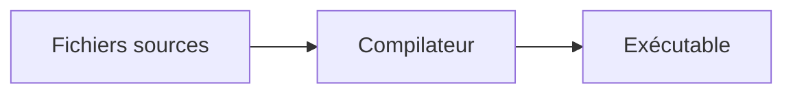

# CM5 — Du pseudo-code au C++

[[R1.01 - Index|← Index R1.01]] · Suite : [[CM6 - Caractères, chaînes, boucles et vector]]

> [!abstract] En bref
> Première traduction systématique de l'algorithme vers le C++ : structure d'un programme, commentaires, variables, entrées/sorties, conditions, booléens, entiers et réels. Chaque notion d'algo a son **équivalent C++** — et quelques **pièges** (troncature, comparaison de réels).

---

## 1. Avant-propos

### 1.1 Un langage de programmation, c'est quoi ?

> En informatique, un langage de programmation est une **notation conventionnelle** destinée à formuler des **algorithmes** et produire des **programmes informatiques** qui les appliquent. D'une manière similaire à une langue naturelle, un langage de programmation est fait d'un **alphabet**, d'un **vocabulaire**, de **règles de grammaire** et de **significations**.

Source : `fr.wikipedia.org/wiki/Langage_de_programmation`.



### 1.2 Le problème du développeur

> **« C'est une roue ! On ne re-développe JAMAIS une fonctionnalité si elle est déjà fournie par le langage »** (sauf raisons pédagogiques).

Exemple : trier un tableau d'entiers. Il existe une **trentaine d'algorithmes**, avec des performances différentes ; l'un des plus efficaces est le **tri rapide**.

| Taille du tableau | Temps C++ | Temps « mon implémentation » |
|-------------------|-----------|------------------------------|
| 1 000 | ~0 s | ~0 s |
| 10 000 | ~0 s | ~0 s |
| 100 000 | ~0 s | ~0 s |
| 1 000 000 | ~0 s | **~13 s** |
| 10 000 000 | **~6 s** | **~1200 s** |

> [!important] Leçon
> La différence n'est pas « savoir coder une boucle », c'est **choisir le bon algorithme** et **utiliser la bibliothèque standard**. Le cours de tri du [[CM10 - Flux, tri et tests|CM10]] montrera justement les complexités.

### 1.3 La documentation

Elle se lit :

- **en ligne** (elle est à jour) ;
- **en anglais** (on évite les erreurs de traduction, s'il y a traduction) ;
- elle comporte des **exemples**.

Objectifs :

- **début janvier** : être capable de **lire** une documentation en anglais, de la **comprendre**, et d'**adapter les exemples** à votre problématique ;
- **fin du BUT** : être capable d'**écrire** une documentation technique en anglais.

> [!warning] Règle du cours
> **Tous les noms de fonctions et de variables doivent être en anglais !** (Les commentaires et les noms de types du cours restent en français pour l'apprentissage, mais le code professionnel est en anglais.)

### 1.4 Le C++, c'est quoi ?

1. Un **langage de programmation** ;
2. une **surcouche (partiellement) objet du C**.

- Dernière norme du C++ : **2020**.
- Compilateurs : `g++` (support complet), `clang` (support complet), VS2017 (support **partiel**).
- En C++ :
  - **tout est appel de fonction ou de méthode** (maintenant) ;
  - **tout est flux** ;
  - vive les **références** (maintenant) et les **pointeurs** (S3).

---

## 2. Un premier programme

Quel que soit le langage, le premier programme affiche **`Hello world!`** (modulo quelques arrangements) :

- sur un **terminal** (une console) ;
- sur une **page web** ;
- sur une **interface graphique**.

```cpp
/**
 * @file   Hello.cxx
 * @author A. Casali
 * @date   12/09/2013
 **/

#include <iostream>
using namespace std;

int main()
{
    cout << "Hello World!" << endl;
    return 0;
}
```

| Élément | Rôle |
|---------|------|
| `/** … **/` | commentaire de documentation (Doxygen) |
| `#include <iostream>` | bibliothèque qui gère les **flux** d'entrées/sorties (*input/output*) |
| `using namespace std;` | permet d'écrire `cout` au lieu de `std::cout` |
| `int main()` | **point d'entrée** du programme, renvoie un `int` |
| `{ … }` | **bloc** d'instructions |
| `cout << … << endl;` | affichage + retour à la ligne |
| `return 0;` | code de retour **0** = succès |

> [!note] `main` est une fonction
> Le programme commence toujours par `main`. `return 0;` indique au système d'exploitation que tout s'est bien passé.

---

## 3. Les commentaires

| Forme | Syntaxe |
|-------|---------|
| Une seule ligne | `// this is a one line remark` |
| Plusieurs lignes | `/* this is a drawn out explanation */` |
| Une ligne « à la C » | `/* this is also a one line remark */` |

Plus de détails : <http://www.stack.nl/~dimitri/doxygen/>.

> [!tip] Commenter quoi ?
> Le **pourquoi**, pas le **comment**. `i = i + 1; // incrémente i` est inutile ; `// passage à la case suivante` apporte de l'information.

---

## 4. Déclaration, affectation, bloc

### 4.1 Déclaration de variables

```text
// Algorithmique
declarer nomDeVariable : Type;
```

```cpp
// C++
type varIdent;      // varIdent = Variable Identifier
```

```cpp
int i;
```

### 4.2 Affectation

```text
// Algorithmique
nomDeVariable <- valeur;
```

```cpp
// C++
varIdent = valeur;
```

```cpp
i = 10;
```

> [!warning] `=` n'est pas `==`
> `=` **affecte** ; `==` **compare**. C'est l'erreur de débutant la plus coûteuse : `if (i = 10)` compile et est **toujours vrai**.

### 4.3 Variables constantes

```text
// Algorithmique
declarer KnomDeVariable : constante type <- valeur;
```

```cpp
// C++
const type KvarIdent = valeur;
```

```cpp
const int Ki = 10;
```

> **Tous les noms des constantes doivent commencer par la lettre `K`.**

### 4.4 Déclaration et initialisation à la volée

Trois écritures possibles :

```cpp
type varIdent = valeur;      // 1
type varIdent (valeur);      // 2
type varIdent {valeur(s)};   // 3
```

```cpp
int i = 10;
int j (5);
int k {3};
```

> [!important] La troisième forme est la plus puissante
> **Seule la troisième forme** (`{…}`) permet la **déclaration et l'initialisation à la volée des tableaux** (et plus généralement des conteneurs). C'est aussi celle qui interdit les conversions qui « rétrécissent » la valeur.

### 4.5 Bloc et portée de variable

> [!important] Définition — bloc
> Un **bloc** est une suite d'instructions entre `{` et `}`.

> [!important] Propriété — portée
> Une variable **n'existe que dans le bloc dans lequel elle est déclarée**.

```cpp
{
    type i;
    i = value1;
    …
    {
        type j (value2);
        // i et j existent
        i = value3;
        j = value4;
    }
    // seul i existe
    i = value5;
    j = value6;   // <- erreur de compilation
}
```

---

## 5. Entrées / sorties

### 5.1 Saisie clavier

```text
// Algorithmique
saisir (nomDeVariable);
```

```cpp
// C++
cin >> varIdent;
```

- `cin` = **console input** ;
- `>>` est un **extracteur**.

```cpp
int i;
cin >> i;    // 10
```

**Prérequis** :

```cpp
#include <iostream>
using namespace std;
```

### 5.2 Affichage écran

```text
// Algorithmique
afficher (unLitteral);
afficher (nomDeVariable);
```

```cpp
// C++
cout << litteralPattern;
cout << varIdent;
```

- `cout` = **console output** ;
- `<<` est un **injecteur**.

```cpp
cout << 10;                  // littéral entier       -> 10
cout << "une jolie chaine";  // littéral chaîne       -> une jolie chaine
int i;
i = 10;
cout << i;                   // variable              -> 10
```

### 5.3 Passage à la ligne

```text
// Algorithmique
ligne_suivante;
```

```cpp
// C++
cout << endl;
```

- `endl` = **end line** ;
- `endl` est un **identificateur**.

```cpp
cout << i;
cout << endl;
```

### 5.4 Compression des sorties

```cpp
cout << "Valeur de i : ";
cout << i;
cout << endl;
```

se compacte en :

```cpp
cout << "Valeur de i : "
     << i
     << endl;
```

Règles :

1. **absence du `;`** à la fin de la ligne ;
2. tous les injecteurs sont **alignés**.

```cpp
cout << "Valeur de i : " << i << endl;
```

---

## 6. Opérateur identité et différence

### 6.1 Identité

```text
// Algorithmique
nomDeVariable vaut Valeur
```

```cpp
// C++
varIdent == valeur
```

```cpp
i == 10
```

> [!tip] « Ou mieux : `10 == i` »
> Mettre le **littéral à gauche** : si on écrit par erreur `10 = i`, le compilateur **refuse** (on ne peut pas affecter à un littéral). Avec `i = 10`, l'erreur passerait inaperçue.

**On ne compare que des variables et/ou des littéraux du même type.**

### 6.2 Différence

```text
// Algorithmique
nomDeVariable ne_vaut_pas Valeur
```

```cpp
// C++
varIdent != valeur
```

```cpp
i != 10
```

---

## 7. Schéma alternatif simple

### 7.1 Sans `sinon`

```text
// Algorithmique
si (condition)
    instruction1;
    instruction2;
    …
fsi
```

```cpp
// C++
if (condition)
{
    instruction1;
    instruction2;
    …
}
```

- `condition` est une **expression booléenne** ;
- `{` marque le **début** d'un bloc, `}` la **fin** ;
- toutes les instructions d'un même bloc sont **alignées**.

### 7.2 Avec `sinon`

```cpp
if (condition)
{
    instruction1;
    instruction2;
    …
}
else
{
    instruction3;
    instruction4;
    …
}
```

Exemple :

```text
verifierVie;
verifierArmes;
si (toutEstOK)
    attaquerBoss;
    …
sinon
    prendrePotion;
    …
fsi
partir;
```

```cpp
checkLife();
checkWeapons();
if (everythingIsOK)
{
    attackBoss();
    …
}
else
{
    takePotion();
    …
}
leave();
```

### 7.3 En cascade

```text
si (exprLog1)
    sequ1;
sinon_si (exprLog2)
    sequ2;
sinon_si (exprLog3)
    sequ3;
sinon                      // tous les autres cas
    sequ4;
fsi
```

```cpp
if (logExp1)
{
    sequ1;
}
else if (logExp2)
{
    sequ2;
}
else if (logExp3)
{
    sequ3;
}
else
{
    sequ4;
}
```

Exemple :

```cpp
if (fewOfLife)
{
    takeAPotion();
}
else if (IAmAWarrior)
{
    attackWithSword();
}
else if (IAmAWizard)
{
    castASpell();
}
else
{
    leave();
}
```

---

## 8. Schéma alternatif complexe

### 8.1 Correspondance des opérateurs

| Algorithmique | C++ | C++14 |
|---------------|-----|-------|
| `ET` | `&&` | `and` |
| `OU` | `\|\|` | `or` |
| `ET_ALORS` | `&&` | `and` |
| `OU_SINON` | `\|\|` | `or` |

> [!important] `&&` et `||` court-circuitent
> En C++, `A && B` n'évalue `B` que si `A` est vrai ; `A || B` n'évalue `B` que si `A` est faux. **`&&` correspond donc à `ET_ALORS`** (et non à `ET`), et `||` à `OU_SINON`. C'est une différence de **sémantique** avec l'algorithmique, même si la table de vérité est identique.

```text
si (beaucoupDeVie OU_SINON jeSuisUnGuerrier)
    Attaquer;
fsi
```

```cpp
if (fullOfLife || IAmAWarrior)
{
    attack();
}

// C++14
if (fullOfLife or IAmAWarrior)
{
    attack();
}
```

> [!note] Règles conservées
> Les règles de **propagation de la négation** sont les mêmes qu'en algorithmique (amphi 2, transparents 11 à 14) ; les **tables de vérité** aussi (transparents 15 et 16). Voir [[CM2 - Expressions logiques et types primitifs]].

---

## 9. Le type booléen

| Élément | C++ |
|---------|-----|
| Identificateur | `bool` |
| Valeurs | `true`, `false` |
| Opérations booléennes | `&&`, `\|\|`, `!` (produisent un `bool`) |
| Opérations d'identité | `==`, `!=` (produisent un `bool`) |
| Négation | `!` |

```cpp
bool toBe;
bool notToBe;
bool question;
…
toBe = false;
notToBe = !toBe;              // true
question = toBe || notToBe;   // always true!
```

```cpp
if (toBe == notToBe)
{
    cout << "WTF!";
}
```

Négation :

```text
si (NON condition)
    instruction1;
    instruction2;
    …
fsi
```

```cpp
if (!condition)
{
    instruction1;
    instruction2;
    …
}
```

---

## 10. Les types entiers

### 10.1 Identificateur et opérations

| Élément | `int` |
|---------|-------|
| Valeurs | sous-ensemble des entiers mathématiques |
| Opérations | `+`, `-`, `*`, `/`, `%` → produisent un entier |
| Comparaisons | `<`, `<=`, `>`, `>=` → `bool` |
| Identité | `==`, `!=` → `bool` |

- `/` : **troncature** du reste de la division ;
- `%` : **modulo**, reste de la division entière.

```cpp
int x;
cout << x;          // valeur indéterminée (n'importe quoi)
x = 1;
cout << x;          // 1

x = (x + 2) / 4 * 3;
cout << x;          // 0
```

> [!warning] Incohérence de la diapo C++
> La diapo enchaîne avec `x = (x + 2) * 3 % 4;` et affiche `0`. Or pour `x = 1`, `(1+2)*3 % 4 = 9 % 4 = 1`, pas `0`. Il s'agit vraisemblablement d'une coquille de support. **Retenir le principe** : `/` tronque, `%` donne le reste. L'exemple algorithmique sûr est celui du [[CM2 - Expressions logiques et types primitifs|CM2]] :
> - `(x + 2) / 4 * 3` → `0` ;
> - `(x + 2) * 3 / 4` → `2`.

### 10.2 Priorité des opérateurs

La diapo « Priorité des opérateurs » est **essentiellement graphique** : elle rappelle que `*`, `/`, `%` sont prioritaires sur `+`, `-`, et que les parenthèses permettent de forcer l'ordre. En cas de doute : **mettre des parenthèses**.

### 10.3 Comparaisons et identité

```cpp
int nb1;
nb1 = 12;
int nb2;
nb2 = 5;
int nb3;
nb3 = nb1 / nb2;      // nb3 vaut 2

if (4 == nb3)
{
    cout << "nb3 vaut 4";
}
else if (nb3 >= 2)
{
    cout << "nb3 >= 2";
}
```

### 10.4 Les différents types d'entiers

| Type | Min | Max | #octets |
|------|-----|-----|---------|
| `int` | −2 147 483 648 | 2 147 483 647 | 4 |
| `unsigned [int]` | 0 | 4 294 967 295 | 4 |
| `short [int]` | −32 768 | 32 767 | 2 |
| `unsigned short [int]` | 0 | 65 535 | 2 |
| `long long [int]` | −9 223 372 036 854 775 808 | 9 223 372 036 854 775 807 | 8 |
| `unsigned long [long]` | 0 | 18 446 744 073 709 551 615 | 8 |
| `long [int]` | −2 147 483 648 | 2 147 483 647 | 4 |

> [!note] Lecture du tableau
> Le support présente les très grandes valeurs coupées sur plusieurs lignes (`−9 223 372` / `036 854 770 000`…). Le tableau ci-dessus rétablit les valeurs standard. Retenir surtout : **`unsigned` interdit les négatifs** et **plus le type est large, plus la plage est grande**.

> [!warning] Débordement
> Affecter une valeur hors plage à un type est un **débordement** (*overflow*). Le résultat n'est pas garanti. C'est exactement le piège du `entier_naturel` du [[CM4 - Boucle pour, portée et sous-programmes|CM4]] (`i >= 0` toujours vrai).

---

## 11. Les types réels

### 11.1 Identificateur et opérations

| Élément | `float` |
|---------|---------|
| Valeurs | sous-ensemble des réels mathématiques |
| Opérations | `+`, `-`, `*`, `/` → **division réelle** |
| Comparaisons | `<`, `<=`, `>`, `>=` → `bool` |
| Identité | `==`, `!=` → `bool` |

### 11.2 Les différents types de réels

| Type | #octets |
|------|---------|
| `float` | 4 |
| `double` | 8 |
| `long double` (le support écrit « double double ») | 12 |

> Plus il y a d'octets, plus la **précision** est grande (voir le cours d'architecture).

### 11.3 Égalité entre deux réels

> [!danger] Règle
> **On ne compare jamais deux réels avec l'opérateur d'égalité, même si mathématiquement le résultat est juste !**

```cpp
float four;
four = 4.0;
float squareOfFour;
squareOfFour = …;    // computation of four

if (2.0 == squareOfFour)
{
    cout << "the value of the square root of 4 is 2" << endl;
}
```

La comparaison a de **fortes chances d'être fausse** à cause de la représentation binaire approchée.

**Remplacer le test d'égalité par un test de proximité** :

```cpp
float eps = 0.000001;
if (abs (2.0 - squareOfFour) < eps)
{
    cout << "the value of the square root of 4 is 2" << endl;
}
```

> [!important] À retenir
> `abs (a - b) < eps` : on considère deux réels « égaux » si leur **écart** est inférieur à une **tolérance**. Le choix de `eps` dépend de la précision voulue.

---

## 12. Table de correspondance algo ↔ C++

| Algorithmique | C++ |
|---------------|-----|
| `declarer x : entier;` | `int x;` |
| `declarer Kx : constante entier <- 3;` | `const int Kx = 3;` |
| `x <- 10;` | `x = 10;` |
| `saisir (x);` | `cin >> x;` |
| `afficher (x);` | `cout << x;` |
| `ligne_suivante;` | `cout << endl;` |
| `x vaut 10` | `x == 10` |
| `x ne_vaut_pas 10` | `x != 10` |
| `si (c) … fsi` | `if (c) { … }` |
| `si (c) … sinon … fsi` | `if (c) { … } else { … }` |
| `sinon_si (c)` | `else if (c)` |
| `ET` / `OU` / `NON` | `&&` / `\|\|` / `!` |
| `ET_ALORS` / `OU_SINON` | `&&` / `\|\|` |
| `booleen`, `vrai`, `faux` | `bool`, `true`, `false` |
| `entier`, `entier_naturel` | `int`, `unsigned` |
| `reel` | `float`, `double` |
| `caractere` | `char` |
| `tableau_de` | `vector` (voir [[CM6 - Caractères, chaînes, boucles et vector\|CM6]]) |
| `procedure` | `void` |
| `fonction … renvoie T` | `T …` + `return` |
| `in` / `out` / `in_out` | `const T &` / `T &` / `T &` |

---

## ✅ À retenir

- Un programme C++ commence par `int main() { … return 0; }`.
- `#include <iostream>` + `using namespace std;` pour `cin` / `cout`.
- `//` commentaire ligne, `/* … */` commentaire bloc.
- `=` **affecte**, `==` **compare** ; préférer `10 == i`.
- `const type K… = …;` pour les constantes (préfixe **`K`**).
- Un **bloc** `{ }` définit une **portée**.
- `cin >>` extrait, `cout <<` injecte, `endl` passe à la ligne.
- `&&`, `||`, `!` : **court-circuit** ; `&&` ≡ `ET_ALORS`, `||` ≡ `OU_SINON`.
- Entiers : `/` **tronque**, `%` donne le **reste** ; attention aux **types** et aux **débordements**.
- Réels : **jamais** `==` ; utiliser `abs (a - b) < eps`.

### Questions d'auto-évaluation

- [ ] Pourquoi ne jamais réécrire une fonctionnalité déjà fournie par le langage ?
- [ ] Écrire le programme « Hello world » complet, avec `#include`, `using`, `main`, `cout`, `endl` et `return`.
- [ ] Quelles sont les trois formes de déclaration + initialisation ? Laquelle faut-il utiliser pour un tableau ?
- [ ] Quelle est la différence entre `=` et `==` ? Pourquoi écrire `10 == i` ?
- [ ] Écrire un `if` / `else if` / `else` en C++ à partir d'un `si` / `sinon_si` / `sinon`.
- [ ] `&&` correspond-il à `ET` ou à `ET_ALORS` ? Pourquoi ?
- [ ] Que vaut `(1 + 2) / 4 * 3` en C++ ? Et `(1 + 2) * 3 / 4` ?
- [ ] Quelles sont les plages de `int`, `unsigned`, `short`, `long long` ?
- [ ] Pourquoi ne jamais comparer deux `float` avec `==` ? Écrire le test correct avec `eps`.
- [ ] Traduire en C++ : `declarer n : entier_naturel; saisir (n); si (n > 10) afficher ("ok"); fsi`.
