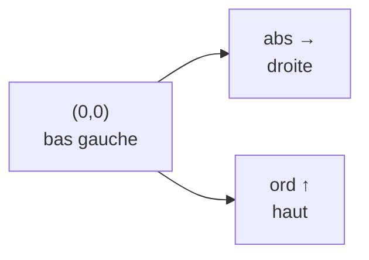

# CM8 — Structs et bibliothèque minGL

[[R1.01 - Index|← Index R1.01]] · Suite : [[CM9 - Chaînes, vecteurs et fichiers]]

> [!abstract] En bref
> Créer ses **propres types** avec `struct` (regrouper des données de types différents), les déclarer, les initialiser « à la volée », les trier avec un **prédicat**. Puis découverte de **minGL 2.0**, la surcouche graphique du cours : fenêtre, pixels, figures primitives et composées, déplacements, animation. Enfin : lectures clavier et conversions `stoi` / `to_string`.

---

## 1. Les `struct`

### 1.1 Objectif

> [!important] Définition
> Une `struct` permet de **créer son propre type** permettant de **regrouper différents types**.

```cpp
struct newName {
  type1 varIdent1;
  type2 varIdent2;
  type3 varIdent3;

}; //newName
```

### 1.2 Exemples du cours

```cpp
struct pos {
  unsigned abs;
  unsigned ord;
}; //pos
```

```cpp
struct RGBcolor
{
  short Red;
  short Green;
  short Blue;
};
```

```cpp
struct perso
{
    string name;
    string biblio;
    short  age;
    unsigned  XP;
    int lifePoint;
};
```

> [!warning] Le `;` final
> « Attention au `;` » : la définition d'une `struct` se termine **obligatoirement** par un point-virgule, juste après l'accolade fermante.

### 1.3 Déclaration d'une variable

```cpp
nameOfTheStruct varIdentOfTheStruct;
```

```cpp
pos aPos;
RGBColor color;
perso bibi;
```

### 1.4 Accès à un élément : notation pointée

```cpp
varIdentOfTheStruct.varIdent
```

```cpp
aPos.abs = 10;
aPos.ord = 10;
```

> [!note] Notation pointée
> On accède à un champ avec le **point** : `variable.champ`. C'est la même notation que pour les méthodes des objets (`window.setPixel(...)`).

### 1.5 Déclaration et initialisation à la volée

```cpp
nameOfTheStruct varIdentOfTheStruct {valueList};
```

```cpp
pos aPos {10, 10};
RGBColor color {0, 0, 0};
perso bibi {"casali", "", 44, 100, -1};
```

> [!warning] Autant de valeurs que de champs
> « Autant d'accolades que de champs à remplir » : les valeurs sont affectées **dans l'ordre de déclaration** des champs.

| Champ de `perso` | Type | Valeur dans l'exemple |
|------------------|------|------------------------|
| `name` | `string` | `"casali"` |
| `biblio` | `string` | `""` |
| `age` | `short` | `44` |
| `XP` | `unsigned` | `100` |
| `lifePoint` | `int` | `-1` |

> [!warning] Incohérence entre les amphis 08 et 09
> L'amphi 09 écrit `perso bibi {"casali", "", 44, -1, 100}` : `-1` tombe alors sur le champ **`unsigned XP`**, ce qui est incohérent (un `unsigned` ne peut pas valoir −1). La version de l'amphi 08 (`44, 100, -1`) respecte les types déclarés. Le fond à retenir : l'ordre des valeurs suit l'ordre des champs.

---

## 2. Trier un vecteur de `struct`

### 2.1 Le problème

```cpp
vector<pos> vPos;
vector<RGBColor> vColor;
vector<perso> vPerso;
```

Comment trier ces tableaux ? La fonction `sort` a besoin d'un **critère** :

```cpp
sort (varIdentOfTheStruct.begin(), varIdentOfTheStruct.end(), criteria);
```

| Argument | Rôle |
|----------|------|
| `begin()` | itérateur vers la **première** case |
| `end()` | itérateur vers la **dernière** case |
| `criteria` | **pointeur de fonction** vers le prédicat servant de critère de tri |

> [!note] Les itérateurs
> « On verra le concept d'itérateur plus tard. » Retenir pour l'instant la forme `v.begin(), v.end()`.

### 2.2 Prédicat de tri

```cpp
bool orderByX (const pos & p1, const pos & p2)
{
    return p1.abs <= p2.abs;
}

sort (vPos.begin(), vPos.end(), orderByX);
```

> [!important] Contraintes du prédicat
> - paramètres **`const` et par référence obligatoires** : `const pos &` ;
> - on passe **le nom de la fonction sans parenthèses** : `orderByX`, pas `orderByX()` ;
> - « L'égalité est possible » : le support utilise `<=` et non `<`.

### 2.3 Changer de critère

```cpp
bool orderByX (const pos & p1, const pos & p2)
{
    return p1.abs <= p2.abs;
}

bool orderByY (const pos & p1, const pos & p2)
{
    return p1.ord <= p2.ord;
}

sort (vPos.begin(), vPos.end(), orderByY);
```

« Seul le critère de tri change » ; les paramètres restent les mêmes.

### 2.4 Multi-critères

```cpp
bool orderByName (const perso & p1, const perso & p2)
{
    return p1.name <= p2.name;
}
sort (vPerso.begin(), vPerso.end(), orderByName);

bool orderByAge (const perso & p1, const perso & p2)
{
    return p1.age <= p2.age;
}
sort (vPerso.begin(), vPerso.end(), orderByAge);

bool orderByAge (const perso & p1, const perso & p2)
{
    return p1.name <= p2.name && p1.age <= p2.age;
}
sort (vPerso.begin(), vPerso.end(), orderByAge);
```

> [!warning] Le « nom puis âge » du support n'est pas un tri lexicographique
> `p1.name <= p2.name && p1.age <= p2.age` n'exprime **pas** « trier par nom, puis par âge en cas d'égalité ». Cette condition est fausse dès que l'un des deux champs est plus grand, et elle n'est pas transitive : elle peut rendre `sort` incohérent (voire le faire planter).
>
> Un vrai tri « nom puis âge » s'écrit avec un **ou** :
>
> ```cpp
> if (p1.name != p2.name) return p1.name < p2.name;
> return p1.age < p2.age;
> ```
>
> Le support conclut simplement « On enchaîne les conditions de tri » ; retenir l'intention, mais se méfier du `&&`.

> [!note] `<=` et `std::sort`
> Le support autorise `<=` (« L'égalité est possible »). La norme C++ attend en réalité un **ordre strict** (`<`). En pratique avec `sort`, utiliser `<` est plus sûr ; on garde ici la formulation du cours.

---

## 3. `struct` vs POO

> [!important] Définition du support
> « Une `struct` est une classe pour laquelle **tout** (donnée membre / fonction) est **public**. »

- On **peut** déclarer des fonctions dans une `struct` ;
- mais « **à ne pas faire si vous ne maîtrisez pas** ».

Autrement dit, la `struct` est la version « ouverte » de la classe : pas d'encapsulation, pas de `private`.

---

## 4. minGL 2.0

### 4.1 C'est quoi ? Pourquoi ?

| Point | Détail |
|-------|--------|
| Nature | surcouche de **freeGLUT** (elle-même surcouche d'**OpenGL**), sous Linux |
| Sorties | gestion **simplifiée** : affichage de types primitifs et composés |
| Entrées / sorties | gestion des entrées / sorties |
| Pointeurs | **pas de gestion des pointeurs** |

### 4.2 Réalisations attendues

| Sans animation | Avec animation |
|----------------|----------------|
| Spirale de ULAM | Tri des vecteurs |
| | Tours de Hanoi |
| | SAE 1.02 : *space invaders* |

### 4.3 Prérequis

- **Mathématiques** : savoir se positionner dans un **repère orthonormé d'entiers naturels**.
- **Informatique (Linux)** :

```bash
sudo apt-get install freeglut3-dev
# https://github.com/alain13100/MinGL2_IUT_AIX.git
```

> [!note] Le repère
> L'élément en position **`(0, 0)`** se trouve en **bas à gauche** de la fenêtre. Les `abs` (abscisses) croissent vers la droite, les `ord` (ordonnées) vers le haut.



### 4.4 Création de la fenêtre

```cpp
minGL (const unsigned & width  = 640,
       const unsigned & height = 480,
       const string   & name   = string());

minGL window (400, 200, "une fenetre");
```

| Paramètre | Défaut |
|-----------|--------|
| `width` | 640 |
| `height` | 480 |
| `name` | chaîne vide |

> [!warning] Ne pas redimensionner la fenêtre
> Le support insiste : « Ne pas redimensionner la fenêtre ».

### 4.5 Initialisation des composants graphiques

Il faut appeler **successivement** :

```cpp
window.initGlut();
window.initGraphic();
```

### 4.6 Affichage

```cpp
window.updateGraphic();
```

> [!important] Équivalent du `endl`
> `updateGraphic()` est l'équivalent du `<< endl` dans le terminal : c'est lui qui **rend visible** ce qui a été préparé.

### 4.7 Taille de la fenêtre

```cpp
cout << window.getwindowWidth() << '\t'
     << window.getwindowHeight();
```

- longueur : `getwindowWidth()` ;
- largeur : `getwindowHeight()`.

> [!note] Casse des noms
> Le support écrit `getwindowWidth` / `getwindowHeight` (w minuscule). En cas d'erreur de compilation, vérifier la casse exacte dans les sources de la bibliothèque (les conventions C++ utilisent souvent `getWindowWidth`).

### 4.8 Envoi de pixels

On pourrait définir un pixel ainsi :

```cpp
struct pixel {
    pos aPos;
    RGBcolor color;
};
```

```cpp
window.setPixel (pos (10, 10), RGBcolor (0, 0, 0));
```

`setPixel` prend **2 paramètres** :

1. une **position** (`pos`) ;
2. une **couleur** (`RGBcolor`).

> [!warning] Origine du repère
> `pos (0, 0)` est le pixel en **bas à gauche**. `pos (10, 10)` est donc à 10 pixels de la gauche et 10 pixels du bas.

### 4.9 Couleurs prédéfinies

| Constante | RGB | Constante | RGB |
|-----------|-----|-----------|-----|
| `KBlack` | 0, 0, 0 | `KWhite` | 255, 255, 255 |
| `KRed` | 255, 0, 0 | `KLime` | 0, 255, 0 |
| `KBlue` | 0, 0, 255 | `KYellow` | 255, 255, 0 |
| `KCyan` | 0, 255, 255 | `KMagenta` | 255, 0, 255 |
| `KSilver` | 192, 192, 192 | `KGray` | 128, 128, 128 |
| `KMaroon` | 128, 0, 0 | `KOlive` | 128, 128, 0 |
| `KGreen` | 0, 128, 0 | `KPurple` | 128, 0, 128 |
| `KTeal` | 0, 128, 128 | `KNavy` | 0, 0, 128 |

### 4.10 Premier programme

```cpp
minGL window (400, 200, "une fenetre");
window.initGlut();
window.initGraphic();

for (unsigned i (0); i < 10; ++i)
    for (unsigned j (0); j < 10; ++j)
        window.setPixel (pos (i, j), KRed);

window.updateGraphic();
window.get_key();
```

| Étape | Effet |
|-------|-------|
| double boucle `i`, `j` | dessine un **carré de 10 pixels de côté** en bas à gauche |
| `updateGraphic()` | affiche le résultat |
| `get_key()` | attend que l'utilisateur appuie sur une touche |

---

## 5. Les figures

### 5.1 Triangle

Pour dessiner un triangle, il faut :

- les coordonnées des **3 points** ;
- la **couleur de la bordure** ;
- la **couleur du fond**.

```cpp
triangle (const pos & pos1, const pos & pos2, const pos & pos3,
          const RGBcolor & borderCol, const RGBcolor & fillCol);

triangle tri (pos (50, 50), pos (100, 50), pos (83, 15),
              KBlack, KBlack);

window << tri;
window.updateGraphic();
```

> [!note] `<<` sur la fenêtre
> On « injecte » une figure dans la fenêtre avec `window << figure`, comme on injecte une valeur dans `cout`.

### 5.2 Cercle

Il faut :

- les coordonnées du **centre** ;
- le **rayon** ;
- la couleur de la **bordure** ;
- la couleur du **fond**.

```cpp
circle (const pos & _pos, const unsigned & rad,
        const RGBcolor & borderCol, const RGBcolor & inCol);

circle cir (pos (50, 50), 50, KBlack, KYellow);

window << cir;
window.updateGraphic();
```

### 5.3 Rectangle (deux surcharges)

**Version 1 — deux points non consécutifs :**

```cpp
rectangle (const pos & pos1, const pos & pos2,
           const RGBcolor & borderCol, const RGBcolor & inCol);

rectangle rec (pos (1, 1), pos (10, 10), KBlue, KRed);
window << rec;
window.updateGraphic();
```

**Version 2 — point bas-gauche + dimensions :**

```cpp
rectangle (const pos & pos, const int & width, const int & height,
           const RGBcolor & borderCol, const RGBcolor & inCol);

rectangle rec (pos (1, 1), 9, 9, KBlue, KRed);
window << rec;
```

| Version | Ce qu'on fournit |
|---------|------------------|
| 1 | 2 points **non consécutifs** (opposés) |
| 2 | point en **bas à gauche**, **longueur** et **largeur** |

### 5.4 Figure composée

```cpp
figure pacMan;
```

Ajout d'une figure primitive avec la méthode `.add()` :

```cpp
pacMan.Add (cir);
pacMan.Add (circle (pos (75, 75), 5, KBlack, KBlack));
pacMan.Add (triangle (pos (50, 50), pos (100, 50), pos (83, 15),
                      KBlack, KBlack));
```

| Appel | Rôle |
|-------|------|
| `pacMan.Add (cir)` | ajoute un cercle déjà nommé |
| `pacMan.Add (circle (...))` | ajoute un cercle créé à la volée — **l'œil** |
| `pacMan.Add (triangle (...))` | ajoute un triangle — **la bouche** |

Injection dans la fenêtre :

```cpp
window << pacMan;
```

> [!warning] `.add()` ou `.Add()` ?
> Le texte du support écrit « la méthode `.add ()` » mais tous les exemples utilisent **`.Add()`** avec une majuscule. Suivre les exemples (`.Add`).

### 5.5 Opérateur `+` : décalage

> [!important] `figure + pos`
> L'opérateur `+` appliqué entre une **figure** et une **position** provoque le **décalage** de la figure d'autant de pixels que les valeurs de la position (considérée comme un **vecteur**).

```cpp
window << PacMan + pos (100, 100);
```

L'opérateur `+` existe aussi **entre deux positions** :

```cpp
pos P1 (a, b), P2 (c, d);
pos P3 = P1 + P2;
// P3.abs = P1.abs + P2.abs;
// P3.ord = P1.ord + P2.ord;
```

**Exemple : histogramme d'un tableau d'entiers naturels**

```cpp
pos aPos (2, 0);
for (const unsigned & val : V)
{
    rectangle unRectangle (aPos, longeurDUnCarre,
                           val * longeurDUnCarre, KRed, KCyan);
    window << unRectangle;
    aPos = aPos + pos (longeurDUnCarre, 0);
}
```

### 5.6 Opérateur `*` : homothétie

> [!important] `figure * réel`
> L'opérateur `*` appliqué entre une **figure** et un **réel** provoque le **grossissement** ou la **réduction** de la figure du **facteur** du réel.

```cpp
window << PacMan * 0.25;
window << pos (100, 100) + PacMan * 0.25;
```

### 5.7 Effacer l'écran / animation

```cpp
window.clearscreen();
```

```cpp
for (unsigned i (0); i < 100; ++i) {
  window.clearscreen();
  window << pos (100 + i, 100) + PacMan * 0.25;
}
```

> [!note] Le principe de l'animation
> À chaque tour : on **efface**, on **redessine** légèrement décalé. La répétition rapide donne l'impression de mouvement.

### 5.8 Le reste

- « À vous d'explorer la bibliothèque (vous avez les sources) » ;
- l'**anti-aliasing** est aussi pris en compte ;
- remerciements à **C. Drift** et **A. Sollier** (étudiant 2018-2020).

---

## 6. Lectures au clavier

### 6.1 Lire un caractère

```cpp
char c;
c = cin.get();
```

### 6.2 Lire un mot

```cpp
string s;
cin >> s;
```

> [!warning] `>>` s'arrête au premier blanc
> `cin >> s` lit **un seul mot** : tout ce qui suit le premier espace, tabulation ou retour à la ligne reste dans le tampon.

### 6.3 Lire plusieurs mots

```cpp
string s;
getline (cin, s);
```

> [!important] `getline` exige une `string`
> Le deuxième paramètre est **obligatoirement de type `string`** ; `getline` lit **toute la ligne**, espaces compris.

| Besoin | Outil |
|--------|-------|
| un caractère | `cin.get()` |
| un mot | `cin >> s` |
| une ligne entière | `getline (cin, s)` |

---

## 7. Conversion C++11

### 7.1 `string` → `int` : `stoi`

```cpp
int stoi (string, unsigned*, int)
```

| Paramètre | Rôle | Défaut |
|-----------|------|--------|
| 1 | la chaîne à convertir | — |
| 2 | un **pointeur** (`nullptr`) | `nullptr` |
| 3 | la **base** de conversion | 10 |

```cpp
string str1 = "10";
string str2 = "3.14159";
string str3 = "10xyz";

cout << stoi (str1) << ' '      // 10
     << stoi (str2) << ' '      // 3
     << stoi (str3);            // 10

cout << stoi ("10", nullptr, 2);   // 2
```

> [!note] Lecture du support
> - `"3.14159"` → `3` : `stoi` s'arrête au `.` ;
> - `"10xyz"` → `10` : `stoi` s'arrête au premier caractère non numérique ;
> - `"10"` en base 2 → `2` (le binaire `10` vaut 2).

### 7.2 La famille `sto…`

| Fonction | Type de retour |
|----------|----------------|
| `stol()` | `long` |
| `stoll()` | `long long` |
| `stoul()` | `unsigned long` |
| `stoull()` | `unsigned long long` |
| `stof()` | `float` |
| `stod()` | `double` |
| `stold()` | `long double` |

### 7.3 Deux erreurs à connaître

> [!warning] La chaîne ne doit pas **commencer** par une erreur
> ```cpp
> string str4 = "xyz10";
> int myint4 = stoi (str4);
> // terminate called after throwing an instance of 'std::invalid_argument'
> //   what():  stoi
> // Abort trap: 6
> ```
> `"10xyz"` fonctionne (10), `"xyz10"` **plante**.

> [!warning] La base doit être compatible avec la chaîne
> ```cpp
> string str5 = "42";
> int myint5 = stoi (str5, nullptr, 2);
> // std::invalid_argument
> ```
> `4` n'est pas un chiffre valide en base 2.

### 7.4 `to_string` : intégral → `string`

```cpp
string to_string (int val);
string to_string (long val);
string to_string (long long val);
string to_string (unsigned val);
string to_string (unsigned long val);
string to_string (unsigned long long val);
string to_string (float val);
string to_string (double val);
string to_string (long double val);
```

```cpp
int x;
cin >> x;
cout << "le chiffre contient "
     << to_string (x).size ()
     << " caractère(s)" << endl;
```

Avec `12345` en entrée :

```text
le chiffre contient 5 caractère(s)
```

> [!tip] Pourquoi passer par `to_string` ?
> Pour compter les **chiffres** d'un entier, on le convertit en `string` puis on appelle `.size()`. Sans conversion, il faudrait une boucle de divisions.

---

## ✅ À retenir

- `struct` = **nouveau type** regroupant des champs de types différents ; **`;` obligatoire** après l'accolade.
- Accès par **notation pointée** : `variable.champ`.
- Initialisation à la volée : `pos p {10, 10};` — valeurs **dans l'ordre des champs**.
- `sort (v.begin(), v.end(), critere)` ; le critère est une **fonction** `bool (const T &, const T &)`, passée **sans parenthèses**.
- Le support utilise `<=` ; un vrai tri multi-critères **ne s'écrit pas** avec `&&` mais avec des comparaisons successives.
- Une `struct` est une classe dont **tout est public** ; on peut y mettre des fonctions, mais « à ne pas faire si vous ne maîtrisez pas ».
- minGL = surcouche de **freeGLUT / OpenGL** ; repère d'entiers, **`(0, 0)` en bas à gauche**.
- Fenêtre : `minGL window (largeur, hauteur, nom)` → `initGlut()` → `initGraphic()` → dessin → `updateGraphic()`.
- `setPixel (pos, RGBcolor)` ; couleurs prédéfinies `KBlack`, `KRed`, `KBlue`…
- Figures : `triangle`, `circle`, `rectangle` (2 surcharges) ; `figure` + `.Add()`.
- `figure + pos` = **décalage** ; `figure * réel` = **homothétie** ; `clearscreen()` pour l'animation.
- Clavier : `cin.get()` (caractère), `cin >> s` (mot), `getline (cin, s)` (ligne).
- `stoi` / `stol`… : chaîne → nombre ; `to_string` : nombre → chaîne.

### Questions d'auto-évaluation

- [ ] Pourquoi un `;` après l'accolade fermante d'une `struct` ?
- [ ] Écrire une `struct` `pos` puis une `struct` `perso` avec cinq champs de types différents.
- [ ] Que fait `perso bibi {"casali", "", 44, 100, -1};` ? Dans quel ordre les valeurs sont-elles affectées ?
- [ ] Pourquoi le prédicat de `sort` doit-il prendre `const T &` ?
- [ ] Pourquoi passe-t-on `orderByX` et non `orderByX()` ?
- [ ] Pourquoi `p1.name <= p2.name && p1.age <= p2.age` ne trie-t-il pas par nom puis âge ?
- [ ] Qu'est-ce qu'une `struct` par rapport à une classe ?
- [ ] Où se trouve le point `(0, 0)` dans une fenêtre minGL ?
- [ ] Quel est l'effet de `updateGraphic()` ? Et de `clearscreen()` ?
- [ ] Donner les deux signatures de `rectangle` et la différence entre elles.
- [ ] Que fait `window << PacMan + pos (100, 100);` ? Et `window << PacMan * 0.25;` ?
- [ ] Différence entre `cin.get()`, `cin >> s` et `getline (cin, s)` ?
- [ ] Que renvoie `stoi ("10xyz")` ? Et `stoi ("xyz10")` ? Pourquoi ?
- [ ] Écrire le code qui affiche le nombre de chiffres d'un entier lu au clavier.
