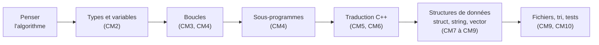

# R1.01 — Initiation au développement

> 🗺️ **Carte des cours :** [[Hub - Carte des cours.canvas|vue d'ensemble du semestre]]

> [!abstract] Le cours en une phrase
> Apprendre à **penser en algorithmes** (pseudo-code), puis à les **traduire en C++** : types, structures de contrôle, sous-programmes, tableaux dynamiques et flux.

## Objectifs pédagogiques

- Apprendre l'**algorithmique** ;
- Apprendre les **bases d'un langage de programmation** (le C++) ;
- **Réduire la dette cognitive vis-à-vis de l'IA**.

> [!warning] Le danger pointé par le prof
> On croit savoir résoudre un problème parce qu'on a vu une vidéo, lu un tuto ou posé la question à une IA — alors qu'on est **incapable de reproduire** ce qu'on a vu. Une personne physique (ou un algorithme virtuel) a résolu *votre* problème, pas vous.

## Division de la ressource

| Partie | Contenu |
|--------|---------|
| **Algorithmique** | Amphis 1 à 4 |
| **Programmation** | Amphis 5 à 10 (C++) |
| **SAE** | 2 SAEs |

## Modalités d'évaluation *(notation temporaire)*

- Poids : **~20 % de la note du S1**.
- Dans la ressource :
  - **Contrôle continu — coef 1** : minitests + feuille d'amphi ;
  - **Test #1 — coef 1** : partie **algo** ;
  - **Test #2 — coef 1** : partie **code** (+ bonus Ecosia 1 pt).
- Note finale **au choix** :
  - `CC × moyenne(test1, test2)`
  - `moyenne(CC, test1, test2)`

### Minitests et feuille d'amphi

- Minitests : à trouver sur le site du prof (rubrique *R1.01 – Mini Tests*).
- Un minitest = date fixée + **cheat code**.
- Feuille d'amphi : **5 questions + 5 réponses** à préparer sur l'amphi précédent ; c'est **un autre étudiant** qui répond (bonus 0,1 pt / bonne réponse) ; absence d'un étudiant nommé = **−0,1** sur la moyenne.

## Plan du cours

| # | Partie | Notes |
|---|--------|-------|
| 1 | C'est quoi un algo ? / schémas de base | [[CM1 - Introduction à l'algorithmique]] |
| 2 | Expressions logiques, variables, types primitifs | [[CM2 - Expressions logiques et types primitifs]] |
| 3 | String, boucles `boucle` / `tant_que` / `jusqua` | [[CM3 - Chaînes, algorithmes et boucles]] |
| 4 | Boucle `pour`, portée, sous-programmes | [[CM4 - Boucle pour, portée et sous-programmes]] |
| 5 | Passage du pseudo-code au C++ | [[CM5 - Du pseudo-code au C++]] |
| 6 | `char`, `string`, `while`, `for`, `switch`, `vector` | [[CM6 - Caractères, chaînes, boucles et vector]] |
| 7 | Transtypage, opérateurs, ternaire | [[CM7 - Caractères, transtypage et opérateurs]] |
| 8 | `struct` et bibliothèque graphique minGL | [[CM8 - Structs et bibliothèque minGL]] |
| 9 | `string`, `vector` et fichiers | [[CM9 - Chaînes, vecteurs et fichiers]] |
| 10 | Flux, tri de tableau et tests | [[CM10 - Flux, tri et tests]] |

## Progression logique du cours

## Informations pratiques

| Sujet | Info |
|-------|------|
| Enseignant (amphi) | A. Casali — <alain.casali@univ-amu.fr> — <https://casali.site/> |
| TD / TP | A. Casali, K. Betari (MCF) et des professionnels |
| Planning | <https://casali.site/category/r1-01-init-dev/r1-01-planning/> |
| Discord Informaix | <https://discord.gg/chqTEBhzsC> |
| Discord du Dept | <https://discord.gg/YfVCKP6yf3> — **se nommer** (mêmes règles de nommage que le Discord du prof) |
| Tuteurat | Le soir 17 h 45 → 18 h 45, par des 2A / 3A (si besoin) |
| VDI | `m-vdi-etu-ha.univ-amu.fr` (travailler depuis chez soi) |

## Sources

- Amphi 01 (2026-2027) — `26.27.R101-amphi01.pptx`
- Amphi 02 à 04 (2024-2025) — `24.25.R101-amphi02/03/04.pptx`
- Amphi 05 et 06 — PDF en ligne sur <https://casali.site/category/r1-01-init-dev/r1-01-amphis/> (`R101-amphi05-1.pdf`, `24.25.R101-amphi06.pdf`)
- Amphi 07 à 10 — `R101-amphi07/08/09/010.pptx`
- Auteur : Alain Casali (Aix-Marseille Université)
- Compléments TD : `TD/Algo` (Analyseur + g++), `TD/Cpp/Lien TP.txt` → <https://casali.site/category/r1-01-init-dev/r1-01-programmation/>

## Voir aussi
