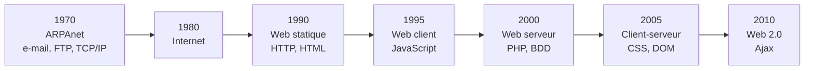
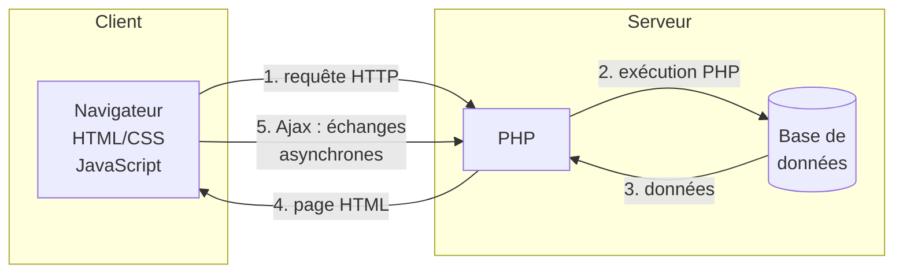

# CM1-1 — Web

[[R1.02 - Index|← Index R1.02]] · Suite : [[CM1-2 - HTML]]

> [!abstract] En bref
> Internet et le Web ne sont pas la même chose. Le Web est une application d'Internet née en 1990, qui n'a cessé d'évoluer : statique, orienté client, orienté serveur, compromis client-serveur, puis Web 2.0. Une page Web sépare le **fond** (HTML) de la **forme** (CSS), le tout encadré par les normes du W3C.

---

## 1. Métiers associés

| Métier | Rôle |
|--------|------|
| Développeur **front end** | partie visible, côté navigateur |
| Développeur **back end** | partie serveur |
| Administrateur de sites Web | exploitation, maintenance |
| Intégrateur | assemblage HTML/CSS des pages |
| Référenceur | SEO |
| Etc. | |

## 2. Où trouve-t-on du Web ?

- Sites Web
- Applications mobiles
- Applications lourdes
- Systèmes d'exploitation (gestionnaires de fenêtres)
- E-books
- JavaFX (création d'interfaces graphiques)

## 3. Planter le décor : l'analogie théâtrale

| Théâtre | Web |
|---------|-----|
| Pièce de théâtre | Site Web consulté |
| Actes | Pages Web |
| Livret | Code source des pages Web |
| Producteur | Web |
| Scène | Écran de l'ordinateur |
| Metteur en scène | Navigateur |
| Public | Internautes |
| Auteur | Webmaster |

> [!important] Idée du prof
> Comme au théâtre, le résultat final diffère selon le **metteur en scène**. L'auteur doit veiller à ce que le metteur en scène respecte le livret et ne dénature pas l'œuvre !

## 4. Historique

| Année | Étape | Apports |
|-------|-------|---------|
| 1970 | Premiers pas | ARPAnet, courrier électronique (1972, Ray Tomlinson), FTP, TCP/IP |
| 1980 | Internet | ARPAnet devient *Inter Networking* (Internet) |
| 1990 | Web **statique** (Tim Berners-Lee) | HTTP, HTML/XHTML |
| 1995 | Web orienté **client** | JavaScript |
| 2000 | Web orienté **serveur** | PHP, bases de données |
| 2005 | Compromis **client-serveur** | CSS, DOM |
| 2010 | Tendances **Web 2.0** | Ajax (asynchronous JavaScript and XML) |

### Évolution des échanges

> [!note] Internet ≠ Web
> Internet **contient** le Web, mais aussi les e-mails, les messageries instantanées, etc. Le Web n'est qu'un service parmi d'autres.

### Premières pages Web

- Première page Web : `http://www.w3.org/History/19921103-hypertext/hypertext/WWW/TheProject.html`
- Exemple de site Web des années 1990 : `http://themostamazingwebsiteontheinternet.com`
- Les Horribles Cernettes : premier groupe du Web
- **WorldWideWeb** : premier navigateur

## 5. Concevoir un site Web

1. Définition de l'objectif et du contenu
2. Mise en place d'un plan de site Web ergonomique
3. Production des pages Web
4. Application / respect de la charte graphique
5. Installation sur un serveur (souvent distant)
6. Maintenance / mise à jour

## 6. Qu'est-ce qu'une page Web ?

| Technologie | Rôle |
|-------------|------|
| **HTML** | Fond — contenu (textes, liens, images, etc.) |
| **CSS** | Forme — apparence (agencement, décoration, couleurs, etc.) |

> [!important] Séparation fond / forme
> Le HTML décrit le **contenu** ; le CSS décrit la **présentation**. Cette séparation est la clé d'un site maintenable, accessible et rapide.

## 7. Norme et compatibilité

**World Wide Web Consortium (W3C)** : organisme de normalisation qui donne les standards pour une meilleure :

- interopérabilité
- accessibilité
- portabilité
- pérennité des documents
- réduction des coûts

Il fournit aussi des **validateurs HTML, CSS**, un **vérificateur de liens**, et des informations de **compatibilité des navigateurs**.

> [!warning] Aucun navigateur ne respecte totalement la norme W3C !

## 8. Navigateurs et moteurs de rendu

| Moteur de rendu | Navigateur(s) |
|-----------------|---------------|
| **Gecko** | Mozilla Firefox |
| **Presto** | Opera (7 – 15) |
| **WebKit** | Chrome (1 – 27), Safari |
| **Blink** | Chrome (28+), Opera (15+), Edge (8+) |
| **Trident** | Internet Explorer (4+) |
| **Edge** | Edge (1+) |

> [!note] Le moteur de rendu est le cœur du navigateur.
> Compatibilité des navigateurs à vérifier sur <https://caniuse.com>.

Navigateurs : Chrome, Mozilla Firefox, Safari, Opera, Internet Explorer, Microsoft Edge.

## 9. Éditeurs de code

| Plateforme | Éditeurs |
|------------|----------|
| Multiplateformes | Visual Studio Code / VSCodium, Vi (Vim), Sublime Text, Atom, Emacs |
| Linux | Geany |
| Windows | Notepad++, Adobe Dreamweaver (WYSIWYG) |
| Mac | CoffeeCup HTML Editor, TextMate |

## 10. Boîte à outils Web

| Outil | Adresse |
|-------|---------|
| Validateur XHTML | <https://validator.w3.org> |
| Validateur CSS | <https://jigsaw.w3.org/css-validator> |
| Vérificateur de liens | <https://validator.w3.org/checklink> |
| École en ligne | <https://www.w3schools.com> |
| Compatibilité navigateurs | <https://www.caniuse.com> |
| Autoprefixer CSS | <https://autoprefixer.github.io> |
| Minifier CSS | <https://www.toptal.com/developers/cssminifier> |
| Optimiseur d'images | <https://squoosh.app> |
| Compresseur d'images | <https://compressor.io> |
| DevTools | outils intégrés au navigateur |
| Google Lighthouse | audit de performance / accessibilité / SEO |

## 11. Liens

- HTML : <http://www.w3.org>, <http://giminik.developpez.com/xhtml/>
- Sébastien Mavromatis, *Langages de l'Internet*
- Antoine Cellerier, *Formation HTML/CSS*

---

## ✅ À retenir

- **Internet ≠ Web** : le Web est un service d'Internet.
- Le Web naît en **1990** (Tim Berners-Lee) avec HTTP et HTML.
- **HTML = fond/contenu**, **CSS = forme/apparence**.
- Le **W3C** normalise ; aucun navigateur n'applique parfaitement la norme.
- Chaque navigateur repose sur un **moteur de rendu** (Gecko, Blink, WebKit…).
- Concevoir un site : objectif → plan ergonomique → pages → charte → serveur → maintenance.

### Questions d'auto-évaluation

- [ ] Quelle est la différence entre Internet et le Web ?
- [ ] Citer les grandes étapes de l'historique du Web et leur apport.
- [ ] À quoi servent respectivement HTML et CSS ?
- [ ] Quels sont les rôles du W3C ?
- [ ] Associer chaque navigateur à son moteur de rendu.
- [ ] Citer les étapes de conception d'un site Web.
