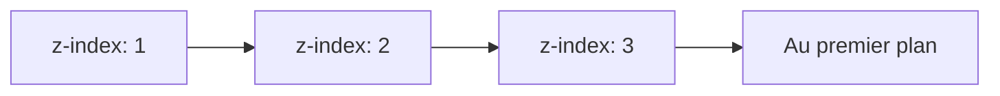

# CM2 — CSS

[[CM1-2 - HTML|← CM1-2 HTML]] · [[R1.02 - Index|Index]] · Suite : [[CM3 - Accessibilité, SEO, écoconception et outils Web]]

> [!abstract] En bref
> CSS (*Cascading Style Sheets*) sépare la **forme** du **fond** HTML. Il repose sur des **sélecteurs** et des **propriétés/valeurs**, avec des règles de priorité (cascade, spécificité, héritage), des modèles de positionnement (Flexbox, `position`), des unités, et des techniques de **responsive design**.

---

## 1. Pourquoi CSS ?

| Sans CSS | Avec CSS |
|----------|----------|
| Une page HTML brute, linéaire | Une page mise en forme, structurée visuellement |

La slide de démonstration présente la même page **sans CSS** puis **avec CSS** : le contenu est identique, seule la présentation change. Démonstration en ligne : <https://www.csszengarden.com> (même HTML, feuilles de style radicalement différentes).

## 2. Principes

- Extension de fichier : `.css`
- **Séparer le contenu (HTML) et la mise en forme (CSS)**
- Méthode recommandée d'utilisation :

```html
<head>
    <link rel="stylesheet" href="css/monfichier.css" media="all">
    <link rel="stylesheet" href="css/monautrefichier.css" media="(max-width:600px)">
</head>
```

- Possibilité d'utiliser **plusieurs feuilles de style à la fois**
- **CSS3** : dernière révision de CSS

### Avantages

- Gestion séparée de la structure et de la présentation
- Réduction en taille et en complexité du code HTML
- Chargement de page plus rapide
- Moins de bande passante utilisée
- Portabilité du contenu facilitée
- Impression facilitée
- Référencement facilité

## 3. Commentaires

Non interprétés par le navigateur, visibles dans le code source.

```css
/* Un commentaire CSS */

/*
    Un autre commentaire CSS
    sur plusieurs lignes
*/
```

## 4. Syntaxe

```css
sélecteur {
    propriété: valeur;
}
```

| Élément | Rôle |
|---------|------|
| `sélecteur` | lien avec HTML |
| `propriété` | propriété CSS |
| `valeur` | valeur de la propriété |
| `:` | sépare propriété et valeur |
| `;` | termine la déclaration |

## 5. Sélecteurs

| Type | Exemple | Effet |
|------|---------|-------|
| **Simple** | `h1 { color: black; }` | nom d'une balise |
| **Multiple** | `h1, h2, h3, h4, h5, h6 { color: red; }` | plusieurs balises séparées par `,` |
| **Contextuel** | `h1 em { color: blue; }` | `em` à l'intérieur d'un `h1` |
| **Pseudo-classe** | `a:visited { color: red; }` | ajoute un contexte au sélecteur |

### Sélecteurs CSS3

```css
/* Position des fils */
table tr:nth-child(odd)      { background-color: #C8D8EA; }
table tr:nth-child(2n + 1)   { background-color: #C8D8EA; }
table tr:nth-of-type(2n + 1) { background-color: #C8D8EA; }

/* Valeur d'un attribut : liens dont href commence par http:// */
a[href^="http://"] { color: red; }

/* Exclusion : liens qui ne sont pas de classe .notme */
a:not(.notme) { color: green; }
```

> [!note] `odd` = impairs, `even` = pairs.

### Classe et identifiant

| HTML | CSS |
|------|-----|
| `<div class="person">` | `.person { font-weight: bold; }` |
| `<div id="monster">` | `#monster { font-weight: bold; }` |

> [!important] Classe vs ID
> Les sélecteurs de classe et d'identifiant se comportent **exactement de la même manière**, à ceci près qu'un **identifiant ne peut être utilisé qu'une seule fois** dans une page HTML.

## 6. Ordre de gestion des conflits

Un même élément peut recevoir différentes mises en forme par différentes règles ; plusieurs feuilles de style peuvent s'appliquer simultanément.

1. Si `!important` est précisé après la valeur :

```css
h1 {
    color: blue !important;
}
```

2. Sinon, dans l'ordre de **spécificité** des règles (poids des sélecteurs).
3. Sinon, la **dernière règle** (dans les fichiers CSS).

> [!important] Héritage
> Chaque élément « enfant » reçoit en héritage toutes les propriétés de son élément « parent » — **seulement pour les propriétés qui s'héritent** (presque toutes !).

## 7. Flexbox (positionnement)

```css
.container {
    display: flex;
    flex-direction: column;
}
```

| Propriété | Valeurs |
|-----------|---------|
| `flex-direction` (distribution) | `row`, `row-reverse`, `column`, `column-reverse` |
| Passage à la ligne (`flex-wrap`) | `nowrap`, `wrap`, `wrap-reverse` |
| `justify-content` (axe principal) | `flex-start`, `flex-end`, `center`, `space-between`, `space-around` |
| `align-items` (axe secondaire) | `flex-start`, `flex-end`, `center`, `baseline`, `stretch` |
| Ordonnancement | `order` |
| Fluidité | `flex-grow`, `flex-shrink`, `flex-basis` |

> [!note] Origine du conteneur : en haut à gauche (de l'écran ou de la balise block englobante).

## 8. Autre positionnement

| Propriété | Valeurs / rôle |
|-----------|----------------|
| `position` | `absolute` (par rapport au conteneur), `fixed` (suit le défilement d'écran), `relative` (par rapport à sa position), `static` (ordre normal, par défaut) |
| `visibility` | `hidden`, `visible` |
| `z-index` | profondeur (empilement) |
| `display` | `none`, `block`, `inline`, `list-item` |



## 9. Variables CSS

```css
/* Déclaration */
element {
    --main-bg-color: brown;
}

/* Utilisation */
element {
    background-color: var(--main-bg-color);
}
```

> [!tip] Intérêts : **factorisation du code** (maintenabilité) et **informations sémantiques**.

## 10. Unités de mesure

| Type | Unités |
|------|--------|
| **Relatives** | `em`, `rem` (*root em*), `vw` (*viewport width*), `vh` (*viewport height*), `small`, `medium`, `large`, etc. |
| **Absolues** | `px` (relatif à l'écran), `mm`, `cm`, etc. |
| **Pourcentage** | `%` |

> [!warning] Pièges
> Nombres décimaux : `.` à la place de `,`. On n'utilise **pas d'unité** si la valeur est `0`.

## 11. Dimensions

| Propriété | Rôle |
|-----------|------|
| `width` | largeur |
| `min-width` / `max-width` | largeur minimum / maximum |
| `height` | hauteur |
| `min-height` / `max-height` | hauteur minimum / maximum |
| `overflow` | débordement : `visible`, `hidden`, `scroll`, `auto` |
| `overflow-x` | seulement la barre de défilement horizontale |
| `overflow-y` | seulement la barre de défilement verticale |

## 12. Marges

| Propriété | Rôle |
|-----------|------|
| `margin` | marge **extérieure** : `margin-top`, `margin-right`, `margin-bottom`, `margin-left` |
| `padding` | marge **intérieure** : `padding-top`, `padding-right`, `padding-bottom`, `padding-left` |

> [!tip] Centrer horizontalement une balise block : `margin: auto;` et indiquer une largeur (quelconque).

## 13. Bordures

| Propriété | Valeurs |
|-----------|---------|
| `border-color` | couleur |
| `border-width` | taille |
| `border-style` | `none`, `dotted`, `dashed`, `solid`, `double`, `groove`, `ridge`, `inset`, `outset` |
| `border-top`, `border-bottom`, `border-left`, `border-right` | bordure partielle |
| `border-radius` | bordures arrondies |

```css
.comment {
    background: white;
    border: 1px solid black;
    -moz-border-radius: 10px;    /* Mozilla (Firefox) */
    -webkit-border-radius: 10px; /* Chrome, Safari, iPhone, Android, etc. */
    border-radius: 10px;         /* Internet Explorer 9, Opera */
}
```

## 14. Propriétés textuelles

### Police et texte

| Propriété | Valeurs / rôle |
|-----------|----------------|
| `font-size` | taille |
| `font-style` | `italic`, `oblique`, `normal` |
| `text-transform` | `capitalize`, `uppercase`, `lowercase` |
| `font-weight` | `normal`, `bold` |
| `text-decoration` | `underline`, `overline`, `line-through` |
| `column-count` | nombre de colonnes textuelles (`p { column-count: 2; }`) |
| `color` | couleur |
| `text-align` | `left`, `center`, `right`, `justify` |
| `vertical-align` | `super`, `baseline` |
| `text-indent` | indentation |
| `list-style-image` | image d'item de liste |
| `list-style-position` | position de l'item |
| `list-style-type` | `none`, `disc`, `circle`, `square`, `decimal`, `upper-alpha`, `lower-alpha`, `upper-roman`, `lower-roman` |

### Familles de police

| Famille générique | Exemple |
|-------------------|---------|
| **Empattement** (`serif`) | `font-family: "Times New Roman", Times, "Liberation Serif", FreeSerif, serif;` |
| **Sans empattement** (`sans-serif`) | `font-family: Arial, Helvetica, "Liberation Sans", FreeSans, sans-serif;` |
| **Chasse fixe** (`monospace`) | `font-family: "Courier New", Courier, "Liberation Mono", monospace;` |
| Autres | `cursive`, `fantasy` |

```css
font-family: Arial, Helvetica, sans-serif;
```

> [!important] Bonnes pratiques
> Toujours déclarer une **famille générique** à la fin. Une police comportant des espaces doit être mise entre `""`. Les polices sont utilisées **dans l'ordre** en fonction de leur disponibilité.

> [!note] Fonte vs police
> Une **fonte** est la représentation d'un alphabet avec un corps, une graisse, etc. Une **police** est l'ensemble des fontes d'une famille. Ce sont les polices de l'**OS de l'utilisateur** (pas celles de l'auteur du site) qui sont utilisées, sauf `font-face`.

## 15. Couleurs

| Forme | Exemple |
|-------|---------|
| Littérale | `black`, `blue`, `gray`, `green`, `purple`, `red`, `white`, etc. |
| RGB | `rgb(15, 111, 198);` (de 0 à 255) |
| Hexadécimale | `#0F6FC6` |
| Dégradé | `linear-gradient`, `radial-gradient` |

Outils : <https://paletton.com/>, <https://www.realtimecolors.com/>

## 16. Fonds

| Propriété | Rôle / valeurs |
|-----------|----------------|
| `background-color` | couleur de fond |
| `background-image` | `url("snow.png")` |
| `background-attachment` | `fixed`, `scroll` |
| `background-repeat` | `no-repeat`, `repeat-x`, `repeat-y`, `repeat` |
| `background-position` | `top`, `bottom`, `left`, `center`, `right` |
| `background-size` | taille |
| `background-clip` | fond présent même sous les bordures |
| `background-origin` | point d'origine à partir du padding |

```css
background: url("soleil.png") fixed no-repeat top right, url("neige.png") fixed;
```

## 17. Liens et tableaux

| Sélecteur | État du lien |
|-----------|--------------|
| `a:link` | lien « au repos » |
| `a:hover` | au survol |
| `a:active` | au (moment du) clic |
| `a:focus` | lien sélectionné |
| `a:visited` | lien déjà visité |

| Propriété tableau | Valeurs |
|-------------------|---------|
| `border-collapse` | `collapse`, `separate` |
| `border-spacing` | espacement entre les bordures |
| `empty-cells` | `show`, `hide` |
| `vertical-align` | `top`, `middle`, `bottom` |

## 18. Propriétés graphiques

```css
div {
    background-color: rgba(255, 0, 0, 0.5); /* composante alpha */
}
```

| Propriété | Rôle |
|-----------|------|
| `box-shadow` | ombre de bloc |
| `text-shadow` | ombre de texte |
| `opacity` | transparence |
| `transform` | déplacement, déformation, rotation, transformation 3D |
| `transition` | transition animée |

## 19. Préfixes propriétaires

| Navigateur / moteur | Préfixe |
|---------------------|---------|
| Mozilla (Firefox) | `-moz-` |
| Chrome, Safari, iPhone, Android, etc. | `-webkit-` |
| Opera | `-o-` |
| Internet Explorer | `-ms-` |
| Konqueror | `-khtml-` |

> [!warning] Certaines propriétés n'existent pas avec préfixes propriétaires ! Un propriétaire est libre de ne pas suivre la norme (propriétés inexistantes).

## 20. Site Web adaptatif (responsive)

**Site Web adaptatif** : technique de réalisation de site Web permettant de faire des sites s'adaptant automatiquement à l'écran. En anglais : *responsive web design* (RWD).

Techniques :

- **Media queries**

```css
body {
    background-color: green;
}

@media screen and (max-width: 600px) {
    /* Style pour les écrans de largeur < 600px */
    body {
        background-color: red;
    }
}
```

- Grille fluide (`em`)
- Redimensionnement d'image (idem)
- Déclinaison : e-mails, etc.

> [!tip] Pensez d'abord **mobile first**.

## 21. Formats d'image pour le Web

| Format | Type | Usage / particularité |
|--------|------|-----------------------|
| **JPEG** | matriciel | photographies |
| **PNG 8 bits** | matriciel | image pauvre en couleurs (< 256) |
| **PNG 24 bits** | matriciel | transparence progressive ; en général plus volumineux que JPEG |
| **WebP** | matriciel | ≃ 65 % plus léger que JPEG ; > 96 % compatible |
| **GIF animé** | matriciel | image animée, pauvre en couleurs (< 256) ; à éviter (plus lourd/lent que les formats vidéo modernes) |
| **SVG** | vectoriel | souvent bien plus léger que les formats matriciels |

> [!note] PNG entrelacé : affichage progressif de l'image lors du chargement. Tous les formats, même vectoriels, peuvent être compressés.

## 22. Liens

- <http://www.w3.org>, <http://html5-css3.fr>, <http://fr.html.net/tutorials/css>, <http://css.mammouthland.net>, <http://www.cssdebutant.com>, <http://www.colorschemer.com/online.html>, <http://pourpre.com>
- Sébastien Mavromatis, *Langages de l'Internet*
- Antoine Cellerier, *Formation HTML/CSS*
- Jonathan Verrecchia, *Introduction au CSS3*
- Mathieu Nebra, *Apprenez à créer votre site web avec HTML5/CSS3* ; *Réalisez votre site web avec HTML5 et CSS3*

---

## ✅ À retenir

- CSS = **forme**, HTML = **fond** ; plusieurs feuilles peuvent coexister.
- Syntaxe : `sélecteur { propriété: valeur; }`.
- Sélecteurs : simple, multiple, contextuel, pseudo-classe, classe (`.`), ID (`#`).
- Conflits : `!important` > spécificité > dernière règle ; ne pas oublier l'**héritage**.
- **Flexbox** pour la distribution et l'alignement ; `position` pour le positionnement fin.
- Unités relatives (`em`, `rem`, `vw`, `vh`, `%`) à privilégier pour le responsive.
- `margin` = extérieur, `padding` = intérieur.
- **Mobile first** + media queries = site adaptatif.
- Les préfixes propriétaires ne sont pas éternels ; toujours mettre la propriété standard en dernier.

### Questions d'auto-évaluation

- [ ] Pourquoi séparer HTML et CSS ?
- [ ] Écrire la syntaxe d'une règle CSS et nommer ses éléments.
- [ ] Différencier sélecteur de classe et sélecteur d'identifiant.
- [ ] Expliquer l'ordre de gestion des conflits et l'héritage.
- [ ] Citer les propriétés principales de Flexbox.
- [ ] Différencier `margin` et `padding`.
- [ ] Citer les unités relatives et absolues.
- [ ] Écrire une media query `max-width: 600px`.
- [ ] Choisir un format d'image adapté (photo, logo, animation, transparence).
