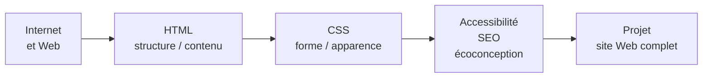

# R1.02 — Développement d'interfaces Web

> 🗺️ **Carte des cours :** [[Hub - Carte des cours.canvas|vue d'ensemble du semestre]]

> [!abstract] Le cours en une phrase
> Concevoir des pages Web : comprendre Internet et le Web, structurer le contenu en **HTML**, le mettre en forme en **CSS**, puis le rendre **accessible**, **référencé** et **sobre**.

## Objectifs pédagogiques

- Avoir de bonnes notions de **HTML**
- Avoir de bonnes notions de **CSS**

**Prérequis :** utiliser l'outil informatique de manière régulière ; utiliser Internet de manière régulière.

## Modalités d'évaluation

- Questionnaires d'évaluation
- **Projet**

## Plan du cours

| # | Partie | Notes |
|---|--------|-------|
| I | Présentation du cours | cette note |
| II | Web | [[CM1-1 - Web]] |
| III | HTML | [[CM1-2 - HTML]] |
| IV | CSS | [[CM2 - CSS]] |
| V | Accessibilité, SEO, écoconception et outils Web | [[CM3 - Accessibilité, SEO, écoconception et outils Web]] |

## Progression logique du cours

> [!tip] Fil conducteur
> 1. Comprendre **où** l'on travaille (Web, navigateurs, normes).
> 2. Écrire le **contenu** en HTML avec une structure sémantique.
> 3. Mettre en **forme** en CSS (et adapter aux écrans).
> 4. Soigner l'**accessibilité**, le **référencement** et le **poids** de la page.

## Sources

- CM0 : Présentation du cours (V1.3.1)
- CM1-1 : Web (V1.1.0)
- CM1-2 : HTML (V2.1.1)
- CM2 : CSS (V2.4.0)
- CM3 : Accessibilité, SEO, écoconception et outils Web (V2.2.0)
- Auteur : Mickaël Martin Nevot — cours en ligne : [mickael-martin-nevot.com](http://www.mickael-martin-nevot.com)
- Licence : CC BY-NC-SA

## Voir aussi
