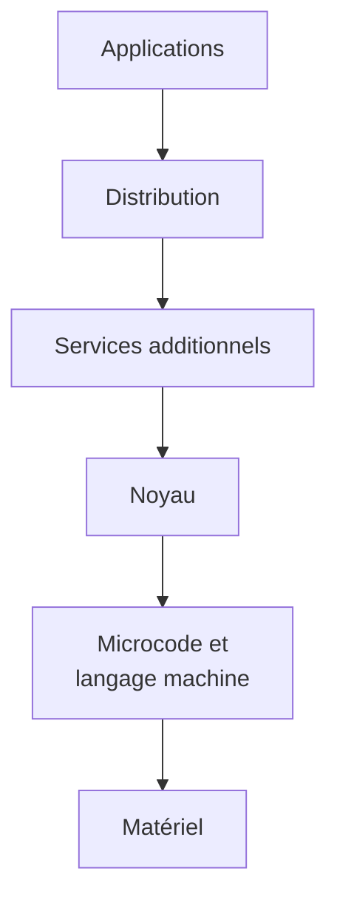
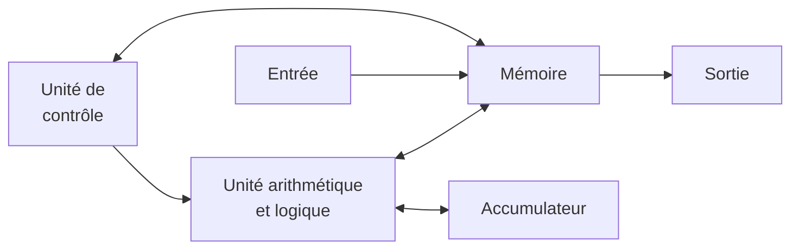
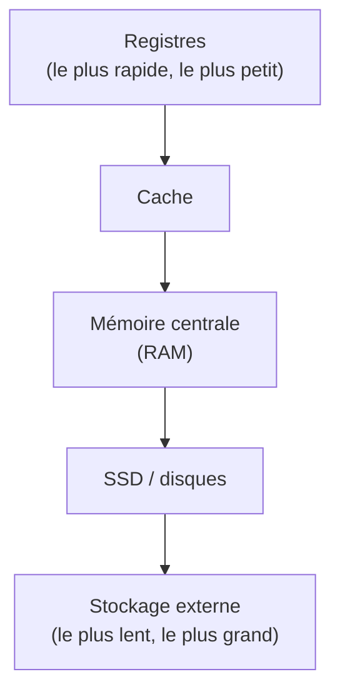
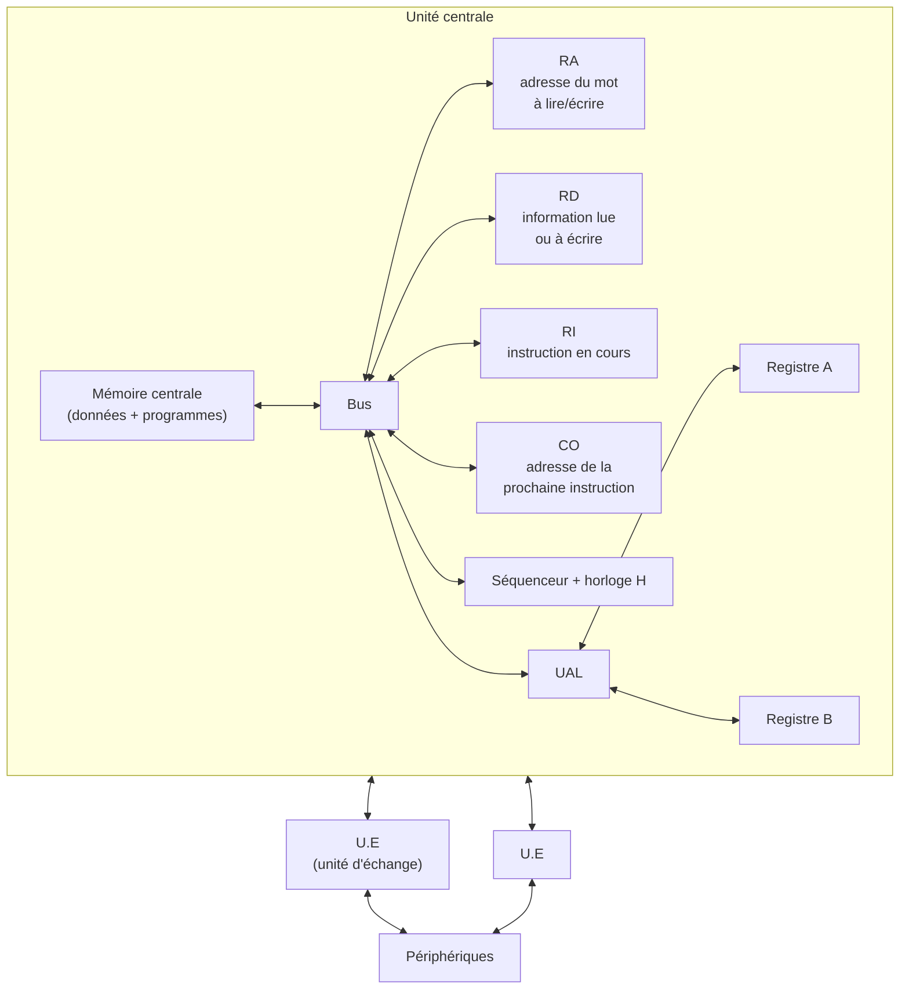

# CM1-1 — Architecture d'un système informatique

[[R1.03 - Index|← Index R1.03]] · Suite : [[CM1-2 - Réseaux]]

> [!abstract] En bref
> Un ordinateur se comprend par **couches** : applications, système/réseau, matériel. Le modèle de **von Neumann** relie mémoire, unité de contrôle, UAL, entrées/sorties. Le processeur exécute des instructions stockées en mémoire, avec des registres (CO, RI, RA, RD), un bus, un séquenceur et des interruptions.

---

## 1. Architecture de référence

| Niveau | Couches |
|--------|---------|
| **Couches hautes** | couche des applications ; couche distribution |
| **Couche système/réseau** | services additionnels ; noyau |
| **Couches basses** | couche du microcode et du langage machine ; couche du matériel |

## 2. Machine de Turing

> [!important] Thèse de Turing
> « Tout ce qui est calculable peut être calculé par une **machine de Turing**. »

## 3. Architecture de von Neumann

Le schéma du cours représente les quatre blocs fonctionnels historiques :

> [!note] John von Neumann
> Mathématicien et polymathe hongrois ; la **médaille John von Neumann** est nommée en son honneur. Le modèle dit « de von Neumann » sépare mémoire, unité de contrôle, UAL et entrées/sorties ; le programme est **stocké en mémoire** comme les données.

## 4. Hiérarchie des mémoires

Le cours présente la classique **pyramide des mémoires** : du haut (petit, rapide, cher) vers le bas (grand, lent, bon marché).

> [!important] ROM
> **ROM** (*read only memory*) : mémoire **persistante** dont le contenu est **fixé initialement** (BIOS, firmware, etc.).

## 5. Stockage de masse

| Support | Principe |
|---------|----------|
| **Disque magnétique** (HDD) | plateau, bras, tête ; organisation en cylindres, pistes et secteurs |
| **SSD** | mémoire vive **persistante** |

| Repère | Signification |
|--------|---------------|
| A | plateau |
| B | bras |
| C | tête |
| D | cylindre |
| E | piste |
| F | secteur |

## 6. Portes et circuits logiques

- Rappel : **algèbre de Boole**.
- Les circuits logiques peuvent être **combinatoires** ou **séquentiels**.

## 7. Le mot

- Un **mot** est une unité : une **cellule mémoire** (de traitement ou de transition).
- Sa taille dépend du microprocesseur : **32 bits** (x86) ou **64 bits**.
- **Plus le mot est long, plus le microprocesseur est rapide.**
- Un mot de 2 mots = **dword** (*double word*) ; de 4 mots = **qword** (*quad word*).

## 8. L'ordinateur et la carte mère

Le cours illustre l'ordinateur par ses composants : processeur et radiateur, carte graphique, carte mère, lecteur Blu-ray, disque dur / SSD, alimentation, etc. (idem pour les ordinateurs portables).

La carte mère porte notamment : **processeur**, ports (USB, IDE/PATA, SATA, etc.), connecteurs mémoire et d'extension.

## 9. Unité centrale

| Composant | Rôle exact du cours |
|-----------|---------------------|
| **Mémoire centrale** | contient des **données** et des **programmes** |
| **Registre d'adresse (RA)** | contient l'adresse du mot mémoire **à lire ou à écrire** |
| **Registre donnée (RD)** | contient l'information **lue ou à écrire** dans le mot dont l'adresse est dans RA |
| **UAL** | effectue les calculs (`+`, `-`, `*`, `/`) et les opérations logiques (et, ou, non) ; manipule les données des registres **A** et **B** |
| **Unités d'échange (U.E)** | assurent la communication entre l'unité centrale et les **périphériques** |
| **Bus** | assure la communication entre les **composants de l'unité centrale** |
| **Compteur ordinal (CO)** | contient l'adresse mémoire de la **prochaine instruction à exécuter** |
| **Registre d'instruction (RI)** | contient l'**instruction en cours d'exécution** |
| **Séquenceur** | envoie ses **commandes** aux autres organes de l'unité centrale, **au rythme de l'horloge (H)** |

### Unités fonctionnelles

| Ensemble | Composition |
|----------|-------------|
| **Unité de commande** | séquenceur + horloge + registre d'instruction (RI) |
| **Processeur** | unité de commande + UAL + Bus + registres CO, RA et RD |

> [!example] Programme exemple
> Le cours déroule pas à pas un programme en mémoire avec les instructions `CHA 0`, `CHB 2`, `ADD`, `RGA 3` : chargement des opérandes depuis la mémoire, addition dans l'UAL, puis rangement du résultat. Chaque étape met en jeu CO, RI, RA, RD, le bus et le séquenceur.

## 10. Les interruptions

> [!important] Définition
> **Arrêt temporaire** de l'exécution d'un programme par le microprocesseur pour l'exécution d'un autre **plus prioritaire**.

| Type d'interruption | Origine |
|---------------------|---------|
| Interruption **processeur** | erreur de calcul |
| Interruption **matérielle** | IRQ |
| Interruption **logicielle** | logiciel |

Principales utilisations :

- Communications **non bloquantes** avec des périphériques plus lents que le microprocesseur.
- Communication entre processus par l'**ordonnanceur**.

## 11. Langages : niveaux d'abstraction

| Niveau | Langage / interface |
|--------|---------------------|
| Application | langage naturel |
| Application | langage dépendant de l'application |
| Programmation | langage de programmation |
| Système d'exploitation | appels du système |
| Architecture de la machine | langage assembleur |
| Microarchitecture | langage machine |
| Circuits logiques | langage de transfert de registres |
| Dispositifs électroniques | algèbre de Boole |

> [!note] Du plus abstrait (langage naturel) au plus concret (électrons), chaque niveau masque les détails du niveau inférieur.

## 12. Langage machine

- **Binaire** : 0 et 1.
- **Assembleur** : langage (symbolique) associé.
- Tout « fil » (bus) dans un ordinateur a un **voltage haut ou bas** : la valeur réelle n'intéresse pas, c'est seulement un **1** ou un **0**.

## 13. DMA

**DMA** : *Direct Memory Access*.

| Sans DMA | Avec DMA |
|----------|----------|
| Le CPU gère lui-même le transfert entre périphérique et RAM | Un contrôleur DMA transfère directement entre périphérique et RAM |
| CPU mobilisé pendant l'échange | CPU libéré pour d'autres tâches |

---

## ✅ À retenir

- Architecture en **couches** : applications / distribution / services / noyau / microcode / matériel.
- **Von Neumann** : programme et données dans la même mémoire.
- **ROM** : mémoire persistante au contenu fixé initialement.
- Hiérarchie mémoire : registres → cache → RAM → stockage.
- Le **mot** (32/64 bits) conditionne les performances ; dword = 2 mots, qword = 4 mots.
- Registres : **CO** (prochaine instruction), **RI** (instruction courante), **RA** (adresse), **RD** (donnée).
- **Unité de commande** = séquenceur + horloge + RI ; **processeur** = UC + UAL + bus + CO/RA/RD.
- **Interruption** : arrêt temporaire pour une tâche plus prioritaire.
- **DMA** : transfert mémoire sans mobiliser le CPU.

### Questions d'auto-évaluation

- [ ] Décrire les couches de l'architecture de référence.
- [ ] Énoncer la thèse de Turing.
- [ ] Dessiner le schéma de von Neumann et nommer ses blocs.
- [ ] Définir la ROM et la placer dans la hiérarchie des mémoires.
- [ ] Expliquer le rôle de CO, RI, RA et RD.
- [ ] Qu'est-ce que l'unité de commande ? Le processeur ?
- [ ] Citer les trois types d'interruption et leurs usages.
- [ ] Classer les langages du plus abstrait au plus concret.
- [ ] Expliquer l'intérêt du DMA.
