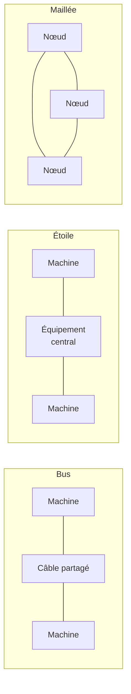
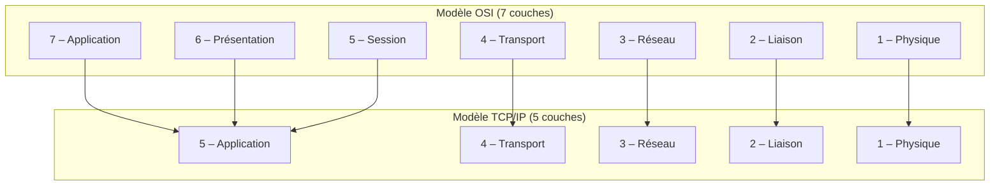
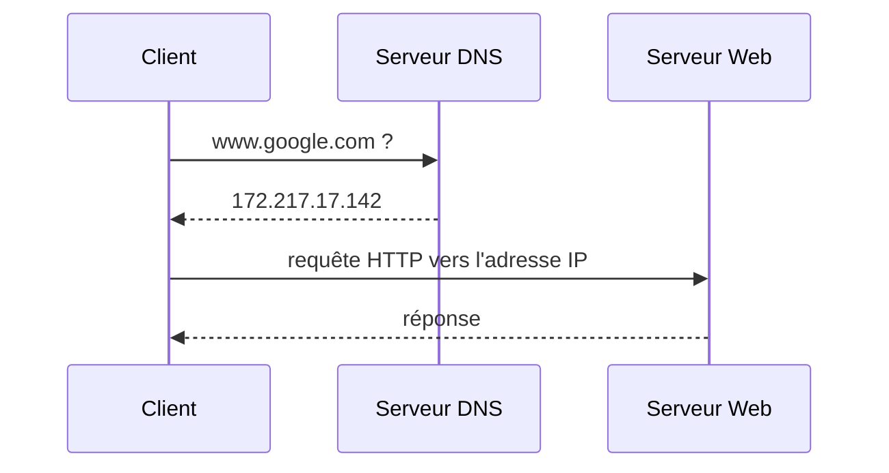
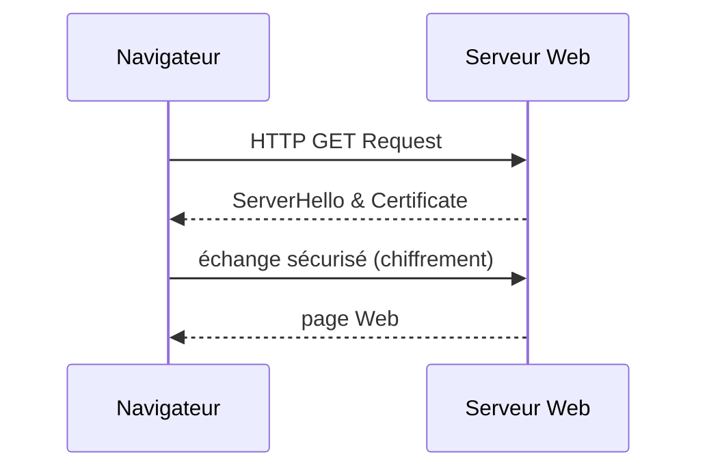

# CM1-2 — Réseaux

[[CM1-1 - Architecture d'un système informatique|← CM1-1]] · [[R1.03 - Index|Index R1.03]] · Suite : [[CM1-3 - Codage de l'information]]

> [!abstract] En bref
> Un réseau relie des machines selon une **topologie** (bus, étoile, anneau, maillée…) et une **taille** (LAN, WAN). La communication se fait par **couches** (modèle OSI, modèle TCP/IP) et par **protocoles** normalisés par l'**IETF** dans les **RFC**. Chaque interface possède une adresse **IP** (logique) et une adresse **MAC** (physique) ; **UDP** est déconnecté, **TCP** connecté, et le **DNS** traduit les noms de domaine en adresses IP.

---

## 1. Normalisation : IETF et RFC

| Sigle | Signification | Rôle |
|-------|---------------|------|
| **IETF** | *Internet Engineering Task Force* | organisme de **normalisation des protocoles de l'Internet** ; élabore et promeut des **standards** |
| **RFC** | *Request for Comments* (« demande de commentaires ») | **documents officiels numérotés** contenant les **spécifications techniques** |

- Site de l'IETF : <https://www.ietf.org/>
- Index des RFC : <https://tools.ietf.org/rfc/index>
- Exemple de RFC : la **RFC 4251** (architecture du protocole SSH) — <https://tools.ietf.org/html/rfc4251>

> [!note] Une RFC n'est pas un « brouillon »
> Malgré son nom (« demande de commentaires »), une RFC publiée est un **document de référence** : c'est la spécification officielle d'un protocole.

## 2. Topologie de réseau

Le cours illustre **sept topologies** :

| Topologie | Principe (définition usuelle) |
|-----------|-------------------------------|
| **En bus** | un seul câble partagé ; toutes les machines y sont reliées |
| **Linéaire** | machines chaînées les unes à la suite des autres |
| **En anneau** | chaque machine est reliée à la suivante, formant une boucle |
| **En étoile** | toutes les machines sont reliées à un équipement central |
| **En arbre** | hiérarchie d'étoiles (ou de bus) imbriquées |
| **Maillée** | plusieurs chemins entre les nœuds (redondance) |
| **Hybride** | combinaison de plusieurs topologies |

## 3. LAN et WAN

| Type | Nom complet | Étendue |
|------|-------------|---------|
| **LAN** | *Local Area Network* — réseau local | un bâtiment, un étage, une salle |
| **WAN** | *Wide Area Network* — réseau étendu | interconnexion de LAN sur une large zone géographique |

### 3.1 Exemple de réseau local (LAN)

Le schéma du cours montre la chaîne complète d'un logement/bâtiment :

- **DTI** ou **PTO** (point de terminaison optique) ;
- **câblage réseau** dans les murs, goulottes, faux plafonds… ;
- **filtre maître**, **ONT** (fibre), **box Internet** ;
- **terminaux** : bureau câblé (embases + cordons **RJ45**), smartphone en **Wi-Fi** ;
- côté local technique : **panneau de brassage**, **switch**, **routeur**, **baie télécom** ;
- services distribués : **Internet**, **téléphone**, **télévision**.

### 3.2 Réseau étendu (WAN)

Un **WAN** relie plusieurs **LAN** entre eux, généralement via un **FAI** (*fournisseur d'accès à Internet*).

## 4. Pile de protocoles : OSI et TCP/IP

| # | Modèle **OSI** (7 couches) | Modèle **Internet / TCP/IP** (5 couches) | Exemples de protocoles |
|---|----------------------------|------------------------------------------|------------------------|
| 7 | Application | **5 – Application** | HTTP, DNS, FTP, SMTP |
| 6 | Présentation | *(fusionnée dans Application)* | — |
| 5 | Session | *(fusionnée dans Application)* | — |
| 4 | Transport | **4 – Transport** | TCP, UDP |
| 3 | Réseau | **3 – Réseau** | IP |
| 2 | Liaison | **2 – Liaison** | Ethernet, Wi-Fi, Bluetooth |
| 1 | Physique | **1 – Physique** | ADSL, Fibre |

> [!important] À retenir
> Le modèle **TCP/IP** ne conserve que **5 couches** : les couches **Application, Présentation et Session** d'OSI sont regroupées dans la seule couche **Application**.

## 5. Matériels réseaux

| Matériel | Rôle |
|----------|------|
| **Carte réseau** | interface entre la machine et le support physique |
| **Câbles** | RJ45 (cuivre), fibre optique, RJ11 (téléphone) |
| **Répéteur** (*repeater*, Wi-Fi ou non) | régénère le signal pour étendre la portée |
| **Concentrateur** (*hub*) | répète le signal vers tous les ports |
| **Pont** (*bridge*) | relie deux segments au niveau **liaison** |
| **Switch** | commute les trames entre les ports |
| **Routeur** | achemine les paquets entre réseaux (**routage**) |
| **Passerelle** (*gateway*) | fait le lien entre deux architectures/protocoles différents |

> [!note] Association usuelle avec les couches
> Le cours juxtapose la liste des matériels et les couches 1 à 4. On retient classiquement : **couche 1** → câbles, répéteur, hub ; **couche 2** → carte réseau, pont, switch ; **couche 3** → routeur ; **couches hautes** → passerelle. Cette correspondance est un complément pédagogique : la slide ne la détaille pas explicitement.

## 6. Pare-feu

> [!important] Définition du cours
> **Logiciel/matériel** qui a pour fonction de **respecter la politique de sécurité du réseau** (privé).

Autrement dit, le **pare-feu** (*firewall*) filtre les communications entrantes et sortantes selon les règles définies pour le réseau.

## 7. Adresse IP

> [!important] Définition du cours
> « **Numéro** » d'**identification unique** attribué à chaque **interface avec Internet** : ordinateur, téléphone portable, console de jeu, routeur (intermédiaire de routage), etc.

### 7.1 IPv4

- **4 nombres de 0 à 255**, en **système décimal**, notés `xxx.xxx.xxx.xxx`.
- **Adresse privée** (réseau local, **LAN**) :

| Plage privée |
|--------------|
| `10.0.0.0` à `10.255.255.255` |
| `172.16.0.0` à `172.31.255.255` |
| `192.168.0.0` à `192.168.255.255` |

- **Adresse publique** (réseau étendu, **WAN**) : **toutes les autres adresses**.

### 7.2 IPv6

- Écriture en **hexadécimal** : `0, 1, 2, 3, 4, 5, 6, 7, 8, 9, A, B, C, D, E, F`.
- Exemple du cours : `2001:0db8:0000:85a3:0000:0000:ac1f:8001`.
- Slide : « IPv6 : le présent ? le futur ? »

### 7.3 Épuisement d'IPv4

| RIR | Espace disponible (en `/8`) | Date d'épuisement estimée |
|-----|-----------------------------|---------------------------|
| **APNIC** | 1,2 | avril 2011 |
| **RIPE NCC** | 1,0 | septembre 2012 |
| **ARIN** | 5,7 | juin 2013 |
| **LACNIC** | 4,1 | janvier 2014 |
| **AfriNIC** | 4,4 | septembre 2014 |

> [!warning] Pourquoi IPv6 ?
> L'espace d'adressage **IPv4** (32 bits) est **épuisé** : les registres régionaux (RIR) n'ont plus de blocs à attribuer depuis 2011–2014. **IPv6** (128 bits) répond à ce manque.

## 8. Adresse MAC

> [!important] MAC ≠ IP
> L'adresse **MAC** est un « numéro » d'identification **unique physique**.

- Format **MAC-48** : **six nombres de 0 à 255** écrits en **hexadécimal**.
- Deux écritures possibles : `xx:xx:xx:xx:xx:xx` ou `xxxxxxxxxxxx`.
- Exemples : `00:04:30:01:DB:18` ou `00043001DB18`.

| Adresse | Nature | Portée |
|---------|--------|--------|
| **MAC** | physique, gravée dans la carte réseau | réseau local |
| **IP** | logique, attribuée à une interface | inter-réseaux (Internet) |

## 9. UDP et TCP

| Protocole | Nom complet | Mode | Analogie du cours |
|-----------|-------------|------|-------------------|
| **UDP** | *User Datagram Protocol* | **déconnecté** | courrier simple |
| **TCP** | *Transmission Control Protocol* | **connecté** | courrier **recommandé avec accusé de réception (AR)** |

> [!note] Conséquence
> **TCP** établit une connexion et garantit la remise (accusés de réception) ; **UDP** envoie sans connexion ni garantie, ce qui le rend plus léger et plus rapide.

## 10. Nom de domaine et DNS

| Terme | Définition |
|-------|------------|
| **Nom de domaine (DN)** | identifiant de domaine Internet |
| **Domaine de premier niveau (TLD)** | `.com`, `.org`, etc. |
| **Sous-domaine** | `www`, etc. |
| **DNS** (*Domain Name System*) | service permettant d'établir une correspondance entre une (ou plusieurs) **adresse(s) IP** et un **nom de domaine** |

Exemple du cours :

| Nom de domaine | Adresse IP |
|----------------|------------|
| `www.google.com` | `172.217.17.142` |

## 11. Le réseau Internet

Le cours présente Internet comme un **réseau de réseaux** :

- des **millions d'ordinateurs** et des **serveurs** ;
- des **FAI** régionaux et nationaux (plus de 100 000 réseaux) ;
- des **points d'échange** entre opérateurs ;
- une **dizaine de backbones** (les « gros tuyaux » formant la **colonne vertébrale** du Net) ;
- des infrastructures nationales, des réseaux d'entreprise (WAN/LAN), des *data centers*.

Le schéma détaille aussi le raccordement d'un client : **adresse IP fixe ou dynamique**, **FAI**, **serveurs proxy**, **serveur DNS**, **serveur FTP**, **serveur HTTP** et **serveur de courrier électronique** (POP/IMAP, SMTP, Webmail).

## 12. Navigation Web et SSL/TLS

| Sigle | Signification | Traduction du cours |
|-------|---------------|---------------------|
| **SSL** | *Secure Sockets Layer* | couche de sockets sécurisée |
| **TLS** | *Transport Layer Security* | sécurité de la couche de transport |

> [!important] Rôle de SSL/TLS
> Sécuriser la navigation Web : le serveur présente un **certificat** au client, puis les échanges sont **chiffrés** (HTTPS). **SSL** est l'ancêtre ; **TLS** est la version moderne.

---

## ✅ À retenir

- **IETF** normalise les protocoles ; les **RFC** sont les documents officiels numérotés.
- Topologies : **bus, linéaire, anneau, étoile, arbre, maillée, hybride**.
- **LAN** = local ; **WAN** = étendu (interconnexion de LAN).
- **OSI** = 7 couches ; **TCP/IP** = 5 couches (Application, Transport, Réseau, Liaison, Physique).
- Matériels : hub, pont, switch, routeur, passerelle, répéteur, carte réseau, câbles.
- **Pare-feu** : respecte la politique de sécurité du réseau privé.
- **IPv4** : 4 nombres 0–255 ; **privé** = 10/8, 172.16/12, 192.168/16 ; **public** = le reste.
- **IPv6** : hexadécimal, réponse à l'**épuisement d'IPv4**.
- **MAC** = identifiant **physique** unique (MAC-48, hexadécimal) ≠ **IP** = identifiant **logique**.
- **UDP** déconnecté (courrier simple) ; **TCP** connecté (recommandé AR).
- **DNS** : correspondance **nom de domaine ↔ adresse IP**.
- **SSL/TLS** : chiffrement de la navigation Web (certificat + échange sécurisé).

### Questions d'auto-évaluation

- [ ] Que font l'IETF et une RFC ?
- [ ] Citer les sept topologies de réseau du cours.
- [ ] Différencier un LAN d'un WAN.
- [ ] Associer les 7 couches OSI aux 5 couches TCP/IP.
- [ ] Citer un protocole par couche TCP/IP.
- [ ] À quoi servent un switch, un routeur et une passerelle ?
- [ ] Définir un pare-feu.
- [ ] Quelles sont les trois plages d'adresses IPv4 privées ?
- [ ] Pourquoi IPv6 ? Donner son format d'écriture.
- [ ] Différencier adresse MAC et adresse IP.
- [ ] Comparer UDP et TCP avec l'analogie du courrier.
- [ ] Expliquer le rôle du DNS et donner un exemple.
- [ ] Que font SSL et TLS lors d'une navigation Web ?
