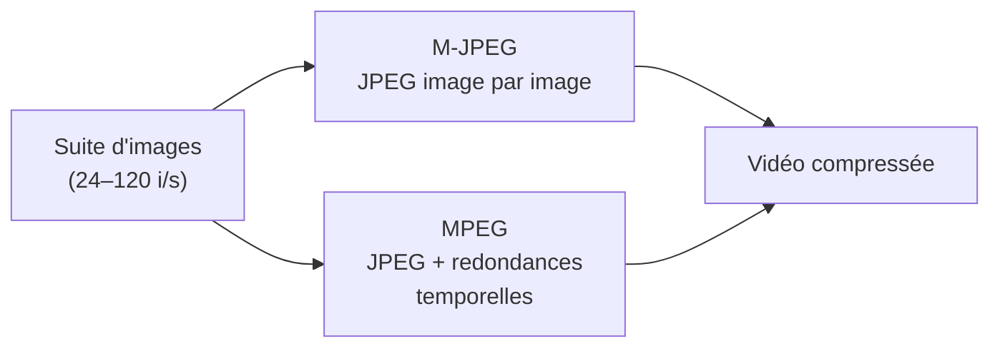

# CM1-3 — Codage de l'information

[[CM1-2 - Réseaux|← CM1-2]] · [[R1.03 - Index|Index R1.03]]

> [!abstract] En bref
> Toute information (texte, image, son, vidéo) est représentée par des **bits**. Les **bases** (2, 8, 16…) et l'**octet** (8 bits) servent de unités. Les caractères utilisent **ASCII**, **Latin-1** ou **Unicode** (UTF-8/16/32) ; les images sont **matricielles** (pixels) ou **vectorielles** ; la **compression** est **sans perte** (RLE, Huffman) ou **avec perte** (JPEG, MPEG).

---

## 1. Rappel : les bases de numération

| Base | Valeur | Peuple / usage cité par le cours |
|------|--------|----------------------------------|
| **Quinaire** | 5 | Mayas |
| **Octal** | 8 | informaticiens |
| **Duodécimale** | 12 | Anglo-Saxons avant 1960 |
| **Vicésimale** | 20 | Mayas |
| **Sexagésimale** | 60 | Sumériens |

> [!note] Base 60 aujourd'hui
> L'héritage sexagésimal survit dans la mesure du **temps** (60 s, 60 min) et des **angles** (360°).

### 1.1 Binaire et hexadécimal

| Binaire | Décimal | Hexadécimal |
|---------|---------|-------------|
| `0000` | 0 | `0` |
| `0001` | 1 | `1` |
| `0010` | 2 | `2` |
| `0011` | 3 | `3` |
| `0100` | 4 | `4` |
| `0101` | 5 | `5` |
| `0110` | 6 | `6` |
| `0111` | 7 | `7` |
| `1000` | 8 | `8` |
| `1001` | 9 | `9` |
| `1010` | 10 | `A` |
| `1011` | 11 | `B` |
| `1100` | 12 | `C` |
| `1101` | 13 | `D` |
| `1110` | 14 | `E` |
| `1111` | 15 | `F` |

> [!tip] Pourquoi l'hexadécimal ?
> Un chiffre hexadécimal représente **exactement 4 bits** : il suffit de découper un nombre binaire par groupes de 4 pour l'écrire en hexadécimal (et inversement). D'où son usage pour les adresses MAC, IPv6, les couleurs…

## 2. Bit et octet

| Unité | Définition |
|-------|------------|
| **Bit** | plus petite unité d'information : `0` ou `1` |
| **Octet** | **8 bits** |

> [!warning] Piège classique
> **`byte` ≃ octet**, mais un **`byte` n'est pas toujours exactement un octet** selon le contexte historique. Le cours signale l'**erreur classique de Windows** (et d'autres) qui confond les deux, notamment dans l'affichage des tailles.

## 3. Codage des caractères

| Codage | Taille | Remarque |
|--------|--------|----------|
| **ASCII** | **7 bits** | caractères de base (anglais) |
| **ISO-8859-1 / Latin-1** | **8 bits** | étend ASCII aux langues d'Europe de l'Ouest |
| **UTF-8** | **1 à 4 octets** | Unicode, compatible ASCII |
| **UTF-16** | **2 ou 4 octets** | Unicode |
| **UTF-32** | **4 octets** | Unicode |

> [!important] Mojibake
> Le **mojibake** est l'affichage de caractères incorrects (symboles bizarres) lorsqu'un texte est **décodé avec un mauvais encodage** : par exemple de l'UTF-8 lu comme du Latin-1.

## 4. Codage des images

### 4.1 Formats matriciels (pixels)

Une image **matricielle** est composée de **pixels**. Exemple du cours : image de **1024 × 768** pixels, soit **786 432 pixels**.

| Type de codage | Profondeur | Taille de l'exemple |
|----------------|------------|---------------------|
| **Monochrome** (noir et blanc) | 1 bit | **786 432 bits** = **96 Kio** |
| **Niveaux de gris** | 8 bits | **770 Kio** |
| **Couleurs indexées** | 8 bits | **770 Kio** |
| **Couleurs vraies** | 24 bits | **2,25 Mio** |

> [!note] Calcul
> Taille brute = nombre de pixels × nombre de bits par pixel. Pour 786 432 pixels : 1 bit → 786 432 bits ≈ 96 Kio ; 8 bits → 6 291 456 bits ≈ 768 Kio (arrondi à 770 Kio dans le cours) ; 24 bits → 18 874 368 bits ≈ 2,25 Mio.

> [!warning] Vocabulaire
> Le terme **« bitmap »** est utilisé **abusivement** : c'est en réalité un **format propriétaire**. Le terme générique correct est **format matriciel**.

### 4.2 Formats vectoriels

Les formats **vectoriels** décrivent l'image par des **formes géométriques** (équations mathématiques) et non par des pixels : ils sont redimensionnables sans perte.

## 5. Techniques de compression

### 5.1 Sans perte : l'exemple du RLE

**RLE** (*Run-Length Encoding*, codage par plages) remplace les répétitions par un compteur.

| Chaîne | Longueur |
|--------|----------|
| `SSYYYYYYYYYPHHHHHHHERRRRRRRRRR` | 30 caractères |
| `SS@9YP@7HE@10R` | 14 caractères |

- `@9Y` = **9** fois le caractère `Y` ; `@7H` = **7** fois `H` ; `@10R` = **10** fois `R`.
- **Taux de compression** : 30 → 14, soit **53 %** de compression.
- Le taux est un **paramètre réglable de 1 % à 99 %**.

> [!important] Sans perte
> La compression **sans perte** permet de **reconstruire exactement** les données d'origine. Elle est utilisée pour les **documents, exécutables**, etc.

### 5.2 Avec perte : l'exemple du JPEG

Le **JPEG** compresse les images en :

1. décomposant l'image en **carrés de 8 × 8 pixels** ;
2. **supprimant les fréquences** auxquelles l'œil est **peu sensible** ;
3. **supprimant les redondances spatiales**.

Le cours cite aussi les compressions **RLE** et **Huffman**.

> [!important] Avec perte
> La compression **avec perte** ne restitue pas exactement l'original : elle est réservée aux **images, sons, vidéos**, etc., où une petite dégradation est acceptable.

| Type | Principe | Emploi |
|------|----------|--------|
| **Sans perte** | reconstruction exacte | documents, exécutables |
| **Avec perte** | suppression d'informations peu perceptibles | images, sons, vidéos |

## 6. Codage des vidéos

Une vidéo est une **suite d'images** affichées à une certaine fréquence : **24, 25, 50, 60, 120** images par seconde, etc.

> [!example] Vidéo de 15 minutes en 1024 × 768, couleurs vraies
> - **22 500 images** (15 min × 60 s × 25 i/s) de **2,25 Mio** chacune.
> - **Sans compression** : **50,625 Gio** (valeur reprise telle quelle de la slide).
> - **M-JPEG** : compression **JPEG appliquée à chaque image**.
> - **MPEG-1, MPEG-2, MPEG-4** : idem, **avec en plus la suppression des redondances temporelles** (ce qui ne change pas d'une image à l'autre).

## 7. Identification des objets

| Technologie | Principe |
|-------------|----------|
| **Code-barres** | information codée par des barres noires/blanches |
| **Code QR** | code-barres **2D** lisible par un smartphone |
| **RFID** | identification par **ondes radio**, sans visibilité directe |

> [!quote] Le cours
> « Scanner un code QR c'est comme faire un clic IRL. »

> [!warning] Sécurité
> Un **code QR** peut renvoyer vers n'importe quelle URL : vérifier la destination avant de valider (hameçonnage, faux paiement).

---

## ✅ À retenir

- Bases citées : **5** (Mayas), **8** (informaticiens), **12** (Anglo-Saxons), **20** (Mayas), **60** (Sumériens).
- **1 octet = 8 bits** ; attention à la confusion **byte / octet**.
- **ASCII** = 7 bits ; **Latin-1** = 8 bits ; **Unicode** : **UTF-8** (1–4 octets), **UTF-16** (2 ou 4), **UTF-32** (4).
- **Mojibake** = mauvais décodage d'encodage.
- Image **matricielle** = pixels ; **vectorielle** = formes géométriques (équations).
- 1024 × 768 : monochrome **96 Kio**, gris/indexé **770 Kio**, couleurs vraies **2,25 Mio**.
- **RLE** : sans perte, `SSYYYYYYYYYPHHHHHHHERRRRRRRRRR` → `SS@9YP@7HE@10R` (**53 %**).
- **JPEG** : avec perte, blocs **8 × 8**, suppression des fréquences peu sensibles et des redondances spatiales.
- **MPEG** = JPEG + suppression des **redondances temporelles**.
- Identification : **code-barres**, **code QR**, **RFID** (ondes radio).

### Questions d'auto-évaluation

- [ ] Citer les bases de numération et les peuples associés.
- [ ] Convertir un nombre binaire en hexadécimal et inversement.
- [ ] Combien de bits dans un octet ? Quelle est la confusion classique avec le *byte* ?
- [ ] Comparer ASCII, Latin-1 et les trois formes d'Unicode.
- [ ] Qu'est-ce que le mojibake ?
- [ ] Différencier image matricielle et image vectorielle.
- [ ] Calculer la taille brute d'une image 1024 × 768 en monochrome, 8 bits et 24 bits.
- [ ] Décoder `SS@9YP@7HE@10R` et calculer le taux de compression.
- [ ] Expliquer le principe du JPEG et citer ses trois étapes.
- [ ] Différencier compression sans perte et avec perte, avec des exemples d'usage.
- [ ] Pourquoi MPEG est-il plus efficace que M-JPEG ?
- [ ] Citer trois technologies d'identification d'objets.
