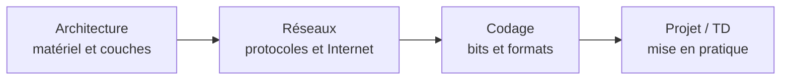

# R1.03 — Introduction à l'architecture des ordinateurs

> 🗺️ **Carte des cours :** [[Hub - Carte des cours.canvas|vue d'ensemble du semestre]]

> [!abstract] Le cours en une phrase
> Comprendre **comment fonctionne un ordinateur** : son architecture matérielle et logicielle (couches, von Neumann, processeur, mémoires), les **réseaux** qui le relient (protocoles, IP, TCP/UDP, DNS) et le **codage de l'information** (bits, caractères, images, compression).

## Objectifs pédagogiques

- **Architecture générale** d'un système informatique
- **Bases sur les réseaux** informatiques
- **Codage de l'information**

**Prérequis :** être méthodique et rigoureux ; utiliser l'outil informatique de manière régulière ; utiliser Internet de manière régulière.

## Modalités d'évaluation

- Questionnaires d'évaluation
- Livraisons et présentations de projets

## Matériel à prévoir

- **Casque audio (filaire !)** pour le TD2-2

## Plan du cours

| # | Partie | Notes |
|---|--------|-------|
| I | Présentation du cours | cette note |
| II | Architecture | [[CM1-1 - Architecture d'un système informatique]] |
| III | Réseaux | [[CM1-2 - Réseaux]] |
| IV | Codage de l'information | [[CM1-3 - Codage de l'information]] |

## Progression logique du cours

> [!tip] Fil conducteur
> 1. Comprendre la **machine** : couches, von Neumann, processeur, mémoires, DMA.
> 2. Comprendre la **communication** : topologies, OSI/TCP-IP, IP/MAC, UDP/TCP, DNS, SSL/TLS.
> 3. Comprendre la **représentation** : bases, octets, caractères, images, compression, vidéo.

## Sources

- CM0 : Présentation du cours (V1.5.0)
- CM1-1 : Architecture d'un système informatique (V1.2.1)
- CM1-2 : Réseaux (V1.3.1)
- CM1-3 : Codage de l'information (V1.3.2)
- Auteur : Mickaël Martin Nevot — cours en ligne : [mickael-martin-nevot.com](http://www.mickael-martin-nevot.com)
- Licence : CC BY-NC-SA

## Voir aussi
