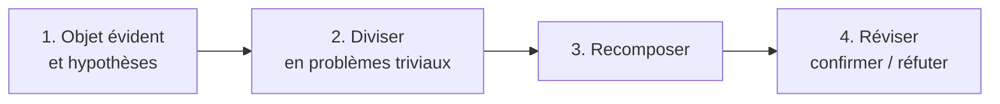

# CM1-1 — Généralités

[[R1.04 - Index|← Index R1.04]] · Suite : [[CM1-2 - Intelligence artificielle (IA) et co]]

> [!abstract] En bref
> Ce CM pose le **vocabulaire** commun (système, modèle, logique, protocole, transaction, logiciel libre…) et la **méthode scientifique**. Il retrace ensuite l'**histoire de l'informatique** à travers ses figures (Al-Khwârizmî, Babbage, Turing, von Neumann, Torvalds…) et termine par les **mots de passe** et leur robustesse.

---

## 1. Avant-propos

> [!quote] Jiddu Krishnamurti
> « Ne laissez pas les mots penser à votre place. Ayez une parole habitée. »

- « Quelqu'un qui connaît l'informatique peut valoir **100 hommes**. »
- Même en cas de doute sur la filière, **persister à apprendre l'informatique** servira toujours plus que n'importe quoi d'autre.

## 2. Exigences : clients / serveurs

| Rôle | Exigence |
|------|----------|
| **Client** | « Je suis client : je dois être **satisfait** ! » |
| **Serveur** | « Je suis serveur : je dois **satisfaire** ! » |

Trois attitudes attendues :

- Être (autant que faire se peut) **exemplaire** ;
- être **porteur de solutions** ;
- avoir le **réflexe relation clients / fournisseurs**.

## 3. Méthode scientifique (selon René Descartes)

1. **Objet évident** : sujet de l'étude, problème à résoudre et hypothèses.
2. **Diviser** jusqu'à obtenir un ensemble de problèmes **triviaux**.
3. **Recomposer**.
4. **Réviser** : vue globale, confirmer ou réfuter les hypothèses.

## 4. Vocabulaire

| Terme | Définition du cours |
|-------|---------------------|
| **Système** | ensemble d'éléments **interagissant** entre eux selon des **règles** |
| **Représentation** | rendre sensible un concept ou un objet absent « au moyen d'une image, d'une figure ou d'un signe » |
| **Modélisation** | représentation **abstraite** d'un système qui facilite son étude et permet de le **simuler** ; vue subjective, décomposée mais pertinente de la réalité ; représentation d'un système dans un autre monde que celui du système |
| **Paradigme** | représentation du monde selon un **modèle cohérent** |
| **Prédicat** | ce qui est **affirmé** à propos d'un autre terme |
| **Logique** | représentation **virtuelle**, à opposer à une description physique |
| **Idempotence** | opération ayant le **même effet** qu'on l'applique **une ou plusieurs fois** |
| **Discrétisation** | représentation **finie discontinue** d'un ensemble **continu** |
| **Sémantique** | sens : traite de l'**interprétation** et de la **signification** des systèmes |
| **Protocole** | **conventions** qui facilitent une communication sans faire directement partie du sujet de la communication elle-même |
| **Transaction** | suite d'opérations vue et manipulée de manière **atomique** |
| **Atomique** | opérations qui s'exécutent **entièrement** sans pouvoir être interrompues avant la fin de leur déroulement |
| **Service** | composant logiciel permettant la **communication** et l'**échange de données** entre applications et systèmes **hétérogènes** |
| **Application / applicatif / app** | programme (ou ensemble logiciel) réalisant une **tâche élémentaire** (ou un ensemble de tâches d'un même domaine ou formant un tout) |

### 4.1 Logique technique et logique métier

| Logique (ou code source) | Caractéristique |
|--------------------------|-----------------|
| **Technique** | **non spécifique**, utilitaire (communication, persistance, etc.) |
| **Métier** | **spécifique** au « métier » ou au domaine du système |

> [!warning] Exemple de discrétisation
> `round(2.675, 2) = 2.67` : le cours illustre ainsi les **limites de la représentation** des nombres en machine (2.675 n'est pas exactement représentable en binaire).

## 5. Logiciel libre, open source, Creative Commons

| Notion | Définition |
|--------|------------|
| **Logiciel libre** | utilisation, étude, modification et duplication par autrui **en vue de diffusion** permises, **techniquement et légalement** |
| **Open source** | possibilités de **libre redistribution**, d'**accès au code source** et de **création de travaux dérivés** |
| **Creative Commons (CC)** | licences permettant de **libérer les œuvres** des droits de propriété intellectuelle standard de leur pays, jugés trop restrictifs |

> [!warning] Libre ≠ gratuit
> **Open source** n'est **pas fondamentalement gratuit** : la liberté porte sur l'usage et le code, pas sur le prix.

## 6. Histoire de l'informatique

| Date | Figure(s) | Apport |
|------|-----------|--------|
| **IXe siècle** | **Al-Khwârizmî** | mathématicien ; son nom est à l'origine du mot **algorithme** ; ses écrits ont introduit l'**algèbre** en Europe |
| **1842** | **Charles Babbage**, **Ada Lovelace** | Babbage énonce le principe d'un ordinateur et développe la **machine analytique** ; Lovelace est considérée comme le **premier développeur** de l'histoire (langage **Ada** en son honneur) |
| **1847** | **George Boole** | logique moderne fondée sur une structure algébrique et sémantique : **algèbre de Boole** |
| **1940** | **Alan Turing** | travaux fondant scientifiquement l'informatique ; **machine** et **test** de Turing ; le **prix Turing** est l'équivalent du Nobel |
| **1946** | **Claude Shannon**, **John von Neumann** | Shannon : **théorie de l'information** (codage, compression, cryptographie), modèle de Shannon ; von Neumann : **architecture** des ordinateurs modernes, idée de **singularité technologique**, **médaille John von Neumann** |
| **1959** | **Edsger Dijkstra**, **Grace Hopper** | Dijkstra : **Algol**, système **THE**, **sémaphore**, algorithme du **plus court chemin** ; Hopper : premier **compilateur**, **COBOL**, concept de **débogage** |
| **1969** | **Donald Knuth**, **Margaret Hamilton** | Knuth : *The Art of Computer Programming*, logiciel **TeX** ; Hamilton : système embarqué du programme **Apollo** |
| **1969 / 1972** | **Ken Thompson**, **Dennis Ritchie**, **Brian Kernighan** | **Unix** ; langages **B** puis **C** ; Thompson créera aussi **Go** |
| **1971 / 1973 / 1985** | **Ray Tomlinson**, **Vint Cerf**, **Radia Perlman** | ARPANET, **adresse e-mail** et **@** ; co-invention **TCP/IP** ; Perlman parfois appelée « **Mère de l'Internet** » |
| **1970 / 1974** | **Edgar F. Codd**, **Jim Gray** | **modèle relationnel** des bases de données, OLAP, **12 règles de Codd** ; transactions et bases de données |
| **1977** | **Ronald Rivest** | chiffrement à clé publique **RSA**, hachage **MD5** |
| **1980** | **Bill Gates**, **Steve Jobs**, **Steve Wozniak** | **Microsoft**, **Windows**, **BASIC** ; **Apple**, **Macintosh**, premiers Apple |
| **1980** | **Kevin Mitnick** | un des pirates les plus célèbres, devenu consultant en sécurité ; premier hacker sur la liste des dix fugitifs les plus recherchés du **FBI** |
| **1983 / 1987 / 1991** | **Richard Stallman**, **Andrew Tanenbaum**, **Linus Torvalds** | **GNU** (GNU's Not Unix), Emacs, **FSF** ; **MINIX**, précurseur de Linux ; **Linux** (à 21 ans) et **Git** |
| **1987** | Pionniers de la **POO** | bases de la programmation orientée objet ; **principe de substitution de Liskov** ; langage **Eiffel** |
| **1983 / 1994** | **Bjarne Stroustrup**, **James Gosling** | **C++** ; **Java** |
| **1990** | **Tim Berners-Lee** | inventeur du **World Wide Web** et du **HTML** ; fondateur du **W3C** |
| **1991 / 1994 / 1995** | **Guido van Rossum**, **Rasmus Lerdorf**, **Brendan Eich** | **Python** ; **PHP** ; **JavaScript** |
| **1991** | **Bram Moolenaar** | **Vim** |
| **1997** | **Fabrice Bellard** | **FFmpeg**, émulateur **QEMU** |
| **1998** | **Larry Page**, **Sergey Brin** | **Google**, Alphabet, Google X Lab |
| **2004** | **Mark Zuckerberg** | **Facebook** |
| **2000 / 2006 / 2013** | **Aaron Swartz**, **Julian Assange**, **Edward Snowden** | **RSS** et **Creative Commons** ; **WikiLeaks** ; révélation de programmes de **surveillance de masse** (CIA/NSA) |

> [!note] « Correspondance des couleurs ? »
> La slide est un **mème** reprenant les portraits de Knuth, Codd et Turing ; elle n'apporte pas de contenu technique.

### 6.1 Références vidéo citées

Le cours renvoie à des films sur l'histoire de l'informatique : *Pirates of Silicon Valley*, *The Imitation Game*, *Steve Jobs*, *The Social Network*, *Snowden* / *Le Cinquième Pouvoir*.

## 7. Mots de passe

> [!important] Mot de passe complexe (BIOS, session, etc.)
> - **Long** : plus de **six caractères** ;
> - **alphanumérique** + **caractères spéciaux** ;
> - **pas** de mot existant, date de naissance, nom du conjoint, etc. ;
> - **absolument personnel**.

### 7.1 Temps de piratage

La slide compare le temps nécessaire pour casser un mot de passe selon :

- le **nombre de caractères** (de 4 à 18) ;
- le **jeu de caractères** : chiffres seuls ; minuscules ; majuscules + minuscules ; chiffres + lettres minuscules ; chiffres + lettres majuscules/minuscules + symboles.

> [!example] Ordres de grandeur (chiffres seuls)
> 4 à 8 chiffres : **instantané** ; 9 chiffres : **2 heures** ; 10 chiffres : **1 semaine** ; 11 chiffres : **8 000 ans**.
>
> Le message est le même pour tous les jeux : **allonger** le mot de passe et **élargir** l'alphabet des caractères fait croître le temps de cassage de façon **explosive**.

> [!warning] Tableau partiellement illisible
> Le tableau complet (14 lignes × 5 colonnes) est une **image** ; l'OCR n'a pas permis de réaligner toutes les valeurs. Seules les valeurs ci-dessus sont fiables.

### 7.2 Bonnes pratiques

- Utiliser un **générateur de mot de passe solide** (le cours cite l'outil de la **CNIL**) à partir d'une **phrase** facile à retenir ;
- ne pas donner son mot de passe, le **changer régulièrement**, ne pas le laisser au bureau.

> [!quote] Humour du cours
> « Un mot de passe c'est comme un slip : ça ne se donne pas, ça se change régulièrement, ça ne se laisse pas au bureau. »

---

## ✅ À retenir

- **Système** = éléments interagissant selon des règles ; **modélisation** = représentation abstraite simulable.
- **Idempotence** : même effet une ou plusieurs fois ; **atomique** : tout ou rien.
- **Logique technique** (utilitaire) ≠ **logique métier** (spécifique).
- **Libre** ≠ **gratuit** ; **open source** = redistribution, code source, travaux dérivés.
- Méthode de Descartes : **objet évident → diviser → recomposer → réviser**.
- Repères : Al-Khwârizmî (algorithme), Boole (logique), Turing (machine/test), von Neumann (architecture), Codd (relationnel), Berners-Lee (Web), Torvalds (Linux/Git).
- Mot de passe : **long**, **varié**, **personnel**, sans information devinable.

### Questions d'auto-évaluation

- [ ] Définir système, modèle, paradigme et représentation.
- [ ] Donner un exemple d'idempotence et expliquer l'atomicité d'une transaction.
- [ ] Différencier logique technique et logique métier.
- [ ] Pourquoi `round(2.675, 2)` donne-t-il `2.67` ?
- [ ] Différencier logiciel libre, open source et Creative Commons.
- [ ] Citer les quatre étapes de la méthode de Descartes.
- [ ] Associer chaque figure à son apport : Al-Khwârizmî, Boole, Turing, Shannon, von Neumann, Hopper, Ritchie, Torvalds, Berners-Lee.
- [ ] Qu'est-ce qu'un mot de passe complexe ? Pourquoi la longueur compte-t-elle le plus ?
