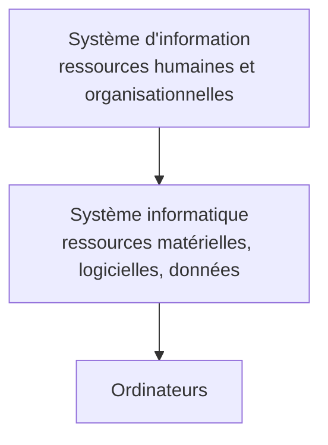
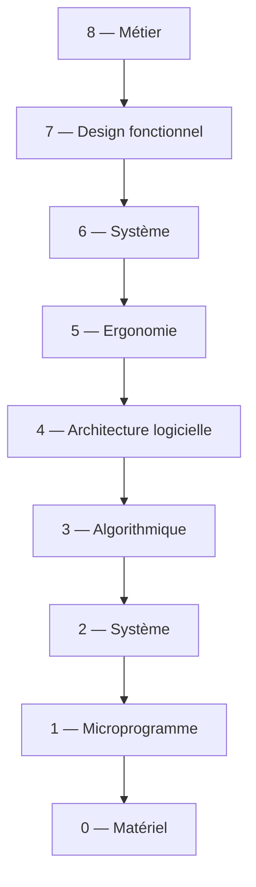

# CM1-3 — Introduction

[[CM1-2 - Intelligence artificielle (IA) et co|← CM1-2]] · [[R1.04 - Index|Index R1.04]] · Suite : [[CM2 - Systèmes d'exploitation et shell]]

> [!abstract] En bref
> Situer l'ordinateur dans le **système d'information**, définir le **système d'exploitation** et son vocabulaire (programme, processus, logiciel, application, système de fichiers), puis découvrir l'environnement de travail : **Unix/GNU/Linux**, **distributions**, **shell bash**, **éditeurs** et **bonnes pratiques** de saisie.

---

## 1. Niveaux de systèmes



| Niveau | Contenu |
|--------|---------|
| **Système d'information** | ressources **humaines et organisationnelles** |
| **Système informatique** | ressources **matérielles, logicielles, données** |
| **Ordinateurs** | machines du système informatique |

## 2. Couches d'un système d'information

| Couche | Nom |
|--------|-----|
| **8** | **Métier** |
| **7** | **Design fonctionnel** |
| **6** | **Système** |
| **5** | **Ergonomie** |
| **4** | **Architecture logicielle** |
| **3** | **Algorithmique** |
| **2** | **Système** |
| **1** | **Microprogramme** |
| **0** | **Matériel** |

> [!note] Précision du cours
> « Ces couches peuvent être **logicielles** ou **informationnelles**. »



## 3. Architecture de référence

| Niveau | Couches |
|--------|---------|
| **Couches hautes** | couche des **applications** ; couche **distribution** |
| **Couche système/réseau** | **services additionnels** ; **noyau** |
| **Couches basses** | couche du **microcode et du langage machine** ; couche du **matériel** |

> [!tip] Le système d'exploitation se situe au niveau du **noyau** et des **services additionnels** : il fait le lien entre les applications et le matériel.

## 4. Vocabulaire

| Terme | Définition du cours |
|-------|---------------------|
| **Programme** | **séquence d'instructions** exécutable par un ordinateur |
| **Processus** | **programme en cours d'exécution** (« chargé » en mémoire vive) |
| **Logiciel** | un ou plusieurs **programmes** avec **données** et **documentation** |
| **Système d'exploitation** | ensemble de **programmes et de logiciels (systèmes)** contrôlant le **matériel informatique** et **orchestrant les applications** |
| **Application** (logiciel applicatif) | logiciel **non-système** |
| **Système de fichiers** | mécanisme de **stockage / accession** des données sur « disque » (disque dur, clé USB, DVD-ROM, etc.) |

> [!important] Programme ≠ processus
> Un **programme** est un fichier d'instructions ; un **processus** est ce programme **en cours d'exécution**, chargé en mémoire vive.

## 5. Ressources informatiques

| Type | Exemples |
|------|----------|
| **Matérielles** | processeur, mémoire vive/virtuelle, disques durs, périphériques externes, bande passante réseau |
| **Logicielles** | programmes, services, fichiers… |

> [!quote] Le cours
> « Pour un OS, (presque) **tout est ressource**. »

## 6. Système d'exploitation

- **OS** : *Operating System*.
- Les OS modernes sont **tous multitâches préemptifs** : plusieurs tâches progressent « simultanément » et le système peut **reprendre la main** sur un processus.

## 7. Unix, GNU, Linux

| Nom | Nature |
|-----|--------|
| **Unix** | système d'exploitation historique (années 1970) |
| **GNU** | projet de système d'exploitation **libre** (GNU's Not Unix) |
| **Linux** | **noyau** développé par Linus Torvalds, autour duquel sont bâties les distributions |

### 7.1 Distributions Linux

> [!important] Définition du cours
> Contrairement à Windows et Mac, **Linux est disponible sous plusieurs distributions** : des **ensembles cohérents de logiciels** assemblés autour du **noyau Linux** (les logiciels système principaux).

### 7.2 Gestionnaires de bureau

Le cours cite **Unity**, **GNOME**, **KDE** et **MATE**.

## 8. Le shell

| Shell | Particularité |
|-------|---------------|
| **bash** (*Bourne Again Shell*) | shell original (`sh`) avec des idées de `ksh` et `csh` ; **par défaut sur Linux et macOS** ; utilisé dans cet enseignement |
| **tcsh** (*C shell*) | syntaxe inspirée du **C** (initialement `csh`) |
| **ksh** (*Korn shell*) | développé par **David Korn** |
| **zsh** (*Z shell*) | reprend le meilleur de `bash`, `ksh` et `tcsh` |
| **fish** (*friendly interactive shell*) | orienté **utilisation interactive** |
| **yash** (*yet another shell*) | **POSIX** + utilisation interactive |

- Le cours mentionne **Oh My Bash** pour personnaliser bash.

### 8.1 Invite de commande

```text
cmd -opt1 -opt2 par1 par2
```

- Une commande = un **nom**, des **options** (souvent préfixées par `-`) et des **paramètres**.
- Le cours signale le site **GeekTyper** (<https://geektyper.com/>) comme pastiche d'interface de hacker.

### 8.2 Outils du cours

| Outil | Usage |
|-------|-------|
| **CoCalc** (<https://cocalc.com/>) | invite de commande **en ligne** pour les tests |
| **MobaXterm** | terminal portable pour **Windows** |
| **VSCodium**, **Notepad++**, **Vim**, **XEmacs** | éditeurs de code source |
| **repl.it**, **codeshare.io** | éditeurs en ligne |
| **`man`** | consulter le **manuel** d'une commande |

> [!note] Commandes citées en introduction
> Le cours évoque **Wget**, **Shellshock** et **John the Ripper** comme exemples d'outils en ligne de commande (téléchargement, faille de shell, cassage de mots de passe).

### 8.3 Environnement hostile

Un environnement peut être **hostile** quand :

- l'**architecture** ou l'**OS** n'est pas choisi ;
- l'**éditeur de code source** est imposé ;
- etc.

> [!tip] Savoir s'adapter
> L'objectif est de savoir travailler **avec les outils imposés**, pas seulement avec ses préférences.

## 9. Bonnes pratiques

| Règle | Raison |
|-------|--------|
| **Indenter** | lisibilité du code |
| **80 caractères par ligne** | taille des premiers **terminaux physiques** (24 lignes × 80 colonnes) |
| Respecter la **sensibilité à la casse** | `Fichier` ≠ `fichier` sous Unix |
| **Relire** son propre code | détecter les erreurs |

> [!warning] Piège Unix
> Les noms de fichiers et de commandes sont **sensibles à la casse** : une majuscule change tout.

---

## ✅ À retenir

- Trois niveaux : **système d'information** → **système informatique** → **ordinateurs**.
- **9 couches** d'un SI, de **8 Métier** à **0 Matériel**.
- Architecture de référence : applications, distribution, services additionnels, noyau, microcode, matériel.
- **Programme** = instructions ; **processus** = programme en exécution ; **logiciel** = programmes + données + documentation.
- **OS** : contrôle le matériel et orchestre les applications ; les OS modernes sont **multitâches préemptifs**.
- **Linux** = noyau ; une **distribution** = logiciels système assemblés autour de ce noyau.
- **bash** est le shell par défaut de Linux/macOS et celui du cours.
- Bonnes pratiques : **indentation**, **80 colonnes**, **casse**, **relecture**.

### Questions d'auto-évaluation

- [ ] Différencier système d'information, système informatique et ordinateur.
- [ ] Citer les neuf couches d'un SI, de 8 à 0.
- [ ] Définir programme, processus, logiciel, application et système de fichiers.
- [ ] Pourquoi « pour un OS, presque tout est ressource » ?
- [ ] Qu'est-ce qu'un OS multitâche préemptif ?
- [ ] Différencier Unix, GNU, Linux et une distribution.
- [ ] Citer les shells du cours et la particularité de bash.
- [ ] Pourquoi limiter les lignes à 80 caractères ?
- [ ] Pourquoi la casse est-elle importante sous Unix ?
