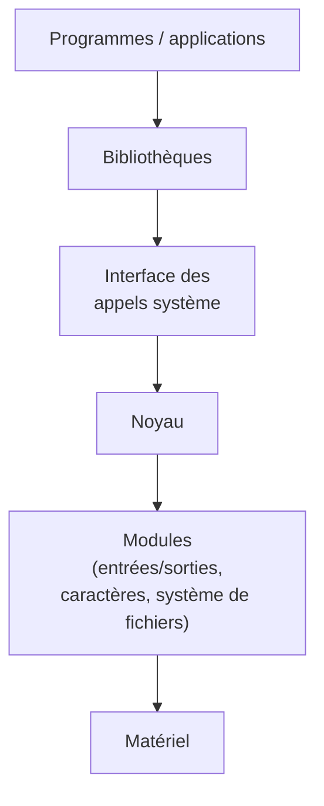
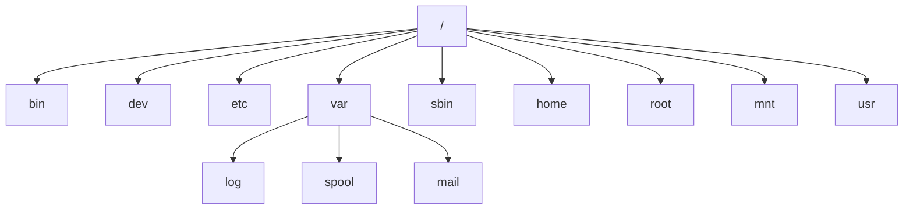
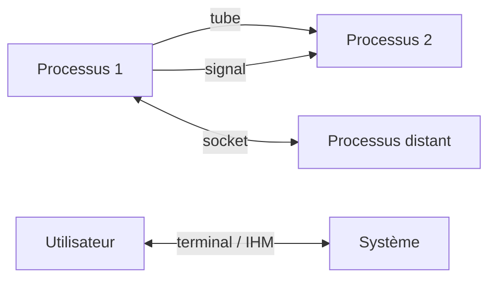

# CM2 — Systèmes d'exploitation et shell

[[CM1-3 - Introduction|← CM1-3]] · [[R1.04 - Index|Index R1.04]] · Suite : [[CM3-1 - Installation et configuration des OS]]

> [!abstract] En bref
> Le cœur pratique du cours : les **fonctions d'un OS**, puis **bash** de A à Z — commandes générales, **processus**, **arborescence et fichiers**, **globbing**, **expressions rationnelles**, **droits**, **variables d'environnement** et **scripts** (paramètres, structures de contrôle).

---

## 1. Architecture d'un système Unix



> [!note] Principe
> Les applications n'accèdent pas directement au matériel : elles passent par les **appels système** exposés par le **noyau**, qui pilote les **modules** et le matériel.

## 2. Les fonctions d'un OS

| Fonction | Description | Ressources matérielles | Concepts abstraits |
|----------|-------------|------------------------|--------------------|
| **Gestion des activités** | création, destruction, suivi des activités | processeur, programme, mémoire centrale, interruptions | **processus** |
| **Gestion des données persistantes** | accès, stockage, partage des données | disque, sauvegardes | **fichier**, **répertoires** |
| **Gestion des communications** | IHM, entrées/sorties, réseaux | clavier, écran, souris, périphériques, infrastructures réseau | **fenêtres**, **flots de données** |
| **Gestion de la sécurité** | intégrité, confidentialité, disponibilité | utilisateurs, droits | — |

## 3. Commandes Unix générales

| Code | Description | Exemple |
|------|-------------|---------|
| `echo` | afficher une ligne de texte | `echo Salut ça va ?` |
| `ls` | lister les fichiers d'un répertoire | `ls`, `ls -l`, `ls -a`, `ls -al` |
| `cd` | changer de répertoire courant | `cd dir`, `cd`, `cd ~`, `cd ..` |
| `xterm` | lancer un terminal | `xterm` |
| `clear` | effacer l'écran du terminal | `clear` (ou `CTRL + L`) |
| `wc` | compter caractères / mots / lignes | `wc -l file` |
| `sort` | trier des fichiers | `sort -n nb` (tri numérique) |

### 3.1 Redirections et enchaînements

| Opérateur | Rôle | Exemple |
|-----------|------|---------|
| `<` | rediriger l'entrée | `sort < file` |
| `>` | rediriger la sortie (écrase) | `ls > file` |
| `>>` | rediriger la sortie (ajoute) | `sort < file1 >> file2` |
| `2>` | rediriger la sortie d'erreur | `cmd 2> errors` |
| `2>>` | ajouter la sortie d'erreur | `cmd 2>> errors` |
| `&>` | rediriger les deux sorties | `cmd &> all` |
| `&>>` | ajouter les deux sorties | `cmd &>> all` |
| `\|` | **canal** unidirectionnel entre processus | `ls -l \| grep key \| less` |
| `;` | lancer des commandes **séquentiellement** | `echo "Hello " ; echo "world"` |
| `alias` | lister ou créer un alias | `alias la='ls-A'` |

> [!warning] Coquille du support
> La slide écrit `alias la='ls-A'`. La forme usuelle est `alias la='ls -A'` (option `-A` séparée). Retenir le **principe** de l'alias.

## 4. Gestion des activités (processus)

| Notion | Définition |
|--------|------------|
| **PID** (*process identifier*) | identifiant **unique** d'un processus |
| **PPID** (*parent PID*) | identifiant **unique** de son processus **père** |

### 4.1 Mythologie des processus

| Statut | Sens |
|--------|------|
| **Zombie** | processus **terminé** dont le père n'a pas encore récupéré le code de retour |
| **Orphelin** | processus **qui a perdu son père** (adopté par `init`/le système) |
| **Démon** | processus qui **n'est pas contrôlé par l'utilisateur** (tourne en arrière-plan, souvent au démarrage) |
| **Achevé** (défunt) | processus terminé |

> [!note] Un zombie n'est pas un démon
> Le **zombie** est mort mais garde une entrée dans la table des processus ; le **démon** est vivant et détaché du terminal.

### 4.2 Commandes de gestion

| Code | Description | Exemple |
|------|-------------|---------|
| `ps` | afficher l'état des processus | `ps`, `ps -e`, `ps -Af`, `ps auxfw` |
| `bg` | placer un processus en **arrière-plan** | `bg %1` |
| `fg` | passer un processus d'arrière-plan en **premier plan** | `fg %1` |
| `jobs` | afficher les processus en arrière-plan | `jobs` |
| `&` | lancer un programme en arrière-plan | `xterm &` |
| `kill` | envoyer un **signal** à un processus | `kill -9 666` |
| `top` | afficher les processus **en continu** | `top` |

## 5. Gestion des données persistantes

### 5.1 Arborescence Unix

| Répertoire | Contenu |
|------------|---------|
| `/bin` (*binaries*) | commandes « externes » |
| `/dev` (*devices*) | périphériques |
| `/etc` (*editable text configuration*) | fichiers de configuration |
| `/var` | fichiers **variables** : `log` (journaux système), `spool` (files d'impression), `mail` (e-mails) |
| `/sbin` (*system bin*) | commandes d'**administration** |
| `/home` | répertoires personnels des utilisateurs |
| `/root` | répertoire personnel de l'**administrateur** |
| `/mnt` (*mount*) | systèmes de fichiers **montés** |
| `/usr` (*unix system resources*) | **logiciels installés** |



### 5.2 Commandes fichiers

| Code | Description | Exemple |
|------|-------------|---------|
| `pwd` | afficher le répertoire courant | `pwd` |
| `touch` | créer un fichier vide ou modifier ses dates | `touch file` |
| `cp` | copier des fichiers | `cp file dir` |
| `mv` | déplacer ou renommer | `mv file1 file2`, `mv file dir` |
| `rm` | supprimer un fichier | `rm file`, `rm -i file` |
| `mkdir` | créer un répertoire | `mkdir dir` |
| `rmdir` | supprimer un répertoire | `rmdir rep` |
| `cat` | afficher et concaténer des fichiers | `cat file`, `cat file1 file2` |
| `head` | afficher le début d'un fichier | `head -n 20 file` |
| `tail` | afficher la fin d'un fichier | `tail -n 20 file` |
| `diff` | comparer fichiers / répertoires | `diff file1 file2`, `diff dir1 dir2` |

### 5.3 Recherche et traitement

| Code | Description | Exemple |
|------|-------------|---------|
| `grep` | rechercher dans des fichiers | `grep Salut file` |
| `find` | rechercher selon des critères multiples | `find /usr/src -name "*.c"` |
| `sed` | éditer du texte **non interactivement** | `sed 's/Mr./M./g' file.txt` |
| `cut` | afficher des colonnes / champs | `cut -c 1-3 file` |

### 5.4 Répertoires spéciaux et chemins

| Notation | Sens |
|----------|------|
| `.` | répertoire **courant** (`find . -ls`) |
| `..` | répertoire **parent** (`cd ..`) |
| `~` | répertoire **personnel** (`cd ~`) |

> [!important] Chemin absolu vs relatif
> - **Absolu** : **invariant**, commence par `/` (ou `~`) ;
> - **Relatif** : **variable**, dépend du répertoire courant.

> [!note] Extension
> Sous Unix, l'**extension de fichier n'a pas d'importance** pour le système : c'est le contenu (et éventuellement les droits) qui compte.

## 6. Globbing patterns (filtres)

| Métacaractère | Sens |
|---------------|------|
| `?` | **exactement un** caractère quelconque |
| `*` | **n'importe quel nombre** de caractères (y compris zéro) |
| `[ab…]` | **un unique** caractère au choix dans la liste |
| `[!ab…]` | un unique caractère **absent** de la liste |
| `a-z` | **liste** / intervalle |

| Code | Description | Exemple |
|------|-------------|---------|
| `'`, `"`, `\` | échappement des caractères spéciaux | `ls 'a*'`, `ls "x y"`, `echo -e "x\ty"` |
| `` ` `` | évaluation **préalable** de la commande | ``chown `id -u` dir`` |

> [!warning] Globbing ≠ regex
> Les **caractères de filtrage** du shell (`*`, `?`) n'ont **pas** la même syntaxe que les **expressions rationnelles** : voir la section suivante.

## 7. Expressions rationnelles

> [!important] Définition
> Chaîne de caractères appelée **motif** (*pattern*) qui décrit un **ensemble de chaînes possibles**. **Pas de standardisation** : la syntaxe varie selon les outils.

| Symbole | Sens |
|---------|------|
| `.` | n'importe quel caractère |
| `\` | échapper (banaliser) un caractère |
| `[]` | un des caractères au choix entre crochets |
| `^`, `$` | début / fin (`^a`, `a$`) |

| Quantifieur | Sens |
|-------------|------|
| `?` | **zéro ou une** fois |
| `*` | **zéro, une ou plusieurs** fois |
| `+` | **une ou plusieurs** fois |

### 7.1 Exemples du cours

```text
a.b
b.1..re
[0-9][0-9]aaa.*
[a-z]+-[a-z]+
^ *[0-9]
crée(|e|es|s)
^r.*[0-9]$
.*[aeiouy](l)[aeiouy].*
^[a-z0-9._-]+@[a-z0-9._-]{2,}\.[a-z]{2,4}$
```

> [!tip] Outils
> - <https://regex101.com/>
> - <http://www.debuggex.com>
> - <https://www.debuggex.com/cheatsheet/regex/pcre>
> - <https://regexcrossword.com> (apprendre en jouant)

## 8. Gestion des communications

| Type | Mécanisme |
|------|-----------|
| **IPC** (communication inter-processus) **locaux** | **signaux**, **tubes** (*pipes*) |
| **IPC distants** | **sockets** |
| **Communication homme-système** | terminal, IHM |

> [!note] Hors cadre
> Les détails des sockets et des terminaux Ubuntu sont **hors du cadre du cours**.



## 9. Gestion de la sécurité

> [!quote] Sous Unix
> « **Tout est fichier**. »

- Les fichiers **cachés** commencent par `.` (ex. `.bashrc`).

### 9.1 Commandes

| Code | Description | Exemple |
|------|-------------|---------|
| `whoami` | afficher le nom / identifiant de l'utilisateur | `whoami` |
| `chmod` | changer les droits d'accès | `chmod 644 file` |
| `umask` | définir les droits **par défaut** | `umask 0022` |
| `id` | afficher les attributs **UID, GID**… | `id` |
| `finger` | afficher les données d'un utilisateur | `finger user` |
| `groups` | afficher les groupes d'un utilisateur | `groups`, `groups user` |
| `sudo` | exécuter **comme root** | `sudo apt-get update` |

### 9.2 Utilisateurs et groupes

| Action | Utilisateur | Groupe |
|--------|-------------|--------|
| **Créer** | `useradd user` | `groupadd group` |
| **Modifier** | `usermod user` | `groupmod group` |
| **Supprimer** | `userdel user` | `groupdel group` |
| **Changer mot de passe** | `passwd user` | `gpasswd group` |

> [!tip] Commandes interactives
> Beaucoup de distributions offrent **`adduser`** et **`addgroup`**, plus conviviales que `useradd` / `groupadd`.

## 10. Variables d'environnement

| Variable | Valeur |
|----------|--------|
| `HOME` | chemin du répertoire personnel |
| `PWD` | répertoire courant |
| `PS1` | **prompt** |
| `PATH` | liste des répertoires de **recherche des commandes** |

> [!important] `$`
> `$` permet d'obtenir la **valeur** d'une variable shell : `echo $HOME`.

### 10.1 Fichiers de démarrage

| Fichier | Moment d'exécution |
|---------|--------------------|
| `.bash_profile` | au démarrage d'une **nouvelle session** |
| `.bashrc` | au démarrage d'un **nouveau shell** |
| `.bash_logout` | à l'**arrêt** d'un shell |

## 11. Scripts bash

> [!important] Définitions
> - **Script** : **série de commandes**.
> - **Langage de script** : langage de programmation **non compilé**.

```bash
#!/bin/bash
# Mon premier script
echo "Bonjour"
```

| Élément | Règle |
|---------|-------|
| **Shebang** | `#!/bin/bash` — doit être la **première ligne**, rien avant |
| **Commentaire** | `#` |
| **Exécution par défaut** | `bash file` |
| **Fichier exécutable** | `./file` ou `~/file` |
| **Script dans le PATH** | `file` |
| **Code de retour** | `0` : succès ; `1` à `255` : erreur (aussi avec `exit`) |

### 11.1 Paramètres, arguments, variables

| Notation | Sens |
|----------|------|
| `$1`, `$2`, `$3`… | **paramètres positionnels** |
| `$0` | nom du **script** |
| `$#` | **nombre** d'arguments |
| `$@` | **liste** des arguments |
| `$?` | **code de retour** de la dernière commande |

> [!note] Paramètre vs argument
> - **Paramètre** (formel, « argument muet ») : variable utilisée dans le script, la procédure ou la fonction.
> - **Argument** (effectif) : **valeur** fournie dans la ligne de commande ou lors de l'appel.

```bash
a=1
read -p "Tapez votre réponse : " x
echo $a "Réponse" ${a}m
```

> [!warning] Pas d'espace
> En bash, `a=1` est correct ; `a = 1` **ne l'est pas** (espaces autour du `=` interdits à l'affectation).

### 11.2 Tableaux, chaînes, calculs, fonctions

```bash
name[0]='foo'
name[1]='bar'
echo ${name[0]}          # foo

name='foo'
echo "M. $name"          # M. foo
echo 'M. $name'          # M. $name (pas d'interprétation)
echo "M. \"$name\""      # M. "foo"

(( a=1 ))
echo $(( (a+5)/2 ))

show() {
    echo "Hello $1"
    return 5
}
show foo                 # Hello foo
```

> [!warning] Attention aux espaces
> Les espaces sont **significatifs** en bash, notamment dans les tests `[ ... ]` et les affectations.

### 11.3 Structures de contrôle

```bash
if condition ; then
    instructions
else
    instructions
fi

while condition ; do
    instructions
done

for i in $@ ; do
    instructions
done

for (( i=0 ; i<10 ; ++i )) ; do
    instructions
done
```

| Test | Syntaxe | Exemples |
|------|---------|----------|
| **Fichiers** | `[ ... ]` | `-d` : répertoire existe ; `-f` : fichier ordinaire ; etc. |
| **Chaînes** | `[ ... ]` | `==`, `!=`, `<`, etc. |
| **Numérique** | `(( ... ))` | `==`, `!=`, `>`, `<`, `>=`, `<=`, `&&`, `\|\|`, `!` |

```bash
if [ -d ~/dir ]
if [ "$name" == "foo" ]
if (( (nb > 3) && (nb < 8) ))
```

> [!tip] Pour aller plus loin
> Le cours signale aussi **`case`** et **`until`**.

---

## ✅ À retenir

- L'OS gère **activités** (processus), **données** (fichiers), **communications** et **sécurité**.
- **PID** = identifiant du processus ; **PPID** = identifiant du père.
- **Zombie** (terminé non récupéré), **orphelin** (père perdu), **démon** (non contrôlé par l'utilisateur).
- Redirections : `>`, `>>`, `2>`, `&>`, `<` ; **pipe** `|` ; séquence `;`.
- Arborescence : `/bin`, `/dev`, `/etc`, `/var`, `/sbin`, `/home`, `/root`, `/mnt`, `/usr`.
- **Chemin absolu** = invariant (`/`, `~`) ; **relatif** = variable.
- **Globbing** (`?`, `*`, `[ab]`, `[!ab]`) ≠ **regex** (`.`, `\`, `[]`, `^`, `$`, `?`, `*`, `+`).
- Droits : `chmod`, `umask`, `sudo` ; **tout est fichier**, les fichiers cachés commencent par `.`.
- Variables : `HOME`, `PWD`, `PS1`, `PATH` ; `$var` donne la valeur.
- Script : **shebang**, `#` commentaire, code de retour **0 = succès**.
- Paramètres : `$1`…, `$0`, `$#`, `$@`, `$?`.
- Structures : `if`, `while`, `for`, tests `[ ]` et `(( ))`.

### Questions d'auto-évaluation

- [ ] Citer les quatre fonctions d'un OS et leurs concepts abstraits.
- [ ] Différencier `>`, `>>` et `2>`.
- [ ] Expliquer le rôle du pipe `|`.
- [ ] Différencier zombie, orphelin et démon.
- [ ] Que font `ps`, `top`, `kill`, `jobs`, `bg` et `fg` ?
- [ ] À quoi servent `/etc`, `/var`, `/usr`, `/home` et `/mnt` ?
- [ ] Différencier chemin absolu et chemin relatif.
- [ ] Donner la différence entre `*` en globbing et `*` en regex.
- [ ] Que signifient `chmod 644` et `umask 0022` ?
- [ ] Que contiennent `HOME`, `PWD`, `PS1` et `PATH` ?
- [ ] Écrire un script bash avec shebang, argument `$1` et test de fichier.
- [ ] Que valent `$0`, `$#`, `$@` et `$?` ?
- [ ] Écrire une boucle `for` et une condition `if` en bash.
