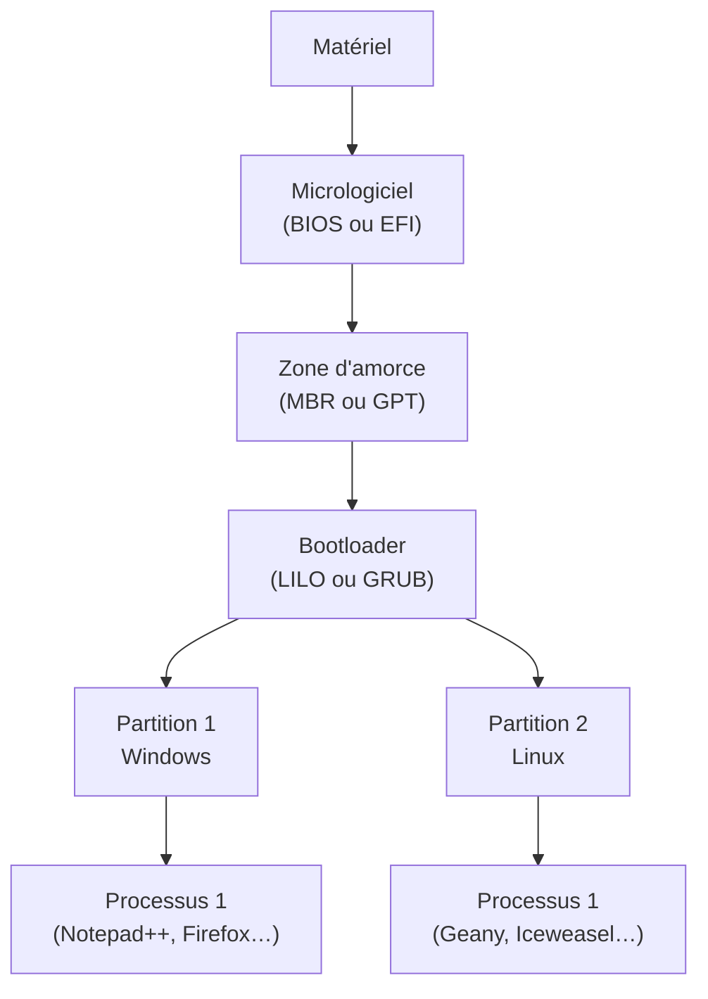
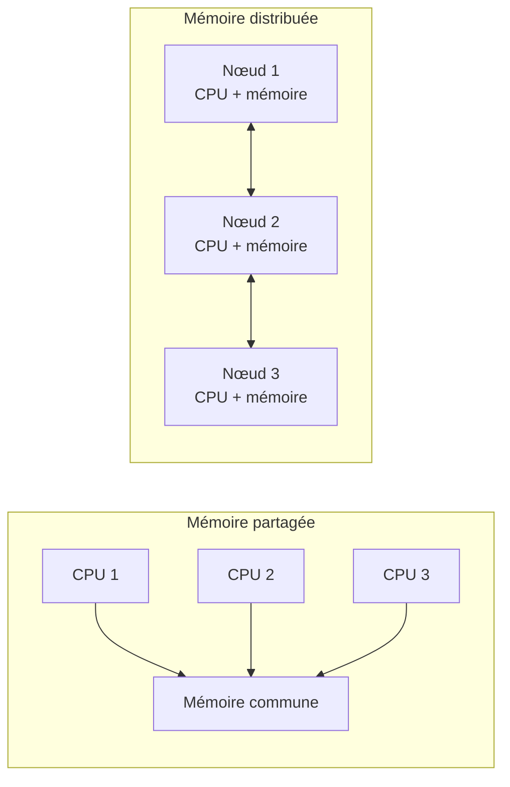

# CM3-1 — Installation et configuration des OS

[[CM2 - Systèmes d'exploitation et shell|← CM2]] · [[R1.04 - Index|Index R1.04]] · Suite : [[CM3-2 - Applications]]

> [!abstract] En bref
> Installer et configurer un système : **partitions** et **amorçage** (BIOS/EFI, MBR/GPT, GRUB), **systèmes de fichiers** (NTFS, ext4…), **gestionnaires de paquets** (`apt-get`), **hébergement**, puis les architectures de serveurs : **systèmes parallèles**, **machines virtuelles**, **répartition de charge**, **clusters** et **cloud**.

---

## 1. Partitions et amorçage

| Élément | Rôle |
|---------|------|
| **BIOS** | micrologiciel historique |
| **EFI** (*Extensible Firmware Interface*) | micrologiciel moderne, plus riche que le BIOS |
| **MBR / GPT** | zone d'amorce du disque (schémas de partitionnement) |
| **Bootloader** | programme de démarrage ; **LILO** ou **GRUB** sous Linux |
| **Partition** | découpage du disque ; chaque OS peut occuper sa partition |

> [!important] Multiboot
> Le **bootloader** permet de choisir entre plusieurs systèmes d'exploitation installés sur des **partitions** différentes (ex. Windows et Linux).

## 2. Systèmes de fichiers

| Caractéristique | **NTFS** | **ext4** |
|-----------------|----------|----------|
| **Structure** | **B-arbre** | **liste chaînée** |
| **Permissions** | **ACL** | **POSIX** |
| **Compression** | oui | — |
| **Fragmentation** | — | **pas de fragmentation** |

> [!note] Autres systèmes de fichiers
> Le cours cite aussi **BTRFS**, **ReiserFS**, **FAT32**, etc.

## 3. Installation de paquets : `apt-get`

| Commande | Action |
|----------|--------|
| `apt-get update` | mettre à jour la **liste des paquets** |
| `apt-get install packet` | **installer** un paquet |
| `apt-get dist-upgrade` | mettre à jour l'**OS** |
| `apt-get upgrade` | mettre à jour les **paquets installés** |
| `apt-get remove packet` | **désinstaller** un paquet |
| `apt-get clean` | effacer les **installeurs** (pas les paquets) |

> [!important] `apt-get`
> **Gestionnaire de paquets** en **ligne de commande**, qui utilise des **dépôts APT**.

## 4. Rendre Windows utilisable

| Outil | Rôle |
|-------|------|
| **Chocolatey** | gestionnaire de paquets pour Windows |
| **WSL** | **Ubuntu sous Windows 10** (Windows Subsystem for Linux) |

## 5. Offres d'hébergement

| Offre | Contenu |
|-------|---------|
| **Nom de domaine** | réservation d'un nom |
| **Hébergement de serveurs** | **mutualisés** ou **dédiés** |
| **Cloud** | ressources à la demande |
| etc. | |

Fournisseurs cités : **OVH** (un des moins chers), **Amen** (éthique sur les noms de domaine), **1&1**, **Jaguar Network**, **Alwaysdata**.

> [!tip] Clef en main
> **Webmin** est un **gestionnaire Web de serveur Unix** : administration via une interface Web plutôt que le shell.

## 6. Systèmes parallèles

| Architecture | Principe |
|--------------|----------|
| **Mémoire partagée** | plusieurs processeurs accèdent à une **mémoire commune** |
| **Mémoire distribuée (dédiée)** | chaque nœud possède sa **propre mémoire** ; communication par réseau |

## 7. Machine virtuelle

| Virtualisation | Principe |
|----------------|----------|
| **Avec émulateur** | un **émulateur** simule un processeur ; l'OS invité tourne au-dessus de l'OS hôte |
| **Avec hyperviseur** | un **hyperviseur** s'exécute directement sur le matériel et héberge les OS invités |

> [!note] Repères historiques
> La slide situe la virtualisation entre **1974** (workstation), **1999** et les offres cloud (**Amazon**).

## 8. Répartition de charge

Objectifs :

- gérer les **montées en charge** (qualité de service) ;
- assurer une **haute disponibilité** des services ;
- assurer la **sécurité des données** en cas de panne.

> [!important] Répartiteur
> Utilisation d'un **répartiteur de charge** (*load balancer*) qui distribue les requêtes entre plusieurs serveurs.

## 9. Grappes de serveurs (clusters)

> [!important] Définition
> Regrouper des **nœuds** pour une **gestion globale**, afin de :
> - permettre une **répartition de la charge** ;
> - faciliter la **gestion des ressources**.

| Type de nœud | Rôle |
|--------------|------|
| **Nœud de calcul** | exécute les traitements |
| **Nœud de stockage** | stocke les données |
| **Nœud frontal** | point d'entrée du cluster |
| **Nœud de suivi** (*monitoring*) | surveille le cluster |

### 9.1 Réplication vs cluster

> [!warning] Critère de choix
> La **réplication** est préférable si les données sont **modifiées à une fréquence élevée** (souvent le cas d'une **base de données**).

### 9.2 Quorum

> [!quote] Définition du cours
> « **Nombre minimum de membres d'un corps délibératif nécessaire à la validité d'une décision.** »

Rôles du quorum :

- fournir un moyen d'**arbitrer l'appartenance** au cluster ;
- aider à **maintenir la cohérence** du cluster ;
- fournir un moyen de **stocker la configuration** du cluster.

Modèles de quorum cités :

- **Disk only** ;
- **Disk and node majority** ;
- **Node majority** ;
- **Node and file share majority**.

> [!note] Précisions de la slide
> Les modèles sont associés à des contraintes du type « nécessite deux votants fonctionnels » ou « pas de stockage partagé ». L'OCR ne permet pas d'attribuer ces mentions avec certitude à chaque modèle.

## 10. Cloud computing

- **Puissance de calcul et de stockage à la demande** ;
- **pas besoin de serveurs propres** ;
- appel à des **fournisseurs spécialisés** (offre de garantie).

> [!quote] Analogie du cours
> Le cloud est comparé à la **distribution de l'énergie électrique**.
>
> Questions posées : **sécurité ? qualité de service ?**

## 11. Réseau pair à pair (P2P)

- **Client/serveur** où **chaque client est aussi un serveur**.
- Utilisations :
  - **partage de fichiers** (eMule, etc.) ;
  - **calcul scientifique distribué** (BOINC, etc.).

---

## ✅ À retenir

- Chaîne d'amorçage : **matériel → BIOS/EFI → MBR/GPT → bootloader (LILO/GRUB) → OS**.
- **NTFS** : B-arbre, ACL, compression ; **ext4** : liste chaînée, POSIX, pas de fragmentation.
- `apt-get update` met à jour la **liste** ; `upgrade` les **paquets** ; `dist-upgrade` l'**OS**.
- **Chocolatey** et **WSL** rendent Windows plus utilisable.
- **Webmin** : administration Unix via le Web.
- **Mémoire partagée** vs **distribuée**.
- **Émulateur** (au-dessus de l'OS hôte) vs **hyperviseur** (directement sur le matériel).
- **Load balancer** : montée en charge, haute disponibilité, sécurité des données.
- **Cluster** : nœuds de calcul, stockage, frontal, suivi ; **quorum** = arbitrage et cohérence.
- **Cloud** : ressources à la demande ; **P2P** : chaque client est aussi serveur.

### Questions d'auto-évaluation

- [ ] Décrire la chaîne d'amorçage d'un ordinateur.
- [ ] Différencier BIOS et EFI, MBR et GPT.
- [ ] Comparer NTFS et ext4.
- [ ] Citer les commandes `apt-get` et leur rôle.
- [ ] Que font Chocolatey et WSL ?
- [ ] Différencier hébergement mutualisé et dédié.
- [ ] Différencier mémoire partagée et mémoire distribuée.
- [ ] Comparer virtualisation par émulateur et par hyperviseur.
- [ ] Quels sont les objectifs d'un répartiteur de charge ?
- [ ] Citer les types de nœuds d'un cluster.
- [ ] Qu'est-ce que le quorum et à quoi sert-il ?
- [ ] Quand préférer la réplication à un cluster ?
