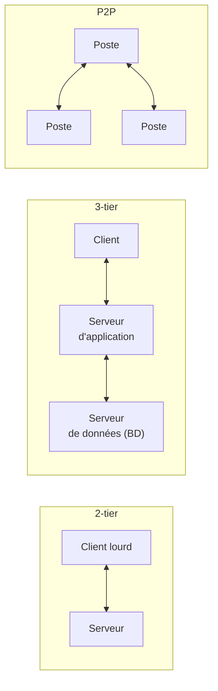
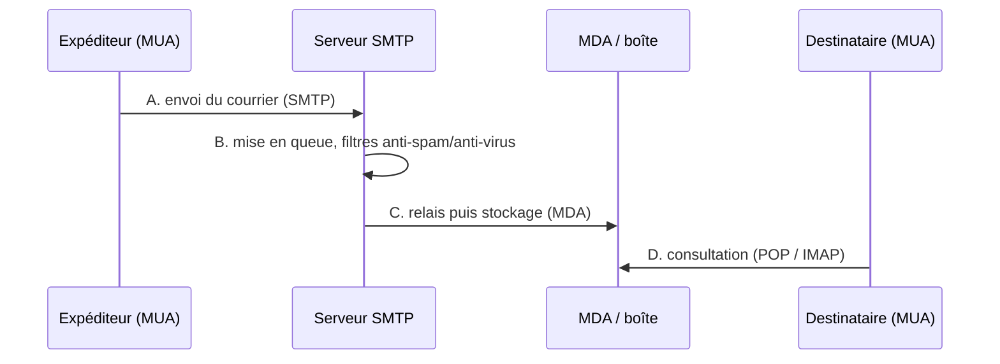

# CM3-2 — Applications

[[CM3-1 - Installation et configuration des OS|← CM3-1]] · [[R1.04 - Index|Index R1.04]]

> [!abstract] En bref
> Les applications réseau : architectures **client-serveur** (mainframe, 2-tier, 3-tier, P2P), **ports**, **transfert de fichiers** (FTP, scp, rsync), **connexion à distance** (telnet, SSH), **NFS**, **SMB/Samba**, **courrier électronique**, **Git/GitHub**, **cron**, **Markdown**, **LDAP** et **IoT**.

---

## 1. Architecture client-serveur

| Architecture | Principe |
|--------------|----------|
| **Mainframe** | client **passif sans unité centrale** (ancien) |
| **2-tier** | **client lourd / serveur** |
| **3-tier** | **client / serveur d'application / serveur de données (BD)** |
| **Peer-to-peer (P2P)** | chaque poste est **à la fois client et serveur** |

> [!warning] 3-tier ≠ MVC
> Le cours précise explicitement que l'architecture **3-tier** n'est **pas** le patron **MVC**.



### 1.1 Types de client

| Client | Avantages | Inconvénients |
|--------|-----------|---------------|
| **Léger** | peu de ressources client | temps de **latence** ; **ergonomie limitée** |
| **Lourd** | **interface riche** ; fonctionnement « **autonome** » | **charge cliente importante** |

> [!note] « Riche »
> Le cours mentionne aussi le client **riche** entre léger et lourd.

## 2. Architecture 3-tier : avantages

- **Répartition** (liens faibles ⇒ distribution possible) ;
- **client léger** possible.

Traitements applicatifs :

| Type | Rôle |
|------|------|
| **Locaux** | traitement du **dialogue** avec l'IHM et la BD |
| **Globaux** (logiques ou métiers) | l'**application** à proprement parler |

Traitements **centralisés / partagés / regroupés** :

- montée en charge **mieux gérée** ;
- meilleure **fiabilité** ;
- meilleures **performances** ;
- **maintenance** facilitée ;
- **évolutivité** simplifiée.

## 3. Ports (logiciels)

> [!important] Définition
> « **Portes** donnant accès au système d'exploitation », identifiées par un numéro de **1 à 65535**.

| Port | Type | Service |
|------|------|---------|
| **53** | UDP | **DNS** |
| **80** | TCP | **HTTP** |
| **8080** | TCP | **HTTP alternatif** |

Exemple d'adressage :

```text
172.217.17.142:80
www.google.com:80
```

> [!tip] Retenir
> Le port se met **après les deux-points**, à la suite de l'adresse IP ou du nom de domaine.

## 4. Transfert de fichiers

| Outil | Principe |
|-------|----------|
| **FTP** | protocole de transfert ; **modes actif et passif** ; commande Linux `ftp` ou client **FileZilla** |
| **wget** | téléchargement en ligne de commande |
| **scp** | copie sécurisée via **SSH** (port **TCP/22**) |
| **rsync** | synchronisation ; port par défaut **TCP/873** ; **plus rapide que scp** en principe |

```bash
scp -rp /source login@serveur.org:/destination/
rsync -avz /source login@serveur.org:/destination/
```

## 5. Connexion à distance

| Outil | Port par défaut | Remarque |
|-------|-----------------|----------|
| **telnet** | **TCP/23** | non chiffré |
| **ssh** | **TCP/22** | sécurisé ; vérifier l'**empreinte de la clé publique** |

```bash
telnet serveur/IP port
ssh login@serveur
```

> [!warning] Telnet
> **Telnet** transmet tout en clair (mots de passe compris) : à éviter au profit de **SSH**.

## 6. Serveur de fichiers : NFS

- **NFS** : *Network File System*.
- Port par défaut : **TCP/2049**.
- Permet de **monter** un répertoire distant comme s'il était local.

## 7. Serveur de fichiers : SMB/CIFS

| Élément | Détail |
|---------|--------|
| **SMB** | *Server Message Block*, initialement pour **Windows** |
| **Samba** | **implantation Unix** de SMB ; partage de fichiers et d'**imprimantes** |
| **NetBIOS** | **TCP/139** |
| **Microsoft Directory Services** | **TCP/445** |

## 8. Courrier électronique

### 8.1 Bonnes pratiques

- **Toujours** une formule de politesse (début et fin) ;
- **accuser réception** quand c'est important ;
- **remercier** : simple mais souvent oublié ;
- être **concis et précis** : on facilite la vie du destinataire et on respecte son temps ;
- **objet** nettoyé, court, explicite : facilite le tri et le classement ;
- **créer des dossiers / sous-dossiers** pour organiser ses mails ;
- intégrer une **signature** avec ses coordonnées ;
- **bien choisir** destinataires et copies ; **répondre à tous** quand c'est pertinent ;
- **copie cachée (CCI)** uniquement pour une **liste d'envoi** ;
- écrire **en français** ou dans une langue officielle.

### 8.2 Chaîne technique



| Sigle | Signification | Rôle |
|-------|---------------|------|
| **MUA** | *Mail User Agent* | client de courrier (expéditeur/destinataire) |
| **SMTP** | *Simple Mail Transfer Protocol* | **envoi** du courrier |
| **MDA** | *Mail Delivery Agent* | **livraison** dans la boîte finale |
| **POP / IMAP** | *Post Office Protocol* / *Internet Message Access Protocol* | **relève** du courrier |

> [!note] Filtres
> Entre l'envoi et la livraison : filtres **anti-spam**, **anti-virus** et autres filtres (listes).

## 9. Git

> [!important] Définition
> **Logiciel de gestion de version décentralisé**.

Intérêts :

- **code partagé** ;
- **travailler à plusieurs** ;
- **connaître les étapes** ;
- **revenir en arrière**.

### 9.1 Lexique

| Terme | Sens |
|-------|------|
| **Repository** (dépôt) | espace de stockage sur un serveur |
| **Clone** (cloner) | téléchargement **initial** depuis un serveur |
| **Pull** (tirer) | télécharger la **dernière version** depuis un serveur |
| **Commit** (valider) | **validation** avant envoi |
| **Push** (pousser) | **envoyer** des fichiers sur un serveur |
| **Master** (maître) | **branche principale** |
| **Branch** (branche) | développer une **nouvelle branche** |
| **Merge** (fusionner) | **fusionner** une branche avec le master |

### 9.2 GitHub

- **Hébergeur public** Git ;
- **réseau social** ;
- **documentation en Markdown** ;
- **Gist** : *pastebin* (<https://gist.github.com>).

## 10. cron

- **Exécution automatique de tâches** à intervalles réguliers.
- **crontab** (« chrono table ») :
  - `/etc/crontab` ;
  - `/var/spool/cron/crontabs/login`.

## 11. Langages de balisage léger

| Langage | Usage |
|---------|-------|
| **Wikitexte** | wikis |
| **Markdown** | documentation, GitHub, Discord… |

> [!tip] Markdown
> Markdown est un langage de balisage **léger** : lisible en texte brut, convertible en HTML.

## 12. Annuaire : LDAP

- **LDAP** : *Lightweight Directory Access Protocol* (le support écrit « *access control* »).
- **Six domaines normalisés** :

| Modèle | Objet |
|--------|-------|
| **Modèle d'information** | structure des données |
| **Modèle de nommage** | nommage des entrées |
| **Modèle fonctionnel** | opérations disponibles |
| **Modèle d'accès aux données** | comment accéder aux données |
| **Modèle de sécurité** | authentification, contrôle d'accès, chiffrement |
| **Modèle de réplication** | duplication entre annuaires |

### 12.1 Nommage

| Abréviation | Signification |
|-------------|---------------|
| `dc` | *domain component* |
| `ou` | *organizational unit* |
| `cn` | *common name* |
| `dn` | *distinguished name* |

```text
cn=admin, ou=admin, dc=mydomain, dc=org
```

### 12.2 Modèle fonctionnel

Commandes : `ldapsearch`, `ldapadd`, `ldapdelete`, `ldaprename`, etc.

### 12.3 Sécurité et réplication

- **Sécurité** : authentification, contrôle d'accès aux données, **chiffrement** des transactions client-serveur.
- **Réplication** : duplication des données entre serveurs d'annuaire.

## 13. Internet des objets (IoT)

- **IoT** : *Internet of Things*.
- Technologies associées : **RFID**, **NFC**, **big data**, **web sémantique**.

## 14. Pour aller plus loin

Le cours liste notamment :

- représentation machine des **nombres et des dates** ;
- **codes détecteurs et correcteurs** (bit de parité, double) ;
- **inode** (nœud d'index) ;
- **tunnel SSH** ;
- annuaires **NIS, Kerberos, RADIUS** ;
- **répartiteur de charge** ;
- **DHCP** ;
- **intergiciels** ;
- commandes **DOS/PowerShell** ;
- **AsciiDoc**, **reStructuredText**, **LaTeX** ;
- **GitKraken** ;
- **NAS**, **SAN** ;
- **SOA** (architecture orientée services) ;
- base de données en **goulot d'étranglement** ;
- **unité de basculement** de ressource, **ressource quorum**, **split-brain**.

---

## ✅ À retenir

- Architectures : **mainframe**, **2-tier** (client lourd/serveur), **3-tier** (client/applicatif/BD), **P2P**.
- **Client léger** : peu de ressources mais latence et ergonomie limitée ; **client lourd** : interface riche mais charge importante.
- **3-tier ≠ MVC** ; avantages : répartition, montée en charge, fiabilité, maintenance, évolutivité.
- Ports : **53/UDP DNS**, **80/TCP HTTP**, **8080/TCP HTTP alternatif** ; plage **1–65535**.
- Transferts : **FTP** (actif/passif), **scp** (22), **rsync** (873, plus rapide).
- Distant : **telnet** (23, non chiffré), **ssh** (22, empreinte de clé).
- Fichiers : **NFS** (2049), **SMB/Samba** (139, 445).
- Courrier : **MUA → SMTP → MDA → POP/IMAP**.
- **Git** : dépôt, clone, pull, commit, push, master, branch, merge.
- **cron** : tâches planifiées ; **Markdown** : balisage léger.
- **LDAP** : six modèles ; `dn` = `cn`, `ou`, `dc`.
- **IoT** : RFID, NFC, big data, web sémantique.

### Questions d'auto-évaluation

- [ ] Différencier 2-tier, 3-tier et P2P.
- [ ] Comparer client léger et client lourd.
- [ ] Pourquoi 3-tier n'est-il pas MVC ?
- [ ] Donner les ports par défaut de DNS, HTTP, SSH, telnet, NFS et rsync.
- [ ] Comment écrit-on une adresse avec port ?
- [ ] Différencier FTP actif et passif ; scp et rsync.
- [ ] Pourquoi éviter telnet ?
- [ ] Décrire la chaîne MUA → SMTP → MDA → POP/IMAP.
- [ ] Citer cinq bonnes pratiques d'e-mail.
- [ ] Définir repository, clone, pull, commit, push, branch et merge.
- [ ] À quoi servent cron et crontab ?
- [ ] Citer les six modèles LDAP et expliquer un `dn`.
- [ ] Qu'est-ce que l'IoT ?
