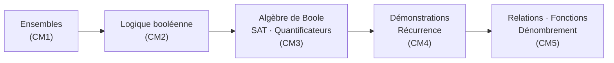

# R1.06A — Logique et ensembles

> 🗺️ **Carte des cours :** [[Hub - Carte des cours.canvas|vue d'ensemble du semestre]]

> [!abstract] Le cours en une phrase
> Étudier les **mathématiques discrètes** : ensembles, logique booléenne, algèbre de Boole, techniques de démonstration, relations et fonctions — outils fondamentaux pour l'informatique.

## Objectifs pédagogiques

- Maîtriser la notion d'ensemble et ses opérations.
- Savoir manipuler les opérateurs booléens et leurs propriétés.
- Connaître l'algèbre de Boole, les formes normales et la décomposition de Shannon.
- Savoir démontrer (quantificateurs, cas, contradiction, contraposée, induction).
- Savoir manipuler relations d'ordre/d'équivalence et fonctions.
- Savoir dénombrer (permutations, combinaisons, binôme).

**Prérequis :** bases de mathématiques (arithmétique).

## Modalités d'évaluation

- TD et exercices (feuilles 1 à 6).
- Examen.

## Plan du cours

| # | Partie | Notes |
|---|--------|-------|
| I | Présentation | cette note |
| II | Ensembles | [[CM1 - Ensembles]] |
| III | Opérateurs booléens | [[CM2 - Opérateurs booléens]] |
| IV | SAT, algèbre de Boole et quantificateurs | [[CM3 - SAT, algèbre de Boole et quantificateurs]] |
| V | Démonstrations et récurrence | [[CM4 - Démonstrations et récurrence]] |
| VI | Relations binaires et fonctions | [[CM5 - Relations binaires et fonctions]] |

## Progression logique du cours

## Sources

- CM0 : Présentation du cours — Samuele Anni, 16 septembre 2026 (Aix-en-Provence).
- CM1 : Ensembles — Samuele Anni, 16 septembre 2026.
- CM2 : Opérateurs booléens — Samuele Anni, 23 septembre 2026.
- CM3 : SAT, algèbre de Boole et quantificateurs — Samuele Anni, 30 septembre 2026.
- CM4 : Démonstrations et récurrence — Samuele Anni, 14 octobre 2026.
- CM5 : Relations binaires et fonctions — Samuele Anni, 20 octobre 2026.
- Polycopié : *Mathématiques discrètes — Logique et ensembles*, Samuele Anni, version du 12 septembre 2026.
- TD : feuilles 1 à 6 (avec solutions) dans `CM PDF/A1/R1-06A`.

## Voir aussi

- [[CM1 - Ensembles]]
- [[CM2 - Opérateurs booléens]]
- [[CM3 - SAT, algèbre de Boole et quantificateurs]]
- [[CM4 - Démonstrations et récurrence]]
- [[CM5 - Relations binaires et fonctions]]
